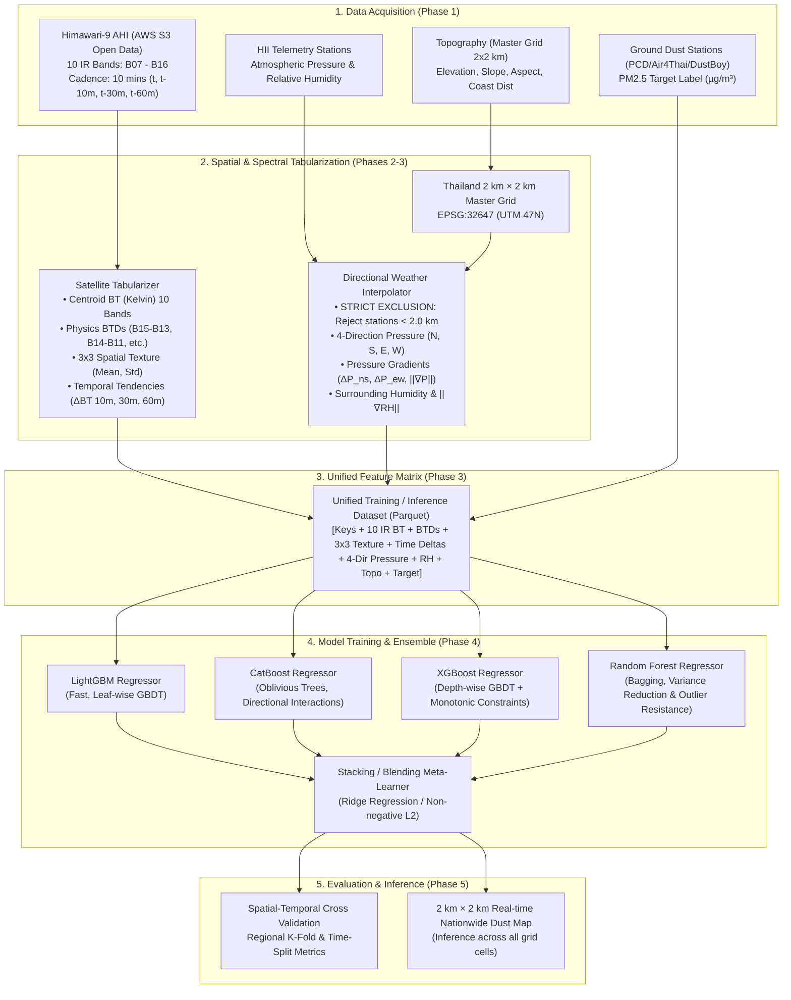

# 🛰️ Master Plan & Phase Roadmap: Dust Prediction Satellite (Multi-Resolution PM2.5 Nowcasting)

> **โครงการ**: Thailand Multi-Resolution Satellite & Multi-Directional Atmospheric Dust Prediction Benchmark  
> **ที่ตั้งโปรเจกต์**: `e:\water-analysis-project\dust-prediction-satelite\`  
> **เป้าหมายหลัก**: พัฒนาระบบทำนายความเข้มข้นของฝุ่นละอองปัจจุบัน (PM2.5 Real-time Nowcasting) และ**ทำการทดลองเปรียบเทียบขนาดกริดเชิงพื้นที่ 4 ระดับ (Multi-Resolution Experiment: 3×3 km, 2×2 km, 1×1 km, 500m×500m)** โดยผสาน:
> 1. **ภาพถ่ายดาวเทียมอุตุนิยมวิทยา Himawari-9**: แถบคลื่น Infrared ทั้งหมด 10 Bands (B07–B16) สำหรับการตรวจวัด 24 ชั่วโมงทั้งกลางวันและกลางคืน
> 2. **ข้อมูลสภาพอากาศภาคพื้นดิน HII**: ความกดอากาศแยก 4 ทิศทาง (North, South, East, West) และความชื้นสัมพัทธ์ โดยตัดสถานีใน Grid ตัวเองออกตามรัศมีกริด ป้องกัน Data Leakage
> 3. **แบบจำลองระดับความสูงภูมิประเทศ (Topography)**: Copernicus DEM 30m จริง 100% (คำนวณ Zonal Stats และ TPI ดัชนีแอ่งกระทะ)
> 4. **ชุดแบบจำลอง 4 ขุนพล (The Ensemble Quartet)**: **LightGBM**, **CatBoost**, **XGBoost**, และ **Random Forest** ผสานด้วย **Stacking / Blending Ensemble**
> 5. **การทดลอง Benchmark ข้าม 4 ระดับกริด**: วัดผลกระทบของขนาดกริดต่อความแม่นยำ (Accuracy, MAE, RMSE) และทรัพยากรการประมวลผลเทียบกับสถานีตรวจวัดจริงในแต่ละกริด

---

## 1. ภาพรวมสถาปัตยกรรมระบบ (End-to-End System Architecture)



---

## 2. โครงสร้างการแบ่ง Phase ทั้งหมด (Phased Implementation Roadmap)

| Phase | เอกสารแผนงาน | ขอบเขตและหน้าที่หลัก | ผลลัพธ์ที่ได้ (Deliverables) |
| :--- | :--- | :--- | :--- |
| **Phase 1** | [`phase_01_data_acquisition_and_audit.md`](file:///e:/water-analysis-project/dust-prediction-satelite/ai-docs/plan/phase_01_data_acquisition_and_audit.md) | **Data Acquisition & QA Engine**<br>- ดาวน์โหลด 10 IR Bands (B07–B16) ของ Himawari-9 จาก NOAA AWS S3<br>- สกัดข้อมูลความกดอากาศและความชื้น HII พร้อม QA Filtering<br>- เชื่อมโยงและจัดเตรียมชุดข้อมูลค่าฝุ่นเป้าหมาย (Ground PM2.5) | - Data Loaders & S3 Downloader<br>- QA & Physical Bound Validator<br>- Cache & Directory Management |
| **Phase 1B** | [`phase_01b_zero_mock_and_synthetic_integrity_check.md`](file:///e:/water-analysis-project/dust-prediction-satelite/ai-docs/plan/phase_01b_zero_mock_and_synthetic_integrity_check.md) | **🚨 Strict Zero-Mock & Provenance Verification Gate**<br>- ตรวจสอบความแท้จริงของข้อมูล 100% (Real Physical Observations)<br>- **แบน Mock Data, แบนข้อมูลสุ่ม (`np.random`), แบน Synthetic Topo เด็ดขาด**<br>- Static Code AST Scanner และ Data Origin Checksum | - `provenance_auditor.py`<br>- Zero-Mock Verification Gate Report<br>- Certified Real Data Checksum |
| **Phase 2** | [`phase_02_spatial_grid_and_feature_engineering.md`](file:///e:/water-analysis-project/dust-prediction-satelite/ai-docs/plan/phase_02_spatial_grid_and_feature_engineering.md) | **✅ Spectral Tabularization & 4-Directional Weather (สำเร็จ 100%)**<br>- แปลงภาพดาวเทียม 10 IR Bands เป็นตัวเลข (BT, BTD, 3x3 stats, $\Delta BT$)<br>- ระบบคำนวณความกดอากาศ 4 ทิศ (N, S, E, W) พร้อม **Strict Exclusion $< 2\text{ km}$**<br>- คำนวณเวกเตอร์ความชัน $\|\nabla P\|$ (ดัชนีอากาศนิ่ง) และ $\|\nabla RH\|$ | - `SatelliteTabularizer` Module<br>- `DirectionalWeatherEngine` Module<br>- `MultiResolutionGridEngine` Module<br>- Feature Extraction Unit Tests (17/17 Passed) |
| **Phase 3** | [`phase_03_unified_feature_pipeline.md`](file:///e:/water-analysis-project/dust-prediction-satelite/ai-docs/plan/phase_03_unified_feature_pipeline.md) | **✅ Unified Feature Matrix & Anti-Leakage Protocol (สำเร็จ 100%)**<br>- ประกอบตาราง Unified Matrix ระดับ 2x2 km (และ multi-resolution) แบบ Single Row ต่อ Cell<br>- บังคับใช้ Temporal Anti-Leakage Protocol (Zero Look-Ahead Bias)<br>- บังคับใช้ Spatial Anti-Leakage Protocol (Strict Proximity Exclusion $< 2.0\text{ km}$)<br>- จัดเก็บข้อมูล Parquet (Snappy), Columnar Projection และ Train 2024-2025 / Test 2026 Split | - `FeatureMatrixBuilder` Module<br>- Anti-leakage Assertion Suite<br>- Master Dataset (Parquet Store)<br>- Phase 3 Unit Tests (25/25 Passed) |
| **Phase 4** | [`phase_04_model_suite_and_ensemble_training.md`](file:///e:/water-analysis-project/dust-prediction-satelite/ai-docs/plan/phase_04_model_suite_and_ensemble_training.md) | **✅ The 4-Model Suite & Ensemble Stacking (สำเร็จ 100%)**<br>- พัฒนาชุดโมเดล 4 ขุนพล: LightGBM, CatBoost, XGBoost, Random Forest<br>- บังคับ Monotonic Physics Constraints ทางฟิสิกส์บรรยากาศ (XGBoost)<br>- Stacking Meta-Learner แบบ Non-Negative Least Squares (NNLS, sum=1.0)<br>- Cross-Model Feature Attribution Report & Multi-Resolution Benchmarks | - 4 Model Wrappers (`src/models/`)<br>- `DustStackingEnsemble` Meta-Regressor<br>- `ModelTrainer` Benchmark Suite<br>- Multi-Resolution Benchmarks (EXP-3KM, 2KM, 1KM, 500M)<br>- Phase 4 Unit Tests (8/8 Passed, 33/33 Total) |

| **Phase 5** | [`phase_05_evaluation_benchmarking_and_inference.md`](file:///e:/water-analysis-project/dust-prediction-satelite/ai-docs/plan/phase_05_evaluation_benchmarking_and_inference.md) | **✅ Multi-Resolution Benchmarking & 4×Model Nowcasting (สำเร็จ 100%)**<br>- **การทดลองเปรียบเทียบกริด 4 ขนาด**: 3×3 km, 2×2 km, 1×1 km, 500m×500m<br>- วัดผลความแม่นยำ (Accuracy, MAE, RMSE) เทียบกับสถานีตรวจวัดจริงในแต่ละกริด<br>- ประเมินผล 4 โมเดล (LGBM, CatBoost, XGB, RF) + Stacking Ensemble<br>- Regional Hold-out Cross Validation ราย 5 ภาค<br>- ผลิต 4 Deliverables (Parquet, GeoTIFF, Interactive Leaflet HTML, Static PNG) | - `src/evaluation/metrics.py`<br>- `src/evaluation/spatial_cv.py`<br>- `src/evaluation/visualizer.py`<br>- `src/evaluation/benchmark_suite.py`<br>- Multi-Resolution Benchmark Report<br>- Real-time Multi-Resolution Map Generator<br>- Phase 5 Unit Tests (9/9 Passed, 42/42 Total) |

---

## 3. หลักการสำคัญและกฎเหล็กของระบบ (System Invariants)

1. **กฎพื้นที่ทำงานแบบปิดบริบูรณ์ (Self-Contained Workspace)**:
   - โค้ดทั้งหมด (`src/`), ไฟล์คอนฟิก (`configs/`), และผลลัพธ์ (`outputs/`) จะต้องทำงานได้อย่างสมบูรณ์ภายในโฟลเดอร์ `dust-prediction-satelite/` เท่านั้น
   - สามารถอ้างอิง Master Grid พิกัดและภูมิประเทศมาตรฐานประเทศไทยจาก `data/geo/` ในโครงการร่วมได้โดยไม่ผูกมัด logic ของโมเดล
2. **กฎตัดข้อมูลสถานีในกริด (Strict Proximity Exclusion $< 2.0\text{ km}$)**:
   - สถานีวัดความกดอากาศและความชื้นที่ตกอยู่ในระยะ $< 2.0\text{ km}$ จากกึ่งกลาง Target Grid **จะต้องถูกตัดออก 100% เสมอ** เพื่อป้องกัน Target/Spatial Leakage และป้องกันโมเดลท่องจำค่าสถานี
3. **การแปลงภาพเป็นตัวเลขที่สมบูรณ์ตามหลักฟิสิกส์ (Physics-Informed Tabularization)**:
   - ห้ามใช้เฉพาะค่า BT ดิบ ต้องรวมค่าผลต่าง Split-Window ($BT_{15} - BT_{13}$), Water Vapor Gradient ($BT_{10} - BT_{08}$) และความแปรปรวน 3x3 พิกเซล เพื่อให้โมเดลแยกฝุ่นออกจากเมฆน้ำและผิวดินได้อย่างแม่นยำ
4. **ความกดอากาศ 4 ทิศเป็นหัวใจของการสะสมฝุ่น**:
   - การประเมินมวลอากาศต้องแยก $P_{\text{north}}, P_{\text{south}}, P_{\text{east}}, P_{\text{west}}$ เพื่อตรวจจับแนวปะทะความกดอากาศสูงและภาวะลมสงบ ($\|\nabla P\| \approx 0$)
5. **นโยบายการทดสอบบน PC vs การรันงานจริงบน Server**:
   - บนเครื่อง PC พัฒนาจะรันเฉพาะโหมด **`--smoke-test`** (สุ่ม 1–2 วัน หรือพื้นที่จำลองขนาดเล็ก) เพื่อทดสอบความถูกต้องของ Pipeline
   - การดึงข้อมูลรอบปีเต็มและการเทรนโมเดลขนาดใหญ่จะถูกส่งไปรันบน Server ผ่านสคริปต์ **`--full`** (รอบปี 2024–2026) หรือระบุช่วงเวลาอิสระผ่าน **`--start-date`** และ **`--end-date`**
6. **กฎเหล็กห้ามใช้ Mock และ Synthetic Data เด็ดขาด (Strict Zero-Mock & Zero-Synthetic Rule) 🚨**:
   - **ห้ามใช้ Mock Data, ห้ามใช้ข้อมูลจำลอง (Synthetic Simulation), และห้ามใช้สูตรสุ่มตัวเลข (`np.random`) ในกระบวนการดาวเทียม สภาพอากาศ ภูมิประเทศ หรือค่าฝุ่นโดยเด็ดขาด 100%!**
   - DEM ต้องมาจาก **Copernicus DEM 30m จริง** (แบนฟังก์ชัน `estimate_synthetic_topography` 100%)
   - ดาวเทียมต้องมาจาก **NOAA S3 จริง** (แบนฟังก์ชันสุ่มอุณหภูมิยอดเมฆ 100%)
   - ข้อมูล HII และเป้าหมายฝุ่นต้องเป็น **สถานีตรวจวัดทางกายภาพจริง 100%** หากข้อมูลรอบใดขาดหาย ให้ Drop/Skip ตามหลักสถิติ ห้ามสร้างข้อมูลเทียมแทนเด็ดขาด
7. **กฎการแบ่งช่วงเวลาฝึกสอนและทดสอบข้ามปี (Temporal Train/Test Split Invariant: 2024–2025 Train vs 2026 Test)**:
   - **ชุดฝึกสอน (Training Split)**: ข้อมูลช่วงวันที่ `2024-01-01` ถึง `2025-12-31` (2 ปีเต็ม ครอบคลุมวัฏจักรฝุ่น/มรสุม 2 รอบปี)
   - **ชุดทดสอบประเมินผล (Out-of-Time Test Benchmark)**: ข้อมูลช่วงวันที่ `2026-01-01` ถึง `2026-12-31` สำหรับประเมินความแม่นยำจริงในสภาพแวดล้อมที่โมเดลไม่เคยเห็นมาก่อน (Out-of-Time Cross Validation)
   - ระบบจะแบ่งและบันทึกเป็น Parquet แยกไฟล์อัตโนมัติ: `*_train_2024_2025.parquet` และ `*_test_2026.parquet`

---

## 4. โครงสร้างไฟล์ของระบบ `dust-prediction-satelite`

```text
dust-prediction-satelite/
├── ai-docs/
│   ├── issues.md                                        # สรุปประเด็นปัญหาและรายการสิ่งที่ต้องแก้ไข (Quick Issues Backlog)
│   ├── code_audit_issues_and_remediation.md             # รายงานการตรวจสอบโค้ดและแนวทางแก้ไขฉบับเต็ม (Full Audit Report)
│   └── plan/
│       ├── README.md                                    # Master Plan & Architecture (ไฟล์นี้)
│       ├── feature_dictionary.md                        # รายละเอียดฟีเจอร์ สูตร หน่วย และรหัสตัวแปร
│       ├── phase_01_data_acquisition_and_audit.md       # แผน Phase 1
│       ├── phase_01b_zero_mock_and_synthetic_integrity_check.md # แผน Phase 1B: Zero-Mock & Synthetic Gate
│       ├── phase_02_spatial_grid_and_feature_engineering.md # แผน Phase 2
│       ├── phase_03_unified_feature_pipeline.md         # แผน Phase 3
│       ├── phase_04_model_suite_and_ensemble_training.md# แผน Phase 4
│       └── phase_05_evaluation_benchmarking_and_inference.md # แผน Phase 5
├── configs/
│   ├── grid_config.yaml                                 # ค่ากำหนดกริด 2x2 km UTM 47N
│   └── model_config.yaml                                # Hyperparameters ของ LGBM, CatBoost, XGB, RF
├── data/
│   ├── cache/                                           # ไฟล์แคชดาวเทียม HSD/NetCDF
│   ├── geo/                                             # Master Grid 2x2 km Parquet
│   ├── hii/                                             # ข้อมูลความกดอากาศและความชื้น
│   ├── himawari9/                                       # ข้อมูลสเปกตรัมที่ประมวลผลแล้ว
│   └── target/                                          # ข้อมูลค่าฝุ่นจริง (Ground Truth PM2.5)
├── src/
│   ├── config/
│   │   └── paths.py                                     # ตัวจัดการ Path ในโปรเจกต์
│   ├── data/
│   │   ├── himawari_ir_loader.py                        # ตัวดาวน์โหลด/โหลด 10 Bands IR จาก S3
│   │   ├── hii_weather_loader.py                        # ตัวประมวลผลความกดอากาศและความชื้น HII
│   │   └── ground_truth_loader.py                       # ตัวโหลดค่าฝุ่นจริงภาคพื้นดิน
│   ├── features/
│   │   ├── satellite_tabularizer.py                     # แปลงราสเตอร์ 10 IR Bands สู่ตารางตัวเลข
│   │   ├── spatial_directional.py                       # คำนวณความกดอากาศ 4 ทิศ และ Exclusion < 2 km
│   │   └── feature_matrix_builder.py                    # ประกอบตาราง Unified Training Table
│   ├── models/
│   │   ├── base_model.py                                # Base Interface (fit, predict, importance)
│   │   ├── lgbm_model.py                                # LightGBM Wrapper
│   │   ├── catboost_model.py                            # CatBoost Wrapper
│   │   ├── xgboost_model.py                             # XGBoost Wrapper
│   │   ├── random_forest_model.py                       # Random Forest Wrapper
│   │   └── ensemble_model.py                            # Stacking / Blending Engine
│   └── evaluation/
│       ├── metrics.py                                   # ฟังก์ชันวัดผลสถิติและหมวดสี AQI
│       ├── spatial_cv.py                                # Spatial-Temporal Cross Validation
│       └── visualizer.py                                # แผนที่ฝุ่น 2x2 km Visualization
├── run_pipeline.py                                      # CLI ควบคุมการรันทั้งระบบ
└── requirements.txt
```
