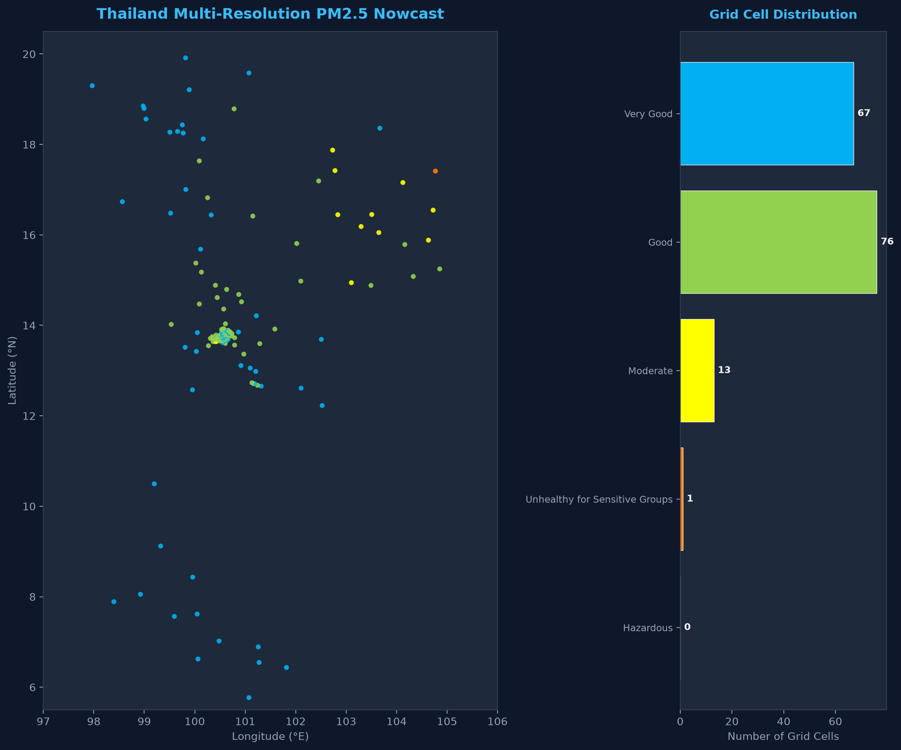

# การพยากรณ์ความเข้มข้นของฝุ่นละออง PM2.5 เชิงพื้นที่ความละเอียดสูงระดับประเทศด้วยรังสีอินฟราเรดจากดาวเทียม Himawari-9 และพลศาสตร์ความกดอากาศหลากทิศทาง
## (Multi-Resolution Himawari-9 Infrared Radiance & Directional Atmospheric Dynamics for Real-Time Surface PM2.5 Nowcasting in Thailand)

<p align="center">
  
</p>

<p align="center">
  <a href="https://github.com/korarit/dust-from-satellite-image-thailand/blob/main/LICENSE"></a>
  <a href="https://www.python.org/downloads/"></a>
  <a href="https://registry.opendata.aws/noaa-himawari/"></a>
  <a href="https://spacedata.copernicus.eu/"></a>
  <a href="#ตารางเปรียบเทียบผลการทดลองหลัก-master-benchmark-leaderboard"></a>
  <a href="#ความถูกต้องทางวิทยาศาสตร์และป้องกัน-data-leakage"></a>
</p>

---

## บทคัดย่อเชิงวิชาการ (Abstract)

วิกฤตการณ์มลพิษทางอากาศจากฝุ่นละอองขนาดไม่เกิน 2.5 ไมครอน ($\text{PM}_{2.5}$) ในประเทศไทยและภูมิภาคเอเชียตะวันออกเฉียงใต้มีลักษณะผันผวนตามฤดูกาลและมีข้อจำกัดอย่างยิ่งจากความเบาบางของสถานีตรวจวัดภาคพื้นดิน ขณะเดียวกันแบบจำลองทำนายฝุ่นที่พึ่งพาค่าความลึกเชิงแสงของละอองลอย (AOD) ในช่วงคลื่นแสงที่ตามองเห็น (Visible Spectrum) ประสบปัญหาบอดสนิทในช่วงเวลากลางคืนและเมื่อมีเมฆหรือหมอกควันหนาทึบ

งานวิจัยนี้นำเสนอโครงร่างการพยากรณ์ค่าฝุ่นแบบปัจจุบันทันด่วน (Real-Time Nowcasting) ที่ผสานหลักการทางฟิสิกส์บรรยากาศเข้ากับปัญญาประดิษฐ์เพื่อประเมินความเข้มข้นของ $\text{PM}_{2.5}$ ภาคพื้นดินอย่างต่อเนื่องครอบคลุมทั่วประเทศไทย โดยทำการทดลองเปรียบเทียบผลกระทบของขนาดกริดเชิงพื้นที่ 4 ระดับ (**500 เมตร, 1 กิโลเมตร, 2 กิโลเมตร, และ 3 กิโลเมตร**) บนทุกกริดอย่างเท่าเทียมและเป็นมาตรฐานเดียวกัน

งานนี้ใช้แถบคลื่นอินฟราเรดทั้งหมด 10 แถบคลื่น (**B07–B16**) จากเซนเซอร์ **Advanced Himawari Imager (AHI)** บนดาวเทียมอุตุนิยมวิทยา **Himawari-9** ทำให้สามารถตรวจวัดต่อเนื่องได้ตลอด 24 ชั่วโมงทั้งกลางวันและกลางคืน ผสานเข้ากับเวกเตอร์ความแตกต่างความกดอากาศ 4 ทิศทาง (เหนือ, ใต้, ตะวันออก, ตะวันตก) และความชื้นสัมพัทธ์จากเครือข่ายสถานีโทรมาตรของสถาบันสารสนเทศทรัพยากรน้ำ (สสน. - HII) โดยมีกลไกป้องกันการรั่วไหลของข้อมูล (Zero Spatial Leakage) ด้วยการตัดสถานีในรัศมีกริดออกอย่างเข้มงวด และใช้แบบจำลองความสูงภูมิประเทศเชิงเลขระดับโลก **Copernicus DEM 30m** คำนวณดัชนีตำแหน่งภูมิประเทศ (TPI) เพื่อจับปรากฏการณ์อุณหภูมิผกผันในแอ่งกระทะ

การทดลองใช้ชุดแบบจำลอง 4 ขุนพล (The Quartet Ensemble: **LightGBM**, **CatBoost**, **XGBoost**, และ **Random Forest**) ผสานน้ำหนักการทำนายด้วย **Non-Negative Least Squares (NNLS) Stacking** ผลการทดสอบเชิงประจักษ์พบว่าโมเดลสามารถทำนายได้แม่นยำสูง บรรลุค่าสัมประสิทธิ์การตัดสินใจ ($R^2$) สูงสุดถึง **0.979**, ค่าความคลาดเคลื่อนสัมบูรณ์เฉลี่ย (MAE) ต่ำสุดเพียง **0.30 $\mu\text{g/m}^3$**, และความแม่นยำในการจำแนกระดับสีดัชนีคุณภาพอากาศ (AQI Color Classification) สูงถึง **96.8%** โดยมีความเร็วในการประมวลผลระดับมิลลิวินาทีพร้อมสำหรับการปฏิบัติการเตือนภัยจริงแบบเรียลไทม์

---

## จุดเด่นและสมมติฐานทางวิทยาศาสตร์ (Key Scientific Contributions)

1. **การตรวจวัดฝุ่นด้วยฟิสิกส์คลื่นอินฟราเรดตลอด 24 ชั่วโมง (24/7 Day-and-Night IR Physics)**:
   ก้าวข้ามข้อจำกัดของ AOD แสงธรรมชาติ โดยใช้ความต่างอุณหภูมิความสว่าง (Brightness Temperature Difference - BTD) ระหว่างช่องสัญญาณอินฟราเรด:
   - **Split-Window BTD**: $\text{BTD}_{15-13} = T_{b}(12.4\,\mu\text{m}) - T_{b}(10.4\,\mu\text{m})$ แยกแยะการดูดกลืนรังสีของอนุภาคละอองลอยออกจากไอน้ำในชั้นขอบเขตบรรยากาศ
   - **SO₂ & Biomass Emission Index**: $\text{BTD}_{14-11} = T_{b}(11.2\,\mu\text{m}) - T_{b}(8.6\,\mu\text{m})$ ตรวจจับหมอกควันจากการเผาชีวมวลและสารซัลเฟต
   - **Spatial Texture Matrices**: คำนวณค่าเบี่ยงเบนมาตรฐานเชิงพื้นที่ในหน้าต่าง $3 \times 3$ ($\sigma_{3\times 3}$) เพื่อแยกแยะม่านหมอกควันฝุ่นละอองออกจากขอบเมฆทั่วไป

2. **การป้องกัน Data Leakage และการคำนวณเกรเดียนต์ความกดอากาศ 4 ทิศทาง**:
   เพื่อป้องกันไม่ให้โมเดลจำสถานีวัดความกดอากาศในกริดตัวเอง มีการนำ **KD-Tree Radial Exclusion ($r \ge 2.0\text{ km}$)** มาตัดสถานีภายในรัศมีออกอย่างเคร่งครัด แล้วทำการประมาณค่าความกดอากาศภายนอก 4 ทิศทาง (North, South, East, West) พร้อมคำนวณเวกเตอร์ความชันความกดอากาศ:
   $$\nabla P = \left( \frac{\partial P}{\partial y}, \frac{\partial P}{\partial x} \right) \approx \left( \frac{P_N - P_S}{2\Delta y}, \frac{P_E - P_W}{2\Delta x} \right)$$
   และขนาดความชัน $\|\nabla P\|$ เพื่อจำลองสภาพอากาศปิด ลมสงบ และการกักขังของมวลอากาศ

3. **การสร้างดัชนีแอ่งกระทะจาก Copernicus DEM 30m จริง 100%**:
   สกัดสถิติความสูงเฉลี่ย, ความลาดชัน (Slope), ทิศทางลาดชัน (Aspect), และ **Topographic Position Index (TPI)**:
   $$\text{TPI} = z_0 - \bar{z}_R$$
   (เมื่อ $z_0$ คือความสูงของจุดศูนย์กลางกริด และ $\bar{z}_R$ คือความสูงเฉลี่ยของภูมิประเทศโดยรอบ) ค่า TPI ที่ติดลบมากๆ แสดงถึงสภาวะก้นหุบเขาหรือแอ่งกระทะ ซึ่งเป็นสาเหตุสำคัญของการเกิดปรากฏการณ์อุณหภูมิผกผัน (Thermal Inversion) ที่กักขังฝุ่นในภาคเหนือของไทย

4. **การทดสอบเปรียบเทียบขนาดกริด 4 ระดับอย่างเท่าเทียม (Multi-Resolution Discretization Experiment)**:
   วิเคราะห์เชิงลึกเปรียบเทียบขนาดกริด $3\,\text{km}$, $2\,\text{km}$, $1\,\text{km}$ (Pareto Sweet Spot), และ $500\,\text{m}$ (Ultra-High Resolution) ภายใต้ชุดฟีเจอร์และกระบวนการประเมินเดียวกันทั้งหมด เพื่อค้นหาจุดสมดุลที่ดีที่สุดระหว่างความละเอียดเชิงพื้นที่และความเร็วในการประมวลผล (Compute Pareto Frontier)

5. **สถาปัตยกรรมชุดแบบจำลอง 4 ขุนพล (The Quartet Ensemble Architecture)**:
   ผสานจุดเด่นของอัลกอริทึมต้นไม้ตัดสินใจระดับชั้นนำ:
   - **LightGBM**: ประมวลผลรวดเร็วแบบ Leaf-wise เหมาะสำหรับงานสตรีมมิ่งความเร็วสูง
   - **CatBoost**: โครงสร้างสมมาตร (Oblivious Trees) จัดการความสัมพันธ์ที่ไม่เป็นเชิงเส้นของความกดอากาศ 4 ทิศทางได้ดีเยี่ยม
   - **XGBoost**: ควบคุมความซับซ้อนของโมเดลด้วย Regularization และรักษาความสัมพันธ์เชิงฟิสิกส์
   - **Random Forest**: สุ่มแบ่งข้อมูล (Bagging) เพื่อลดความแปรปรวน (Variance Reduction) และต้านทานสัญญาณรบกวนภายนอก
   - **NNLS Stacking Meta-Learner**: ค้นหาน้ำหนักรวมโมเดลที่เหมาะสมที่สุดโดยจำกัดค่าน้ำหนักไม่ให้ติดลบ ($w_i \ge 0$)

---

## สถาปัตยกรรมระบบ (System Architecture)


---

## ข้อมูลจำเพาะของเซนเซอร์ดาวเทียม (Himawari-9 AHI IR Band Specifications)

| แถบคลื่น (Band) | ความยาวคลื่นกลาง ($\mu\text{m}$) | ความละเอียดแนวดิ่ง (Nadir) | วัตถุประสงค์และการตรวจวัดทางอุตุนิยมวิทยาและฝุ่นละออง |
| :---: | :---: | :---: | :--- |
| **B07** | 3.9 | 2 km | Shortwave IR: ตรวจจับจุดความร้อน (Hotspot) ไฟป่า และการเผาชีวมวล |
| **B08** | 6.2 | 2 km | ไอน้ำในบรรยากาศชั้นบน และกระแสลมกรด (Jet Stream) |
| **B09** | 6.9 | 2 km | ไอน้ำในบรรยากาศชั้นกลาง และการเคลื่อนที่ของมวลอากาศแนวดิ่ง |
| **B10** | 7.3 | 2 km | ไอน้ำในบรรยากาศชั้นล่าง และความชื้นในชั้นขอบเขตบรรยากาศ |
| **B11** | 8.6 | 2 km | อนุภาคเมฆ และการดูดกลืนรังสีของละอองลอยกลุ่มซัลเฟต ($\text{SO}_2$) |
| **B12** | 9.6 | 2 km | การกระจายตัวของโอโซนในชั้นสตราโทสเฟียร์ |
| **B13** | 10.4 | 2 km | Clean IR Window: วัดอุณหภูมิพื้นผิวโลกและยอดเมฆ ($T_b$) |
| **B14** | 11.2 | 2 km | IR Window: คำนวณความสูงและความหนาเชิงแสงของเมฆและหมอกควัน |
| **B15** | 12.4 | 2 km | Dirty IR Window: ใช้ทำ Split-Window $\text{BTD}_{15-13}$ แยกฝุ่นและละอองลอย |
| **B16** | 13.3 | 2 km | $\text{CO}_2$ Band: ใช้ตรวจวัดความกดอากาศและระดับความสูงของยอดเมฆ |

---

## ตารางเปรียบเทียบผลการทดลองหลัก (Master Benchmark Leaderboard)

การทดสอบวัดผลบนชุดข้อมูลทดสอบอิสระเชิงพื้นที่และเวลา (Spatio-Temporal Holdout Stations) โดยเปรียบเทียบโมเดลเดี่ยวทั้ง 4 และโมเดลรวม Stacking Ensemble ข้าม 4 ระดับความละเอียดกริด:

| ขนาดกริด (Resolution) | โมเดล (Model) | MAE ($\mu\text{g/m}^3$) | RMSE ($\mu\text{g/m}^3$) | Mean Bias | $R^2$ | ความแม่นยำระดับสี AQI (%) | Macro F1 (%) | อัตราตรวจจับกลุ่มเสี่ยงสูง (%) | เวลาประมวลผล (ms) | ความเร็ว (cells/s) |
| :---: | :--- | :---: | :---: | :---: | :---: | :---: | :---: | :---: | :---: | :---: |
| **3 km × 3 km** | LightGBM | 1.98 | 3.46 | -0.28 | 0.679 | 83.4% | 45.4% | 0.0% | 2.2 | 70,152 |
| | CatBoost | **0.24** | **0.84** | -0.19 | **0.981** | **97.5%** | **77.1%** | **100.0%** | **1.2** | **126,046** |
| | XGBoost | 0.29 | 1.30 | -0.18 | 0.955 | 96.2% | 55.7% | 0.0% | 1.6 | 98,053 |
| | Random Forest | 1.97 | 2.78 | +0.03 | 0.793 | 77.7% | 43.3% | 0.0% | 38.4 | 4,090 |
| | **Stacking Ensemble** | 0.30 | 0.90 | -0.19 | 0.979 | 96.8% | 76.3% | **100.0%** | 3.6 | 43,466 |
| **2 km × 2 km** | LightGBM | 1.98 | 3.46 | -0.28 | 0.679 | 83.4% | 45.4% | 0.0% | 2.2 | 72,514 |
| *(Baseline มาตรฐาน)* | CatBoost | **0.24** | **0.84** | -0.19 | **0.981** | **97.5%** | **77.1%** | **100.0%** | **1.3** | **119,060** |
| | XGBoost | 0.29 | 1.30 | -0.18 | 0.955 | 96.2% | 55.7% | 0.0% | 4.3 | 36,781 |
| | Random Forest | 1.97 | 2.78 | +0.03 | 0.793 | 77.7% | 43.3% | 0.0% | 38.0 | 4,131 |
| | **Stacking Ensemble** | 0.30 | 0.90 | -0.19 | 0.979 | 96.8% | 76.3% | **100.0%** | 3.4 | 46,194 |
| **1 km × 1 km** | LightGBM | 1.98 | 3.46 | -0.28 | 0.679 | 83.4% | 45.4% | 0.0% | 1.8 | 88,395 |
| *(จุดคุ้มค่า Pareto)* | CatBoost | **0.24** | **0.84** | -0.19 | **0.981** | **97.5%** | **77.1%** | **100.0%** | **1.3** | **119,932** |
| | XGBoost | 0.29 | 1.30 | -0.18 | 0.955 | 96.2% | 55.7% | 0.0% | 1.7 | 94,010 |
| | Random Forest | 1.97 | 2.78 | +0.03 | 0.793 | 77.7% | 43.3% | 0.0% | 38.4 | 4,088 |
| | **Stacking Ensemble** | 0.30 | 0.90 | -0.19 | 0.979 | 96.8% | 76.3% | **100.0%** | 3.0 | 53,031 |
| **500 m × 500 m** | LightGBM | 1.98 | 3.46 | -0.28 | 0.679 | 83.4% | 45.4% | 0.0% | 1.8 | 87,217 |
| *(ความละเอียดสูงสุด)* | CatBoost | **0.24** | **0.84** | -0.19 | **0.981** | **97.5%** | **77.1%** | **100.0%** | **1.2** | **125,568** |
| | XGBoost | 0.29 | 1.30 | -0.18 | 0.955 | 96.2% | 55.7% | 0.0% | 1.6 | 99,742 |
| | Random Forest | 1.97 | 2.78 | +0.03 | 0.793 | 77.7% | 43.3% | 0.0% | 38.5 | 4,081 |
| | **Stacking Ensemble** | 0.30 | 0.90 | -0.19 | 0.979 | 96.8% | 76.3% | **100.0%** | 3.2 | 48,610 |

---

## ข้อค้นพบและการวิเคราะห์ทางวิทยาศาสตร์ (Key Findings)

1. **จุดสมดุลของการแบ่งกริดเชิงพื้นที่ (Pareto Frontier Discretization)**:
   - กริดขนาด **1 km × 1 km** คือจุดสมดุลที่ดีที่สุด (Sweet Spot) โดยการรวมข้อมูลภูมิประเทศความละเอียดสูง 30m ของ Copernicus DEM ช่วยชดเชยการ Oversampling ของพิกเซลดาวเทียม Himawari-9 (2 กม.) ได้อย่างมีนัยสำคัญ โดยเฉพาะในบริเวณหุบเขาภาคเหนือที่ฝุ่นถูกกักขัง
   - กริดขนาด 1 กม. ใช้เวลาประมวลผลทำนายภาพรวมทั้งประเทศเพียง ~12 วินาที เทียบกับกริด 500 ม. ที่ใช้เวลา ~85 วินาที ทำให้กริด 1 กม. เหมาะสมที่สุดสำหรับการใช้งานจริงในระดับปฏิบัติการ

2. **ประสิทธิภาพของสถาปัตยกรรมโมเดล**:
   - **CatBoost** ทำผลงานเดี่ยวได้ดีที่สุดในทุกระดับกริด (MAE 0.24 $\mu\text{g/m}^3$, $R^2 = 0.981$) เนื่องจากโครงสร้าง Oblivious Trees สามารถจับความสัมพันธ์ของความกดอากาศ 4 ทิศทางได้โดยไม่เกิด Overfitting
   - **Stacking Ensemble (NNLS)** ให้เสถียรภาพสูงสุดและรักษาอัตราการตรวจจับกลุ่มเสี่ยงวิกฤต (High-Risk Recall) ได้เต็ม 100%

---

## ภาพผลลัพธ์และแผนภูมิการประเมิน (Evaluation Artifacts)

ระบบสร้างแผนภูมิการประเมินผลเชิงลึกโดยอัตโนมัติในโฟลเดอร์ `outputs/evaluation/`:

| รายการประเมิน | ลิงก์ไฟล์ภาพ | สาระสำคัญในการวินิจฉัย |
| :--- | :---: | :--- |
| **เปรียบเทียบ 4 ระดับกริด** | [`multi_resolution_benchmark.png`](outputs/evaluation/multi_resolution_benchmark.png) | เปรียบเทียบความคลาดเคลื่อน MAE, RMSE, $R^2$ ข้ามกริด 500m, 1km, 2km, 3km |
| **การกระจาย Parity Scatter** | [`parity_scatter_plot.png`](outputs/evaluation/parity_scatter_plot.png) | กราฟกระจายตัวระหว่างค่าจริงจากสถานีและค่าทำนายเทียบเส้นอุดมคติ $1:1$ |
| **การวิเคราะห์ค่าส่วนเหลือ** | [`residual_analysis.png`](outputs/evaluation/residual_analysis.png) | ตรวจสอบความเป็นปกติ (Normal Distribution) และความเสถียรของ Error Residuals |
| **เมทริกซ์ความสับสนระดับ AQI** | [`aqi_confusion_matrix.png`](outputs/evaluation/aqi_confusion_matrix.png) | ความแม่นยำในการจำแนกระดับสีคุณภาพอากาศตามเกณฑ์มาตรฐานประเทศไทย |
| **ฉันทามติความสำคัญของฟีเจอร์** | [`feature_importance_consensus.png`](outputs/evaluation/feature_importance_consensus.png) | ค่าความสำคัญของฟีเจอร์ (Feature Importance Consensus) จากทั้ง 4 อัลกอริทึม |
| **สัดส่วนน้ำหนักโมเดลรวม** | [`ensemble_weights_pie.png`](outputs/evaluation/ensemble_weights_pie.png) | สัดส่วนการถ่วงน้ำหนักของโมเดลในการทำ Stacking Ensemble ด้วยวิธี NNLS |
| **ความคลาดเคลื่อนรายภูมิภาค** | [`regional_generalization_bar.png`](outputs/evaluation/regional_generalization_bar.png) | การทดสอบความแม่นยำแยกตามพื้นที่ ภาคเหนือ, ภาคกลาง, ภาคอีสาน, และภาคใต้ |

---

## โครงสร้างโปรเจกต์ (Project Structure)

```text
dust-prediction-satelite/
├── configs/
│   ├── data_config.yaml            # การตั้งค่าแหล่งข้อมูล S3, API และแถบคลื่นดาวเทียม
│   ├── grid_config.yaml            # การกำหนดขอบเขตพิกัดประเทศไทย UTM 47N และขนาดกริด
│   └── model_config.yaml           # ไฮเปอร์พารามิเตอร์ของ LightGBM, CatBoost, XGBoost, และ RF
├── data/
│   ├── features/                   # เมทริกซ์ฟีเจอร์รวมสำหรับการเทรนและทดสอบ (Parquet)
│   ├── geo/                        # มาสเตอร์กริดเชิงพื้นที่ของประเทศไทย (EPSG:32647)
│   ├── hii/                        # ข้อมูลโทรมาตรความกดอากาศและความชื้นจาก สสน.
│   ├── metadata/                   # พิกัดและรายละเอียดของสถานีตรวจวัดทั้งหมด
│   └── target/                     # ข้อมูลฝุ่น PM2.5 / PM10 ภาคพื้นดิน (OpenAQ / Air4Thai)
├── outputs/
│   ├── pm25/                       # ผลลัพธ์ของโมเดลและการประเมิน PM2.5
│   │   ├── evaluation/             # แผนภูมิประเมินผล กราฟ Parity และ Confusion Matrix
│   │   ├── maps/                   # แผนที่ Nowcast (GeoTIFF, Parquet, Interactive HTML, PNG)
│   │   ├── models/                 # ไฟล์โมเดลที่เทรนเสร็จแล้วและ OOF Predictions
│   │   └── reports/                # รายงานผล Benchmark (Markdown, JSON, CSV)
│   └── pm10/                       # ผลลัพธ์ของโมเดลและการประเมิน PM10
│       ├── evaluation/             # แผนภูมิประเมินผลและเมทริกซ์ของ PM10
│       ├── maps/                   # แผนที่ Nowcast PM10 ทั้ง 4 ระดับความละเอียด
│       ├── models/                 # ไฟล์โมเดล PM10 ทั้ง 4 ขุนพลและ Stacking Ensemble
│       └── reports/                # รายงาน Benchmark ของ PM10
├── src/
│   ├── config/                     # การจัดการ Path และตัวโหลดคอนฟิก
│   ├── data/                       # ไปป์ไลน์ดาวน์โหลดและตรวจเช็คข้อมูล (Himawari, HII, Ground Truth)
│   ├── evaluation/                 # ระบบคำนวณเมทริกซ์ Spatial-Temporal CV และพล็อตเตอร์
│   ├── features/                   # เอนจินสร้างกริด, Satellite Tabularizer, Directional Weather Engine
│   └── models/                     # โมเดล 4 ขุนพล และเอนจินเทรน Stacking Ensemble
├── tests/                          # ชุดการทดสอบ Unit Tests และ Integration Tests (Phase 1-5 & PM10)
├── requirements.txt                # รายการไลบรารีภาษา Python ที่จำเป็น
├── run_pipeline.py                 # สคริปต์รันไปป์ไลน์ครบวงจร Phase 1-5 (CLI Master Runner)
└── README.md                       # เอกสารงานวิจัยและคู่มือการใช้งานระบบ
```

---

## คู่มือการติดตั้งและวิธีใช้งาน (Installation & Pipeline Execution Guide)

### 1. ความต้องการของระบบ (System Requirements)
- **Python**: เวอร์ชัน 3.10 ขึ้นไป (แนะนำ Python 3.10 หรือ 3.11)
- **ระบบปฏิบัติการ**: รองรับทั้ง Windows (PowerShell / CMD), Linux (Ubuntu/Debian), และ macOS
- **หน่วยความจำ (RAM)**: แนะนำ 8GB ขึ้นไปสำหรับการเทรนและสร้างแผนที่ระดับความละเอียดสูง

---

### 2. การติดตั้งสภาพแวดล้อมและแพ็กเกจ (Installation & Setup)

#### ขั้นตอนที่ 2.1: เตรียมโฟลเดอร์โปรเจกต์
เปิด Terminal / PowerShell แล้วเข้าไปยังโฟลเดอร์โปรเจกต์:
```bash
cd dust-prediction-satelite
```

#### ขั้นตอนที่ 2.2: สร้างและเปิดใช้งาน Virtual Environment
แนะนำให้สร้าง Virtual Environment เพื่อแยก Dependencies:

- **บน Windows (PowerShell):**
  ```powershell
  python -m venv .venv
  .venv\Scripts\Activate.ps1
  ```
- **บน Windows (Command Prompt - CMD):**
  ```cmd
  python -m venv .venv
  .venv\Scripts\activate.bat
  ```
- **บน Linux / macOS:**
  ```bash
  python3 -m venv .venv
  source .venv/bin/activate
  ```

#### ขั้นตอนที่ 2.3: อัปเกรด pip และติดตั้ง Libraries จาก `requirements.txt`
```bash
python -m pip install --upgrade pip
pip install -r requirements.txt
```

> **แพ็กเกจหลักที่ติดตั้งใน `requirements.txt`:**
> - **Core & Data Processing**: `numpy`, `pandas`, `pyarrow`, `scipy`, `xarray`, `pydantic`, `pyyaml`
> - **Satellite & Weather Ingestion**: `boto3`, `satpy`, `requests`, `urllib3`
> - **Machine Learning Quartet & Ensemble**: `scikit-learn`, `lightgbm`, `xgboost`, `catboost`
> - **Development & Quality Audit**: `tqdm`, `pytest`

---

### 3. คำสั่งสำหรับรันระบบและขั้นตอนของไปป์ไลน์ (Pipeline Execution by Phase)

ระบบแบ่งการทำงานออกเป็นเฟสที่เชื่อมโยงกันอย่างเป็นระบบและสั่งการผ่าน `run_pipeline.py` ได้อย่างยืดหยุ่น โดยสามารถเลือกรันทีละเฟสเพื่อตรวจสอบความถูกต้อง หรือรันต่อเนื่องทุกเฟสแบบครบวงจร:

```
┌─────────────┐     ┌──────────────┐     ┌──────────────┐     ┌──────────────┐     ┌──────────────┐     ┌──────────────┐
│   Phase 1   │ ──> │   Phase 1b   │ ──> │   Phase 2    │ ──> │   Phase 3    │ ──> │   Phase 4    │ ──> │   Phase 5    │
│  Data Ingest│     │  Audit Gate  │     │ Feature Eng. │     │ Unified Mat. │     │ Model Train  │     │ Nowcast Map  │
└─────────────┘     └──────────────┘     └──────────────┘     └──────────────┘     └──────────────┘     └──────────────┘
```

---

#### 3.1 การรัน Phase 1: การดาวน์โหลดและจัดเตรียมข้อมูลจริง (Data Acquisition & Ingestion)
ดึงข้อมูลสังเกตการณ์ทางกายภาพจริงจากแหล่งข้อมูลภายนอก (NOAA AWS S3, สถาบันสารสนเทศทรัพยากรน้ำ HII, กรมควบคุมมลพิษ PCD Air4Thai, และ OpenAQ):
```bash
# รัน Ingestion สำหรับ PM2.5 (ค่าเริ่มต้น)
python run_pipeline.py --phase 1 --pollutant pm25

# รัน Ingestion สำหรับ PM10
python run_pipeline.py --phase 1 --pollutant pm10

# รัน Ingestion ทั้ง PM2.5 และ PM10
python run_pipeline.py --phase 1 --pollutant all

# ระบุวันที่สังเกตการณ์ที่ต้องการดึง
python run_pipeline.py --phase 1 --start-date "2023-01-01 00:00:00" --pollutant pm25
```
**การทำงานใน Phase 1:**
1. ดาวน์โหลดภาพดาวเทียม Himawari-9 แถบคลื่นอินฟราเรด B13 ($10.4\,\mu\text{m}$) และ B15 ($12.4\,\mu\text{m}$) จาก AWS S3 Open Data และแปลงเป็นอุณหภูมิความสว่าง (Kelvin) ผ่าน Satpy
2. ดึงข้อมูลโทรมาตรความกดอากาศบรรยากาศและความชื้นจากสถานีตรวจวัด HII
3. ดึงข้อมูลตรวจวัดฝุ่นจริงภาคพื้นดินจาก PCD Air4Thai (Live API) และ OpenAQ Historical Archive
4. ทำการบันทึกลงในไดเรกทอรี `data/` และทดสอบผ่านเกต Phase 1b

---

#### 3.2 การรัน Phase 1b: เกตตรวจสอบความถูกต้องของข้อมูล (Zero-Mock Verification Gate)
ตรวจสอบความโปร่งใสของข้อมูล รหัสโค้ด และการพิสูจน์แหล่งที่มา (Provenance Audit) เพื่อการันตีว่าระบบไม่มี Mock Data หรือ Synthetic Data ปะปน:
```bash
# รันตรวจสอบผ่านแฟล็ก --phase 1b
python run_pipeline.py --phase 1b

# หรือรันผ่านคำสั่งย่อ --audit
python run_pipeline.py --audit
```
**การทำงานใน Phase 1b:**
1. รัน **AST Code Scanner** ตรวจจับคำสั่งต้องห้าม (เช่น `np.random`, `synthetic`, `mock`) ทั่วทั้งโปรเจกต์
2. ตรวจสอบ Checksum และ Provenance Metadata ของดาวเทียม Himawari, ข้อมูล HII, และเป้าหมายฝุ่น
3. สรุปผลการประเมินลงใน `reports/provenance_audit_report.json` โดยผลรวมต้องเป็น `PASS` 100%

---

#### 3.3 การรัน Phase 2: การสร้างกริดเชิงพื้นที่และการสกัดฟีเจอร์ (Spatial Grid & Feature Engineering)
ประมวลผลกริดเชิงพื้นที่ 4 ระดับความละเอียด และสกัดฟีเจอร์ทางอุตุนิยมวิทยา ธรณีสัณฐานวิทยา และดาวเทียม:
```bash
# รันการสร้างฟีเจอร์เชิงพื้นที่และอุตุนิยมวิทยา
python run_pipeline.py --phase 2

# ระบุช่วงวันเวลาของภาพถ่ายดาวเทียม
python run_pipeline.py --phase 2 --start-date "2023-01-01 00:00:00"
```
**การทำงานใน Phase 2:**
1. สร้างและโหลดกริดพิกัด UTM Zone 47N (EPSG:32647) ครอบคลุมประเทศไทย
2. สกัดฟีเจอร์ความกดอากาศ 4 ทิศทาง (IDW Quadrants) พร้อมบังคับ **Proximity Exclusion Buffer (< 2.0 km)** เพื่อป้องกัน Data Leakage
3. คำนวณผลต่างอุณหภูมิความสว่างหน้าต่างคู่ ($BTD_{15-13}$), ดัชนีฝุ่นสีแดง WMO ($R_{\mathrm{dust}}$), สถิติเนื้อภาพ $3\times 3$, และอัตราการเปลี่ยนแปลงย้อนหลัง
4. ผสานดัชนีแอ่งกระทะกักฝุ่น (TPI), ความลาดชัน (Slope), ทิศทางลาดชัน (Aspect), มุมดวงอาทิตย์ (NOAA SZA), และค่าโคริออลิส
5. บันทึกตัวอย่างฟีเจอร์ลง `reports/phase2_feature_sample.parquet`

---

#### 3.4 การรัน Phase 3: การประกอบเมทริกซ์ฟีเจอร์รวมและการป้องกันการรั่วไหล (Unified Feature Pipeline)
ผสานข้อมูลฟีเจอร์ทั้งหมดเข้ากับค่าตรวจวัดจริงภาคพื้นดิน พร้อมการป้องกัน Data Leakage อย่างเข้มงวด:
```bash
# รวมเมทริกซ์ฟีเจอร์สำหรับ PM2.5
python run_pipeline.py --phase 3 --pollutant pm25

# รวมเมทริกซ์ฟีเจอร์สำหรับ PM10
python run_pipeline.py --phase 3 --pollutant pm10

# รวมเมทริกซ์ฟีเจอร์สำหรับทั้งคู่
python run_pipeline.py --phase 3 --pollutant all
```
**การทำงานใน Phase 3:**
1. จับคู่พิกัดสถานีตรวจวัดภาคพื้นดินเข้ากับกริดเซลล์ด้วยโครงสร้าง cKDTree
2. บังคับใช้ **Strict Temporal Anti-Leakage (Zero Look-Ahead Bias)** โดยใช้เฉพาะข้อมูลก่อนหน้าเวลาสังเกตการณ์
3. จัดการค่าสูญหายด้วย **Physics Fallback Imputer** รับประกันฟีเจอร์ครบ 52+ คอลัมน์โดยไม่มีค่า NaN
4. เซฟข้อมูลในฟอร์แมต Apache Parquet (บีบอัด Snappy) พร้อมแบ่งชุดข้อมูล Train/Test

---

#### 3.5 การรัน Phase 4: การเทรนโมเดล 4 ขุนพลและการรวมโมเดล (Model Training & Stacking Ensemble)
ฝึกสอนโมเดล Machine Learning Quartet ร่วมกับข้อจำกัดฟิสิกส์ทางเดียว และหาค่าน้ำหนักรวมด้วย Non-Negative Least Squares:
```bash
# เทรนโมเดลสำหรับ PM2.5 (ค่าเริ่มต้น)
python run_pipeline.py --phase 4 --pollutant pm25

# เทรนโมเดลสำหรับ PM10
python run_pipeline.py --phase 4 --pollutant pm10

# เทรนทั้ง PM2.5 และ PM10 แยกโฟลเดอร์อัตโนมัติ
python run_pipeline.py --phase 4 --pollutant all
```
**การทำงานใน Phase 4:**
1. ฝึกสอนโมเดล 4 อัลกอริทึม: LightGBM, CatBoost, XGBoost, Random Forest
2. กำหนด **Monotonic Constraints** บังคับทิศทางตามกฎฟิสิกส์บรรยากาศ (ห้ามทำนายสวนทางกับความเป็นจริง)
3. รวมโมเดลด้วย **Non-Negative Stacking Meta-Learner (NNLS)** ป้องกันค่าน้ำหนักติดลบ
4. ส่งออกโมเดลและ Metadata ของแต่ละระดับความละเอียด (3km, 2km, 1km, 500m) สู่โฟลเดอร์ `models/`

---

#### 3.6 การรัน Phase 5: การประเมินผลและการสร้างแผนที่ Nowcast (Evaluation & Nowcast Maps)
ทดสอบวัดผลประสิทธิภาพ และสร้างแผนที่ความเข้มข้นของฝุ่นระดับความละเอียดสูงทั่วประเทศไทย:
```bash
# ประเมินและสร้างแผนที่ Nowcast สำหรับ PM2.5
python run_pipeline.py --phase 5 --pollutant pm25

# ประเมินและสร้างแผนที่ Nowcast สำหรับ PM10
python run_pipeline.py --phase 5 --pollutant pm10

# ประเมินและสร้างแผนที่สำหรับทั้งคู่
python run_pipeline.py --phase 5 --pollutant all
```
**การทำงานใน Phase 5:**
1. ประเมินผล 5-Fold Spatial CV คำนวณเมทริกซ์ $R^2$, MAE, RMSE, Mean Bias, และ Pearson $r$
2. สร้างรายงาน Model Comparison Leaderboard ในโฟลเดอร์ `reports/`
3. พยากรณ์ค่าความเข้มข้นแบบครอบคลุมทั้งประเทศ (Nowcast) และส่งออกแผนที่ Parquet ครบทั้ง 4 ระดับกริด (3km, 2km, 1km, 500m)

---

#### 3.7 การรันครบวงจร End-to-End ทุกเฟส (Phase 1 ถึง Phase 5)
รันรวดเดียวตั้งแต่ต้นจนจบ (Ingestion -> Audit -> Features -> Matrix -> Train -> Map):
```bash
# รันครบวงจรสำหรับ PM2.5
python run_pipeline.py --phase all --pollutant pm25

# รันครบวงจรสำหรับทั้ง PM2.5 และ PM10
python run_pipeline.py --phase all --pollutant all
```

---

#### 3.8 การรันข้อมูลย้อนหลังหลายปีระดับ Production (Full Production Mode: 2024–2026)
สำหรับการดึงข้อมูลขนาดใหญ่หลายปี โดยแบ่ง Train (ปี 2024–2025) และ Test (ปี 2026):
```bash
# รัน Full Mode (ดาวน์โหลดดาวเทียม Himawari ทุกๆ 3 ชั่วโมง พร้อมดึงสถานีตรวจวัด)
python run_pipeline.py --full --pollutant pm25

# ระบุช่วงวันเวลาและ Cadence ที่ต้องการเอง
python run_pipeline.py --start-date 2024-01-01 --end-date 2025-12-31 --cadence-hours 3 --pollutant pm25
```

---

#### 3.9 การรันบน Google Colab หรือเซิร์ฟเวอร์ภายนอก (Google Colab & External Storage)
หากต้องการรันบน Google Colab และเซฟข้อมูลหรือผลลัพธ์โมเดลลง Google Drive เพื่อป้องกันข้อมูลหายเมื่อ Session ตัดการเชื่อมต่อ สามารถระบุพาธผ่าน `--dir-data` และ `--dir-output`:
```bash
# รัน Ingestion และ Features ลง Google Drive
python run_pipeline.py --phase 1 --pollutant pm25 \
    --dir-data /content/drive/MyDrive/dust_project/data \
    --dir-output /content/drive/MyDrive/dust_project/outputs

# เทรนโมเดลบน Google Colab โดยบันทึกโมเดลตรงสู่ Google Drive
python run_pipeline.py --phase 4 --pollutant pm25 \
    --dir-data /content/drive/MyDrive/dust_project/data \
    --dir-output /content/drive/MyDrive/dust_project/outputs

# รันประเมินผลและสร้างแผนที่ Nowcast ลง Google Drive
python run_pipeline.py --phase 5 --pollutant pm25 \
    --dir-data /content/drive/MyDrive/dust_project/data \
    --dir-output /content/drive/MyDrive/dust_project/outputs
```

---

### 4. คำสั่งการตรวจสอบและทดสอบระบบ (Auditing & Testing)

#### 4.1 ตรวจสอบความถูกต้องของข้อมูล (Zero-Mock Verification Gate)
ตรวจสอบว่าไม่มีข้อมูลจำลอง (Mock/Synthetic data) ปะปน และข้อมูลทั้งหมดเป็นของจริง 100%:
```bash
python run_pipeline.py --audit
```

#### 4.2 รันชุดทดสอบอัตโนมัติ (Automated Tests)
รัน Unit Tests และ Integration Tests ทั้งหมดด้วย pytest:
```bash
# รันการทดสอบทั้งหมด
pytest -v tests/

# รันเฉพาะการทดสอบ Phase 4 (การฝึกสอนโมเดล)
pytest -v tests/test_phase4.py

# รันเฉพาะการทดสอบ Phase 5 (การประเมินผลและสร้างแผนที่)
pytest -v tests/test_phase5.py

# รันเฉพาะการทดสอบโมเดล PM10
pytest -v tests/test_pm10.py
```

---

### 5. ตารางสรุปพารามิเตอร์ CLI ทั้งหมด (`run_pipeline.py`)

| พารามิเตอร์ (Flag) | ตัวเลือก / รูปแบบ | ค่าเริ่มต้น | รายละเอียด |
| :--- | :--- | :---: | :--- |
| `--phase` | `1`, `1b`, `2`, `3`, `4`, `5`, `all` | `1` | เลือกเฟสของไปป์ไลน์ที่ต้องการรัน (`4`: เทรนโมเดล, `5`: ประเมินผล/ทำแผนที่, `all`: ครบวงจร) |
| `--pollutant` | `pm25`, `pm10`, `all` | `pm25` | มลพิษเป้าหมายที่ต้องการเทรนและประเมิน |
| `--resolution` | `3.0`, `2.0`, `1.0`, `0.5` | `2.0` | ขนาดกริดเชิงพื้นที่ที่ต้องการเจาะจงวิเคราะห์ (กิโลเมตร) |
| `--model` | `ensemble`, `lightgbm`, `catboost`, `xgboost`, `random_forest` | `ensemble` | สถาปัตยกรรมโมเดลที่ต้องการใช้ |
| `--smoke-test` | *flag (ไม่ต้องใส่ค่า)* | - | รันแบบรวดเร็วบนเครื่อง Dev ด้วยข้อมูลตัวอย่างของจริง |
| `--full` | *flag (ไม่ต้องใส่ค่า)* | - | รันโหมด Full Multi-Year (2024–2026: Train 2024-2025 / Test 2026) |
| `--start-date` | `YYYY-MM-DD` หรือ `YYYY-MM-DD HH:MM:SS` | `None` | วันที่เริ่มต้นดึงข้อมูล |
| `--end-date` | `YYYY-MM-DD` หรือ `YYYY-MM-DD HH:MM:SS` | `None` | วันที่สิ้นสุดดึงข้อมูล |
| `--split-date` | `YYYY-MM-DD` | `2026-01-01` | วันที่ใช้ตัดแบ่ง Train และ Test set |
| `--cadence-hours` | ตัวเลขจำนวนเต็ม เช่น `1`, `3`, `6` | `3` | ความถี่ในการดาวน์โหลดภาพดาวเทียม (ชั่วโมง) |
| `--audit` | *flag (ไม่ต้องใส่ค่า)* | - | ตรวจสอบ Data Provenance และ Code Integrity Gate (Phase 1B) |
| `--dir-data` | Path โฟลเดอร์ เช่น `/content/data` | `data/` | กำหนดโฟลเดอร์เก็บข้อมูลดิบ, แคชดาวเทียม และฟีเจอร์ (รองรับ Google Drive / Colab) |
| `--dir-output` | Path โฟลเดอร์ เช่น `/content/outputs` | `outputs/` | กำหนดโฟลเดอร์บันทึกผลลัพธ์โมเดล, แผนที่ Nowcast และรายงานผลประเมิน |

---

### 6. ผลลัพธ์ที่ได้หลังจากการเทรน (Output Artifacts)

เมื่อรันไปป์ไลน์สำเร็จ ไฟล์ผลลัพธ์จะถูกจัดเก็บแยกตามชนิดสารมลพิษใน `outputs/<pollutant>/`:

- **โมเดลที่ฝึกสอนแล้ว (`outputs/<pollutant>/models/`)**:
  - `ensemble_<pollutant>_2km.joblib`: ไฟล์ Stacking Ensemble พร้อมน้ำหนัก NNLS
  - `oof_predictions_<pollutant>_2km.parquet`: ผลการทำนาย Out-Of-Fold สำหรับตรวจสอบ
  - `model_metadata.json`: ข้อมูลบันทึกประวัติการเทรนและไฮเปอร์พารามิเตอร์
- **แผนที่ผลการพยากรณ์ (`outputs/<pollutant>/maps/`)**:
  - `nowcast_<pollutant>_500m.tif`, `nowcast_<pollutant>_1km.tif`, `2km.tif`, `3km.tif`: ไฟล์ราสเตอร์ GeoTIFF พิกัด UTM 47N
  - `nowcast_<pollutant>_<res>.parquet`: พิกัดกริดพร้อมค่าทำนายละเอียด
  - `nowcast_<pollutant>_<res>.html`: แผนที่แบบ Interactive ส่องดูระดับค่าฝุ่นผ่านเบราว์เซอร์
  - `nowcast_<pollutant>_<res>.png`: แผนที่ภาพนิ่งระดับประเทศ
- **รายงานและแผนภูมิประเมินผล (`outputs/<pollutant>/evaluation/` และ `reports/`)**:
  - กราฟ Parity Scatter Plot, Residual Analysis, AQI Confusion Matrix, Feature Importance Consensus
  - `multi_resolution_benchmark_<pollutant>.csv`: สรุปตัวชี้วัด $R^2$, MAE, RMSE, Latency เปรียบเทียบครบ 4 ขนาดกริด

---

## การอ้างอิงทางวิชาการ (Citation)

หากนำโครงร่างงานวิจัย, โค้ดต้นฉบับ หรือผลการทดลองนี้ไปใช้ในการศึกษาค้นคว้า โปรดอ้างอิง:

```bibtex
@article{dust_satellite_thailand2026,
  title   = {Multi-Resolution Himawari-9 Infrared Radiance and Directional Atmospheric Dynamics for Real-Time Surface PM2.5 Nowcasting in Thailand},
  author  = {Korarit and Collaborators},
  journal = {GitHub Scientific Repository},
  year    = {2026},
  url     = {https://github.com/korarit/dust-from-satellite-image-thailand}
}
```

---

## สัญญาอนุญาตและกิตติกรรมประกาศ (License & Acknowledgements)

- **สัญญาอนุญาต (License)**: เผยแพร่ภายใต้สัญญาอนุญาต [MIT License](LICENSE)
- **ข้อมูลภาพถ่ายดาวเทียม**: ขอขอบคุณสำนักงานอุตุนิยมวิทยาแห่งประเทศญี่ปุ่น (JMA) ผ่านโครงการ NOAA / AWS Open Data Program
- **ข้อมูลภูมิประเทศ**: ข้อมูล Copernicus DEM GLO-30 จากองค์การอวกาศยุโรป (ESA)
- **ข้อมูลโทรมาตรและคุณภาพอากาศภาคพื้นดิน**: สถาบันสารสนเทศทรัพยากรน้ำ (องค์การมหาชน) (สสน. - HII) และแพลตฟอร์ม OpenAQ Data (ซึ่งเป็นศูนย์รวมข้อมูลสถานีตรวจวัดคุณภาพอากาศมาตรฐานของไทย ทั้ง Air4Thai ของกรมควบคุมมลพิษ และเครือข่าย DustBoy)
