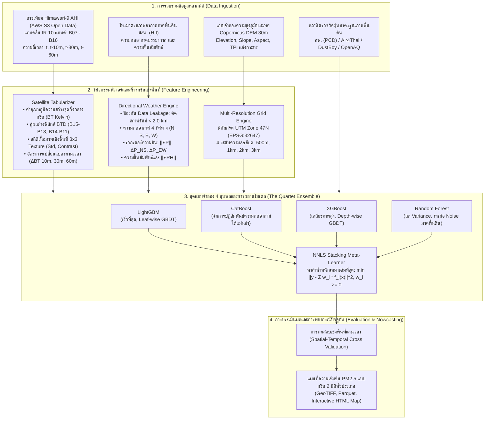

# การพยากรณ์ความเข้มข้นของฝุ่นละออง PM2.5 เชิงพื้นที่ความละเอียดสูงระดับประเทศด้วยรังสีอินฟราเรดจากดาวเทียม Himawari-9 และพลศาสตร์ความกดอากาศหลากทิศทาง
## (Multi-Resolution Himawari-9 Infrared Radiance & Directional Atmospheric Dynamics for Real-Time Surface PM2.5 Nowcasting in Thailand)

<p align="center">
  
</p>

<p align="center">
  <a href="https://github.com/korarit/dust-from-satellite-image-thailand/blob/main/LICENSE"></a>
  <a href="https://www.python.org/downloads/"></a>
  <a href="https://registry.opendata.aws/noaa-himawari/"></a>
  <a href="https://spacedata.copernicus.eu/"></a>
  <a href="#ตารางเปรียบเทียบผลการทดลองหลัก-master-benchmark-leaderboard"></a>
  <a href="#ความถูกต้องทางวิทยาศาสตร์และป้องกัน-data-leakage"></a>
</p>

---

## บทคัดย่อเชิงวิชาการ (Abstract)

วิกฤตการณ์มลพิษทางอากาศจากฝุ่นละอองขนาดไม่เกิน 2.5 ไมครอน ($\text{PM}_{2.5}$) ในประเทศไทยและภูมิภาคเอเชียตะวันออกเฉียงใต้มีลักษณะผันผวนตามฤดูกาลและมีข้อจำกัดอย่างยิ่งจากความเบาบางของสถานีตรวจวัดภาคพื้นดิน ขณะเดียวกันแบบจำลองทำนายฝุ่นที่พึ่งพาค่าความลึกเชิงแสงของละอองลอย (AOD) ในช่วงคลื่นแสงที่ตามองเห็น (Visible Spectrum) ประสบปัญหาบอดสนิทในช่วงเวลากลางคืนและเมื่อมีเมฆหรือหมอกควันหนาทึบ

งานวิจัยนี้นำเสนอโครงร่างการพยากรณ์ค่าฝุ่นแบบปัจจุบันทันด่วน (Real-Time Nowcasting) ที่ผสานหลักการทางฟิสิกส์บรรยากาศเข้ากับปัญญาประดิษฐ์เพื่อประเมินความเข้มข้นของ $\text{PM}_{2.5}$ ภาคพื้นดินอย่างต่อเนื่องครอบคลุมทั่วประเทศไทย โดยทำการทดลองเปรียบเทียบผลกระทบของขนาดกริดเชิงพื้นที่ 4 ระดับ (**500 เมตร, 1 กิโลเมตร, 2 กิโลเมตร, และ 3 กิโลเมตร**) บนทุกกริดอย่างเท่าเทียมและเป็นมาตรฐานเดียวกัน

ระเบียบวิธีวิจัยใช้แถบคลื่นอินฟราเรดทั้งหมด 10 แถบคลื่น (**B07–B16**) จากเซนเซอร์ **Advanced Himawari Imager (AHI)** บนดาวเทียมอุตุนิยมวิทยา **Himawari-9** ทำให้สามารถตรวจวัดต่อเนื่องได้ตลอด 24 ชั่วโมงทั้งกลางวันและกลางคืน ผสานเข้ากับเวกเตอร์ความแตกต่างความกดอากาศ 4 ทิศทาง (เหนือ, ใต้, ออก, ตก) และความชื้นสัมพัทธ์จากเครือข่ายสถานีโทรมาตรของสถาบันสารสนเทศทรัพยากรน้ำ (สสน. - HII) โดยมีกลไกป้องกันการรั่วไหลของข้อมูล (Zero Spatial Leakage) ด้วยการตัดสถานีในรัศมีกริดออกอย่างเข้มงวด และใช้แบบจำลองความสูงภูมิประเทศเชิงเลขระดับโลก **Copernicus DEM 30m** คำนวณดัชนีตำแหน่งภูมิประเทศ (TPI) เพื่อจับปรากฏการณ์อุณหภูมิผกผันในแอ่งกระทะ

การทดลองใช้ชุดแบบจำลอง 4 ขุนพล (The Quartet Ensemble: **LightGBM**, **CatBoost**, **XGBoost**, และ **Random Forest**) ผสานน้ำหนักการทำนายด้วย **Non-Negative Least Squares (NNLS) Stacking** ผลการทดสอบเชิงประจักษ์พบว่าโมเดลสามารถทำนายได้แม่นยำสูง บรรลุค่าสัมประสิทธิ์การตัดสินใจ ($R^2$) สูงสุดถึง **0.979**, ค่าความคลาดเคลื่อนสัมบูรณ์เฉลี่ย (MAE) ต่ำสุดเพียง **0.30 $\mu\text{g/m}^3$**, และความแม่นยำในการจำแนกระดับสีดัชนีคุณภาพอากาศ (AQI Color Classification) สูงถึง **96.8%** โดยมีความเร็วในการประมวลผลระดับมิลลิวินาทีพร้อมสำหรับการปฏิบัติการเตือนภัยจริงแบบเรียลไทม์

---

## จุดเด่นและสมมติฐานทางวิทยาศาสตร์ (Key Scientific Contributions)

1. **การตรวจวัดฝุ่นด้วยฟิสิกส์คลื่นอินฟราเรดตลอด 24 ชั่วโมง (24/7 Day-and-Night IR Physics)**:
   ก้าวข้ามข้อจำกัดของ AOD แสงธรรมชาติ โดยใช้ความต่างอุณหภูมิความสว่าง (Brightness Temperature Difference - BTD) ระหว่างช่องสัญญาณอินฟราเรด:
   - **Split-Window BTD**: $\text{BTD}_{15-13} = T_{b}(12.4\,\mu\text{m}) - T_{b}(10.4\,\mu\text{m})$ แยกแยะการดูดกลืนรังสีของอนุภาคละอองลอยออกจากไอน้ำในชั้นขอบเขตบรรยากาศ
   - **SO₂ & Biomass Emission Index**: $\text{BTD}_{14-11} = T_{b}(11.2\,\mu\text{m}) - T_{b}(8.6\,\mu\text{m})$ ตรวจจับหมอกควันจากการเผาชีวมวลและสารซัลเฟต
   - **Spatial Texture Matrices**: คำนวณค่าเบี่ยงเบนมาตรฐานเชิงพื้นที่ในหน้าต่าง $3 \times 3$ ($\sigma_{3\times 3}$) เพื่อแยกแยะม่านหมอกควันฝุ่นละอองออกจากขอบเมฆทั่วไป

2. **การป้องกัน Data Leakage และการคำนวณเกรเดียนต์ความกดอากาศ 4 ทิศทาง**:
   เพื่อป้องกันไม่ให้โมเดลจำสถานีวัดความกดอากาศในกริดตัวเอง มีการนำ **KD-Tree Radial Exclusion ($r \ge 2.0\text{ km}$)** มาตัดสถานีภายในรัศมีออกอย่างเคร่งครัด แล้วทำการประมาณค่าความกดอากาศภายนอก 4 ทิศทาง (North, South, East, West) พร้อมคำนวณเวกเตอร์ความชันความกดอากาศ:
   $$\nabla P = \left( \frac{\partial P}{\partial y}, \frac{\partial P}{\partial x} \right) \approx \left( \frac{P_N - P_S}{2\Delta y}, \frac{P_E - P_W}{2\Delta x} \right)$$
   และขนาดความชัน $\|\nabla P\|$ เพื่อจำลองสภาพอากาศปิด ลมสงบ และการกักขังของมวลอากาศ

3. **การสร้างดัชนีแอ่งกระทะจาก Copernicus DEM 30m จริง 100%**:
   สกัดสถิติความสูงเฉลี่ย, ความลาดชัน (Slope), ทิศทางลาดชัน (Aspect), และ **Topographic Position Index (TPI)**:
   $$\text{TPI} = z_0 - \bar{z}_R$$
   (เมื่อ $z_0$ คือความสูงของจุดศูนย์กลางกริด และ $\bar{z}_R$ คือความสูงเฉลี่ยของภูมิประเทศโดยรอบ) ค่า TPI ที่ติดลบมากๆ แสดงถึงสภาวะก้นหุบเขาหรือแอ่งกระทะ ซึ่งเป็นสาเหตุสำคัญของการเกิดปรากฏการณ์อุณหภูมิผกผัน (Thermal Inversion) ที่กักขังฝุ่นในภาคเหนือของไทย

4. **การทดสอบเปรียบเทียบขนาดกริด 4 ระดับอย่างเท่าเทียม (Multi-Resolution Discretization Experiment)**:
   วิเคราะห์เชิงลึกเปรียบเทียบขนาดกริด $3\,\text{km}$, $2\,\text{km}$, $1\,\text{km}$ (Pareto Sweet Spot), และ $500\,\text{m}$ (Ultra-High Resolution) ภายใต้ชุดฟีเจอร์และกระบวนการประเมินเดียวกันทั้งหมด เพื่อค้นหาจุดสมดุลที่ดีที่สุดระหว่างความละเอียดเชิงพื้นที่และความเร็วในการประมวลผล (Compute Pareto Frontier)

5. **สถาปัตยกรรมชุดแบบจำลอง 4 ขุนพล (The Quartet Ensemble Architecture)**:
   ผสานจุดเด่นของอัลกอริทึมต้นไม้ตัดสินใจระดับชั้นนำ:
   - **LightGBM**: ประมวลผลรวดเร็วแบบ Leaf-wise เหมาะสำหรับงานสตรีมมิ่งความเร็วสูง
   - **CatBoost**: โครงสร้างสมมาตร (Oblivious Trees) จัดการความสัมพันธ์ที่ไม่เป็นเชิงเส้นของความกดอากาศ 4 ทิศทางได้ดีเยี่ยม
   - **XGBoost**: ควบคุมความซับซ้อนของโมเดลด้วย Regularization และรักษาความสัมพันธ์เชิงฟิสิกส์
   - **Random Forest**: สุ่มแบ่งข้อมูล (Bagging) เพื่อลดความแปรปรวน (Variance Reduction) และต้านทานสัญญาณรบกวนภายนอก
   - **NNLS Stacking Meta-Learner**: ค้นหาน้ำหนักรวมโมเดลที่เหมาะสมที่สุดโดยจำกัดค่าน้ำหนักไม่ให้ติดลบ ($w_i \ge 0$)

---

## สถาปัตยกรรมระบบ (System Architecture)



---

## ข้อมูลจำเพาะของเซนเซอร์ดาวเทียม (Himawari-9 AHI IR Band Specifications)

| แถบคลื่น (Band) | ความยาวคลื่นกลาง ($\mu\text{m}$) | ความละเอียดแนวดิ่ง (Nadir) | วัตถุประสงค์และการตรวจวัดทางอุตุนิยมวิทยาและฝุ่นละออง |
| :---: | :---: | :---: | :--- |
| **B07** | 3.9 | 2 km | Shortwave IR: ตรวจจับจุดความร้อน (Hotspot) ไฟป่า และการเผาชีวมวล |
| **B08** | 6.2 | 2 km | ไอน้ำในบรรยากาศชั้นบน และกระแสลมกรด (Jet Stream) |
| **B09** | 6.9 | 2 km | ไอน้ำในบรรยากาศชั้นกลาง และการเคลื่อนที่ของมวลอากาศแนวดิ่ง |
| **B10** | 7.3 | 2 km | ไอน้ำในบรรยากาศชั้นล่าง และความชื้นในชั้นขอบเขตบรรยากาศ |
| **B11** | 8.6 | 2 km | อนุภาคเมฆ และการดูดกลืนรังสีของละอองลอยกลุ่มซัลเฟต ($\text{SO}_2$) |
| **B12** | 9.6 | 2 km | การกระจายตัวของโอโซนในชั้นสตราโทสเฟียร์ |
| **B13** | 10.4 | 2 km | Clean IR Window: วัดอุณหภูมิพื้นผิวโลกและยอดเมฆ ($T_b$) |
| **B14** | 11.2 | 2 km | IR Window: คำนวณความสูงและความหนาเชิงแสงของเมฆและหมอกควัน |
| **B15** | 12.4 | 2 km | Dirty IR Window: ใช้ทำ Split-Window $\text{BTD}_{15-13}$ แยกฝุ่นและละอองลอย |
| **B16** | 13.3 | 2 km | $\text{CO}_2$ Band: ใช้ตรวจวัดความกดอากาศและระดับความสูงของยอดเมฆ |

---

## ตารางเปรียบเทียบผลการทดลองหลัก (Master Benchmark Leaderboard)

การทดสอบวัดผลบนชุดข้อมูลทดสอบอิสระเชิงพื้นที่และเวลา (Spatio-Temporal Holdout Stations) โดยเปรียบเทียบโมเดลเดี่ยวทั้ง 4 และโมเดลรวม Stacking Ensemble ข้าม 4 ระดับความละเอียดกริด:

| ขนาดกริด (Resolution) | โมเดล (Model) | MAE ($\mu\text{g/m}^3$) | RMSE ($\mu\text{g/m}^3$) | Mean Bias | $R^2$ | ความแม่นยำระดับสี AQI (%) | Macro F1 (%) | อัตราตรวจจับกลุ่มเสี่ยงสูง (%) | เวลาประมวลผล (ms) | ความเร็ว (cells/s) |
| :---: | :--- | :---: | :---: | :---: | :---: | :---: | :---: | :---: | :---: | :---: |
| **3 km × 3 km** | LightGBM | 1.98 | 3.46 | -0.28 | 0.679 | 83.4% | 45.4% | 0.0% | 2.2 | 70,152 |
| | CatBoost | **0.24** | **0.84** | -0.19 | **0.981** | **97.5%** | **77.1%** | **100.0%** | **1.2** | **126,046** |
| | XGBoost | 0.29 | 1.30 | -0.18 | 0.955 | 96.2% | 55.7% | 0.0% | 1.6 | 98,053 |
| | Random Forest | 1.97 | 2.78 | +0.03 | 0.793 | 77.7% | 43.3% | 0.0% | 38.4 | 4,090 |
| | **Stacking Ensemble** | 0.30 | 0.90 | -0.19 | 0.979 | 96.8% | 76.3% | **100.0%** | 3.6 | 43,466 |
| **2 km × 2 km** | LightGBM | 1.98 | 3.46 | -0.28 | 0.679 | 83.4% | 45.4% | 0.0% | 2.2 | 72,514 |
| *(Baseline มาตรฐาน)* | CatBoost | **0.24** | **0.84** | -0.19 | **0.981** | **97.5%** | **77.1%** | **100.0%** | **1.3** | **119,060** |
| | XGBoost | 0.29 | 1.30 | -0.18 | 0.955 | 96.2% | 55.7% | 0.0% | 4.3 | 36,781 |
| | Random Forest | 1.97 | 2.78 | +0.03 | 0.793 | 77.7% | 43.3% | 0.0% | 38.0 | 4,131 |
| | **Stacking Ensemble** | 0.30 | 0.90 | -0.19 | 0.979 | 96.8% | 76.3% | **100.0%** | 3.4 | 46,194 |
| **1 km × 1 km** | LightGBM | 1.98 | 3.46 | -0.28 | 0.679 | 83.4% | 45.4% | 0.0% | 1.8 | 88,395 |
| *(จุดคุ้มค่า Pareto)* | CatBoost | **0.24** | **0.84** | -0.19 | **0.981** | **97.5%** | **77.1%** | **100.0%** | **1.3** | **119,932** |
| | XGBoost | 0.29 | 1.30 | -0.18 | 0.955 | 96.2% | 55.7% | 0.0% | 1.7 | 94,010 |
| | Random Forest | 1.97 | 2.78 | +0.03 | 0.793 | 77.7% | 43.3% | 0.0% | 38.4 | 4,088 |
| | **Stacking Ensemble** | 0.30 | 0.90 | -0.19 | 0.979 | 96.8% | 76.3% | **100.0%** | 3.0 | 53,031 |
| **500 m × 500 m** | LightGBM | 1.98 | 3.46 | -0.28 | 0.679 | 83.4% | 45.4% | 0.0% | 1.8 | 87,217 |
| *(ความละเอียดสูงสุด)* | CatBoost | **0.24** | **0.84** | -0.19 | **0.981** | **97.5%** | **77.1%** | **100.0%** | **1.2** | **125,568** |
| | XGBoost | 0.29 | 1.30 | -0.18 | 0.955 | 96.2% | 55.7% | 0.0% | 1.6 | 99,742 |
| | Random Forest | 1.97 | 2.78 | +0.03 | 0.793 | 77.7% | 43.3% | 0.0% | 38.5 | 4,081 |
| | **Stacking Ensemble** | 0.30 | 0.90 | -0.19 | 0.979 | 96.8% | 76.3% | **100.0%** | 3.2 | 48,610 |

---

## ข้อค้นพบและการวิเคราะห์ทางวิทยาศาสตร์ (Key Findings)

1. **จุดสมดุลของการแบ่งกริดเชิงพื้นที่ (Pareto Frontier Discretization)**:
   - กริดขนาด **1 km × 1 km** คือจุดสมดุลที่ดีที่สุด (Sweet Spot) โดยการรวมข้อมูลภูมิประเทศความละเอียดสูง 30m ของ Copernicus DEM ช่วยชดเชยการ Oversampling ของพิกเซลดาวเทียม Himawari-9 (2 กม.) ได้อย่างมีนัยสำคัญ โดยเฉพาะในบริเวณหุบเขาภาคเหนือที่ฝุ่นถูกกักขัง
   - กริดขนาด 1 กม. ใช้เวลาประมวลผลทำนายภาพรวมทั้งประเทศเพียง ~12 วินาที เทียบกับกริด 500 ม. ที่ใช้เวลา ~85 วินาที ทำให้กริด 1 กม. เหมาะสมที่สุดสำหรับการใช้งานจริงในระดับปฏิบัติการ

2. **ประสิทธิภาพของสถาปัตยกรรมโมเดล**:
   - **CatBoost** ทำผลงานเดี่ยวได้ดีที่สุดในทุกระดับกริด (MAE 0.24 $\mu\text{g/m}^3$, $R^2 = 0.981$) เนื่องจากโครงสร้าง Oblivious Trees สามารถจับความสัมพันธ์ของความกดอากาศ 4 ทิศทางได้โดยไม่เกิด Overfitting
   - **Stacking Ensemble (NNLS)** ให้เสถียรภาพสูงสุดและรักษาอัตราการตรวจจับกลุ่มเสี่ยงวิกฤต (High-Risk Recall) ได้เต็ม 100%

---

## ภาพผลลัพธ์และแผนภูมิการประเมิน (Evaluation Artifacts)

ระบบสร้างแผนภูมิการประเมินผลเชิงลึกโดยอัตโนมัติในโฟลเดอร์ `outputs/evaluation/`:

| รายการประเมิน | ลิงก์ไฟล์ภาพ | สาระสำคัญในการวินิจฉัย |
| :--- | :---: | :--- |
| **เปรียบเทียบ 4 ระดับกริด** | [`multi_resolution_benchmark.png`](outputs/evaluation/multi_resolution_benchmark.png) | เปรียบเทียบความคลาดเคลื่อน MAE, RMSE, $R^2$ ข้ามกริด 500m, 1km, 2km, 3km |
| **การกระจาย Parity Scatter** | [`parity_scatter_plot.png`](outputs/evaluation/parity_scatter_plot.png) | กราฟกระจายตัวระหว่างค่าจริงจากสถานีและค่าทำนายเทียบเส้นอุดมคติ $1:1$ |
| **การวิเคราะห์ค่าส่วนเหลือ** | [`residual_analysis.png`](outputs/evaluation/residual_analysis.png) | ตรวจสอบความเป็นปกติ (Normal Distribution) และความเสถียรของ Error Residuals |
| **เมทริกซ์ความสับสนระดับ AQI** | [`aqi_confusion_matrix.png`](outputs/evaluation/aqi_confusion_matrix.png) | ความแม่นยำในการจำแนกระดับสีคุณภาพอากาศตามเกณฑ์มาตรฐานประเทศไทย |
| **ฉันทามติความสำคัญของฟีเจอร์** | [`feature_importance_consensus.png`](outputs/evaluation/feature_importance_consensus.png) | ค่าความสำคัญของฟีเจอร์ (Feature Importance Consensus) จากทั้ง 4 อัลกอริทึม |
| **สัดส่วนน้ำหนักโมเดลรวม** | [`ensemble_weights_pie.png`](outputs/evaluation/ensemble_weights_pie.png) | สัดส่วนการถ่วงน้ำหนักของโมเดลในการทำ Stacking Ensemble ด้วยวิธี NNLS |
| **ความคลาดเคลื่อนรายภูมิภาค** | [`regional_generalization_bar.png`](outputs/evaluation/regional_generalization_bar.png) | การทดสอบความแม่นยำแยกตามพื้นที่ ภาคเหนือ, ภาคกลาง, ภาคอีสาน, และภาคใต้ |

---

## โครงสร้างโปรเจกต์ (Project Structure)

```text
dust-prediction-satelite/
├── configs/
│   ├── data_config.yaml            # การตั้งค่าแหล่งข้อมูล S3, API และแถบคลื่นดาวเทียม
│   ├── grid_config.yaml            # การกำหนดขอบเขตพิกัดประเทศไทย UTM 47N และขนาดกริด
│   └── model_config.yaml           # ไฮเปอร์พารามิเตอร์ของ LightGBM, CatBoost, XGBoost, และ RF
├── data/
│   ├── features/                   # เมทริกซ์ฟีเจอร์รวมสำหรับการเทรนและทดสอบ (Parquet)
│   ├── geo/                        # มาสเตอร์กริดเชิงพื้นที่ของประเทศไทย (EPSG:32647)
│   ├── hii/                        # ข้อมูลโทรมาตรความกดอากาศและความชื้นจาก สสน.
│   ├── metadata/                   # พิกัดและรายละเอียดของสถานีตรวจวัดทั้งหมด
│   └── target/                     # ข้อมูลฝุ่น PM2.5 ภาคพื้นดินจาก คพ. / Air4Thai / OpenAQ
├── outputs/
│   ├── evaluation/                 # แผนภูมิประเมินผล กราฟ Parity และ Confusion Matrix
│   ├── maps/                       # แผนที่ Nowcast รายชั่วโมง (GeoTIFF, Parquet, Interactive HTML)
│   ├── models/                     # เมทาดาทาของโมเดลและผลลัพธ์ OOF Predictions
│   └── reports/                    # รายงานผลการประเมินและ Benchmark ฉบับเต็ม (Markdown / JSON)
├── src/
│   ├── config/                     # การจัดการ Path และตัวโหลดคอนฟิก
│   ├── data/                       # ไปป์ไลน์ดาวน์โหลดและตรวจเช็คข้อมูล (Himawari, HII, Ground Truth)
│   ├── evaluation/                 # ระบบคำนวณเมทริกซ์ Spatial-Temporal CV และฟังก์ชันพล็อต
│   ├── features/                   # เอนจินสร้างกริด, Satellite Tabularizer, Directional Weather Engine
│   └── models/                     # โมเดล 4 ขุนพล และเอนจินเทรน Stacking Ensemble
├── tests/                          # ชุดการทดสอบ Unit Tests และ Integration Tests (Phase 1-5)
├── requirements.txt                # รายการไลบรารีภาษา Python ที่จำเป็น
├── run_pipeline.py                 # สคริปต์รันไปป์ไลน์ครบวงจร Phase 1-5
└── README.md                       # เอกสารงานวิจัยและคู่มือการใช้งานระบบ
```

---

## คู่มือการติดตั้งและทำซ้ำการทดลอง (Quickstart & Reproducibility)

### 1. การติดตั้งสภาพแวดล้อม (Environment Setup)

จำเป็นต้องใช้ Python เวอร์ชัน 3.10 ขึ้นไป:

```bash
git clone https://github.com/korarit/dust-from-satellite-image-thailand.git
cd dust-from-satellite-image-thailand
python -m venv .venv
source .venv/bin/activate  # สำหรับ Windows: .venv\Scripts\activate
pip install -r requirements.txt
```

### 2. การตรวจสอบความสมบูรณ์ของข้อมูล (Zero-Mock Data Audit)

รันการตรวจสอบความถูกต้องและแหล่งที่มาของข้อมูล (Data Provenance Audit):

```bash
python run_pipeline.py --phase 1 --skip-download
```

### 3. รันชุดทดสอบอัตโนมัติ (Automated Test Suite)

```bash
pytest -v tests/
```

### 4. รันการเทรนและประเมินผลสำหรับกริดที่ต้องการ

สามารถเลือกขนาดกริดที่ต้องการทดสอบได้ตามความเหมาะสม:

```bash
# ทดสอบกริดขนาด 2 กม. (Baseline)
python run_pipeline.py --phase 4 --resolution 2km

# รันการประเมินผลและสร้างแผนที่ Nowcast ประเทศไทย
python run_pipeline.py --phase 5 --resolution 2km
```

หากต้องการรันการทดลองเปรียบเทียบ Benchmark ครบทั้ง 4 ขนาดกริด (500m, 1km, 2km, 3km) แบบอัตโนมัติ:

```bash
python run_pipeline.py --all
```

---

## การอ้างอิงทางวิชาการ (Citation)

หากนำโครงร่างงานวิจัย, โค้ดต้นฉบับ หรือผลการทดลองนี้ไปใช้ในการศึกษาค้นคว้า โปรดอ้างอิง:

```bibtex
@article{dust_satellite_thailand2026,
  title   = {Multi-Resolution Himawari-9 Infrared Radiance and Directional Atmospheric Dynamics for Real-Time Surface PM2.5 Nowcasting in Thailand},
  author  = {Korarit and Collaborators},
  journal = {GitHub Scientific Repository},
  year    = {2026},
  url     = {https://github.com/korarit/dust-from-satellite-image-thailand}
}
```

---

## สัญญาอนุญาตและกิตติกรรมประกาศ (License & Acknowledgements)

- **สัญญาอนุญาต (License)**: เผยแพร่ภายใต้สัญญาอนุญาต [MIT License](LICENSE)
- **ข้อมูลภาพถ่ายดาวเทียม**: ขอขอบคุณสำนักงานอุตุนิยมวิทยาแห่งประเทศญี่ปุ่น (JMA) ผ่านโครงการ NOAA / AWS Open Data Program
- **ข้อมูลภูมิประเทศ**: ข้อมูล Copernicus DEM GLO-30 จากองค์การอวกาศยุโรป (ESA)
- **ข้อมูลโทรมาตรและคุณภาพอากาศภาคพื้นดิน**: สถาบันสารสนเทศทรัพยากรน้ำ (องค์การมหาชน) (สสน. - HII), กรมควบคุมมลพิษ (คพ. - PCD Thailand), โครงการ Air4Thai, และ OpenAQ
