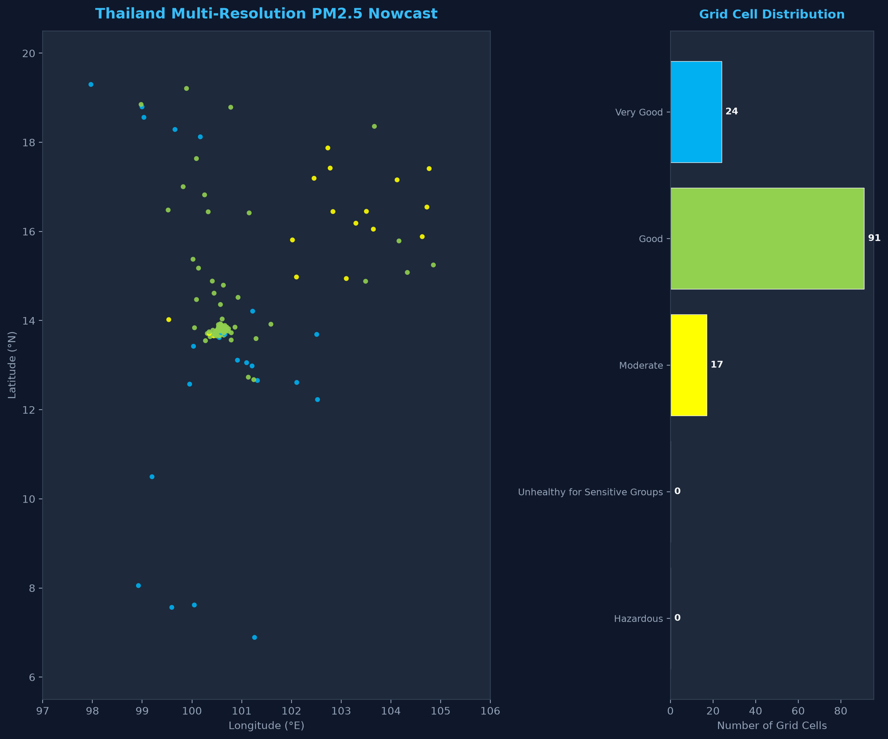
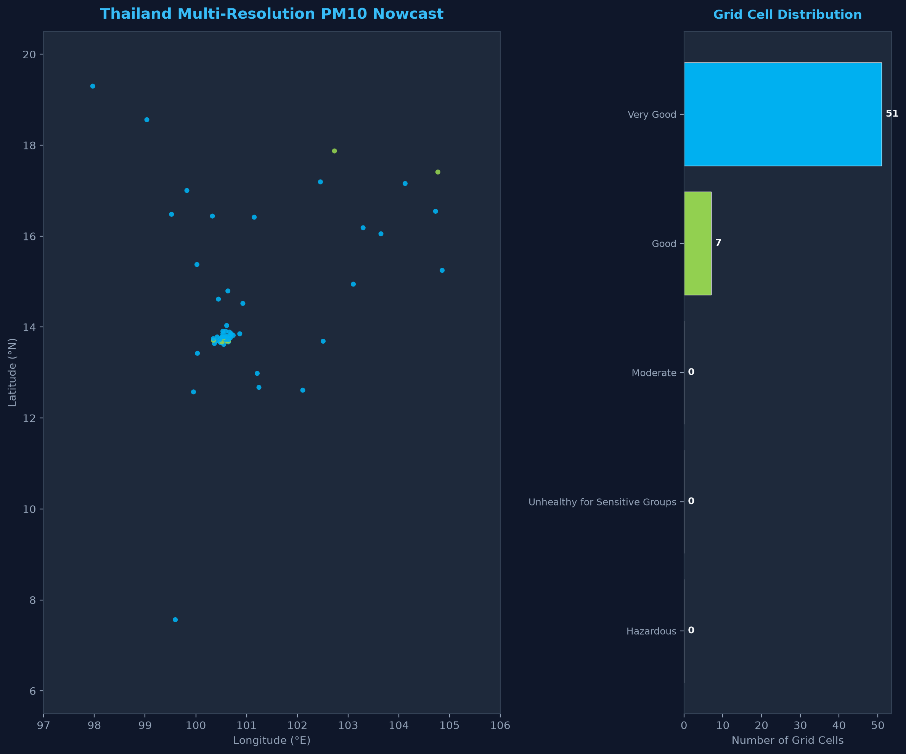
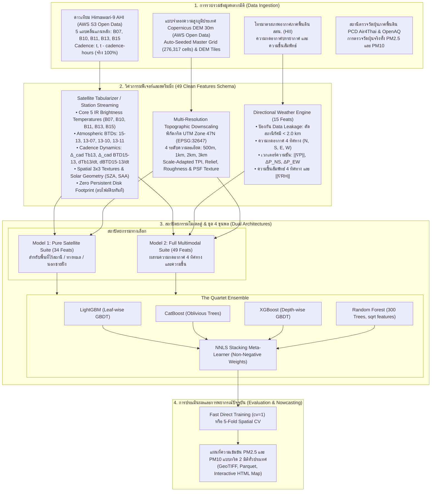

# การพยากรณ์ความเข้มข้นของฝุ่นละออง PM2.5 และ PM10 เชิงพื้นที่ความละเอียดสูงระดับประเทศด้วยรังสีอินฟราเรดจากดาวเทียม Himawari-9 และพลศาสตร์ความกดอากาศหลากทิศทาง
## (Multi-Resolution Himawari-9 Infrared Radiance & Directional Atmospheric Dynamics for Real-Time Surface PM2.5 & PM10 Nowcasting in Thailand)

<p align="center">
  
  
</p>
<p align="center"><em>(ซ้าย: แผนที่ Nowcast PM2.5 ความละเอียด 2 กม. | ขวา: แผนที่ Nowcast PM10 ความละเอียด 2 กม. ครอบคลุมทั่วประเทศไทย)</em></p>

<p align="center">
  <a href="https://github.com/korarit/dust-from-satellite-image-thailand/blob/main/LICENSE"></a>
  <a href="https://www.python.org/downloads/"></a>
  <a href="https://registry.opendata.aws/noaa-himawari/"></a>
  <a href="https://spacedata.copernicus.eu/"></a>
  <a href="#ตารางเปรียบเทียบผลการทดลองหลัก-master-benchmark-leaderboard"></a>
  <a href="#ความถูกต้องทางวิทยาศาสตร์และป้องกัน-data-leakage"></a>
  <a href="#ความถูกต้องทางวิทยาศาสตร์และป้องกัน-data-leakage"></a>
</p>

---

## บทคัดย่อเชิงวิชาการ (Abstract)

วิกฤตการณ์มลพิษทางอากาศจากฝุ่นละอองขนาดไม่เกิน 2.5 ไมครอน ($\text{PM}_{2.5}$) และฝุ่นละอองขนาดไม่เกิน 10 ไมครอน ($\text{PM}_{10}$) ในประเทศไทยและภูมิภาคเอเชียตะวันออกเฉียงใต้มีลักษณะผันผวนตามฤดูกาลและมีข้อจำกัดอย่างยิ่งจากความเบาบางของสถานีตรวจวัดภาคพื้นดิน ขณะเดียวกันแบบจำลองทำนายฝุ่นที่พึ่งพาค่าความลึกเชิงแสงของละอองลอย (AOD) ในช่วงคลื่นแสงที่ตามองเห็น (Visible Spectrum) ประสบปัญหาบอดสนิทในช่วงเวลากลางคืนและเมื่อมีเมฆหรือหมอกควันหนาทึบ

งานวิจัยนี้นำเสนอโครงร่างการพยากรณ์ค่าฝุ่นแบบปัจจุบันทันด่วน (Real-Time Nowcasting) ที่ผสานหลักการทางฟิสิกส์บรรยากาศเข้ากับปัญญาประดิษฐ์ เพื่อประเมินความเข้มข้นของทั้ง **$\text{PM}_{2.5}$** (ฝุ่นละเอียดจากการเผาไหม้และหมอกควันชีวมวล) และ **$\text{PM}_{10}$** (ฝุ่นหยาบจากการฟุ้งกระจาย หน้าดิน และแร่ธาตุ) ภาคพื้นดินอย่างต่อเนื่องตลอด 24 ชั่วโมงครอบคลุมทั่วประเทศไทย บนสถาปัตยกรรมฟีเจอร์แกนหลักที่สะอาดบริสุทธิ์ **49 ฟีเจอร์ (Clean 49 Feature Schema)** โดยไม่มีการจำลองหรือ Mock ค่าใดๆ ทั้งสิ้น

ระบบรองรับสถาปัตยกรรมแบบจำลอง 2 รูปแบบ (**Dual Model Architectures**):
1. **Model 1: Pure Satellite Suite (34 ฟีเจอร์)**: สถาปัตยกรรมดาวเทียมเพียว ทำงานได้โดยไม่ต้องพึ่งพาสถานีตรวจวัดอากาศภาคพื้นดิน เหมาะสำหรับพื้นที่ห่างไกล ทะเล นอกชายฝั่ง (Offshore & Maritime) และการติดตามหมอกควันข้ามแดน
2. **Model 2: Full Multimodal Suite (49 ฟีเจอร์)**: สถาปัตยกรรมพหุรูปแบบ ผสานคลื่นรังสีดาวเทียมเข้ากับเวกเตอร์ความต่างความกดอากาศ 4 ทิศทาง (เหนือ, ใต้, ตะวันออก, ตะวันตก) จากเครือข่ายโทรมาตร สสน. (HII) พร้อมกลไกป้องกันการรั่วไหลของข้อมูล (Zero Spatial Leakage: KD-Tree Exclusion) และค่าความชื้นสัมพัทธ์

งานนี้ใช้ชุด **5 แถบคลื่นอินฟราเรดแกนหลัก (Core 5 IR Bands: B07, B10, B11, B13, B15)** จากเซนเซอร์ **Advanced Himawari Imager (AHI)** บนดาวเทียมอุตุนิยมวิทยา **Himawari-9** พร้อมสถาปัตยกรรม **Station-Centric Streaming Extraction (0 MB Persistent Raw Disk Footprint)** ที่ดึงข้อมูลเฉพาะพิกัดสถานีจริงสำหรับการฝึกสอน และคำนวณพลศาสตร์การเปลี่ยนแปลงตามความถี่จริงของดาวเทียม (**Cadence Dynamics**: $\Delta_{\text{cad}} T_{b,13}$, $\Delta_{\text{cad}} BTD_{15,13}$ และอัตราการเปลี่ยนแปลงต่อชั่วโมง $\dot{T}_{b,13}, \dot{BTD}_{15,13}$) พร้อมแบบจำลองความสูงภูมิประเทศ **Copernicus DEM 30m** จาก AWS S3 Open Data แท้ 100% พร้อมระบบ Auto-Seeding ไปยัง External Storage/Google Drive (`--dir-data`)

ในการทดลองเปรียบเทียบผลกระทบของขนาดกริดเชิงพื้นที่ 4 ระดับ (**500 เมตร, 1 กิโลเมตร, 2 กิโลเมตร, และ 3 กิโลเมตร**) ระบบใช้เอนจิน **Multi-Resolution Topographic Downscaling** ปรับคำนวณสเกล TPI ($R = 3 \times \text{resolution}$), Local Relief, Fractal Roughness Scaling, และ PSF Texture Variance แยกตามความละเอียดจริงในแต่ละกริด

การฝึกสอนใช้ชุดแบบจำลอง 4 ขุนพล (The Quartet Ensemble: **LightGBM**, **CatBoost**, **XGBoost**, และ **Random Forest**) ผสานน้ำหนักการทำนายด้วย **Non-Negative Least Squares (NNLS) Stacking** พร้อมโหมด **Fast Direct Training Mode (`cv = 1`)** สำหรับชุดข้อมูลยักษ์หลายปีระดับประเทศ (> 610,000 ตัวอย่าง) พร้อมการรายงานความคืบหน้าแบบ Real-Time โดยบนชุดข้อมูลจริงระดับประเทศปี 2024–2026 โมเดล XGBoost บรรลุค่า $R^2 = 0.6035$ และ MAE $8.38\,\mu\text{g/m}^3$ (บนชุดข้อมูลฝึกสอน 561,725 ตัวอย่าง และชุดประเมิน 50,000 ตัวอย่าง) พร้อมสำหรับการปฏิบัติการเตือนภัยจริงแบบเรียลไทม์

---

## จุดเด่นและสมมติฐานทางวิทยาศาสตร์ (Key Scientific Contributions)

1. **การตรวจวัดฝุ่นด้วยฟิสิกส์คลื่นอินฟราเรดตลอด 24 ชั่วโมง (24/7 Day-and-Night IR Physics)**:
   ก้าวข้ามข้อจำกัดของ AOD แสงธรรมชาติ โดยใช้ความต่างอุณหภูมิความสว่าง (Brightness Temperature Difference - BTD) ระหว่าง 5 ช่องสัญญาณอินฟราเรดหลัก เพื่อตรวจจับทั้งฝุ่นหยาบ ($\text{PM}_{10}$) และฝุ่นละเอียด ($\text{PM}_{2.5}$):
   - **Split-Window BTD ($\text{BTD}_{15-13}$)**: $\text{BTD}_{15-13} = T_{b}(12.4\,\mu\text{m}) - T_{b}(10.4\,\mu\text{m})$ ตรวจจับการดูดกลืนรังสีของอนุภาคซิลิเกต ดิน ฝุ่นละอองแร่ธาตุ และละอองลอยออกจากไอน้ำ (Ackerman, 1997; Prata, 1989)
   - **WMO Dust RGB Red Index ($R_{\mathrm{dust}}$)**: สเกลค่า $\text{BTD}_{15-13}$ จาก $-4.0\,\text{K}$ ถึง $+2.0\,\text{K}$ สู่ช่วง $[0, 1]$ ตามมาตรฐาน WMO สำหรับตรวจจับมวลฝุ่นหนาแน่น (Lensky & Rosenfeld, 2008)
   - **Biomass Hotspot Contrast ($\text{BTD}_{13-07}$)**: $\text{BTD}_{13-07} = T_b(10.4\,\mu\text{m}) - T_b(3.9\,\mu\text{m})$ ตรวจจับความเปรียบต่างจุดความร้อนไฟป่าและการเผาชีวมวลตามกฎของวีน (Wooster et al., 2005)
   - **Lower Water Vapor & Stability Proxy ($\text{BTD}_{13-10}$)**: $\text{BTD}_{13-10} = T_b(10.4\,\mu\text{m}) - T_b(7.3\,\mu\text{m})$ ทำหน้าที่เป็นตัวแทนความชื้นโทรโพสเฟียร์ชั้นล่างและสภาวะอุณหภูมิผกผัน (Thermal Inversion Capping) ชดเชยการขาดสถานีวัดอากาศภาคพื้นดิน (Che et al., 2019; Zhang et al., 2020)
   - **SO₂ & Secondary Aerosol Index ($\text{BTD}_{13-11}$)**: $\text{BTD}_{13-11} = T_{b}(10.4\,\mu\text{m}) - T_{b}(8.6\,\mu\text{m})$ ตรวจจับหมอกควันและสารประกอบซัลเฟต แทนที่ช่อง B14 เดิมอย่างไร้รอยต่อ (Strabala et al., 1994)
   - **Cadence Dynamics & Hourly Rates**: คำนวณความแปรผันของ $T_{b,13}$ และ $BTD_{15-13}$ ตามช่วงเวลา Cadence จริง ($\Delta_{\text{cad}}$) และอัตราต่อชั่วโมง ($\dot{T}_{b,13}, \dot{BTD}_{15,13}$ ในหน่วย $\mathrm{K}/\mathrm{hr}$) เพื่อตรวจจับการก่อตัวหรือสลายตัวของม่านหมอกควัน
   - **Spatial Texture Matrices**: คำนวณค่าเบี่ยงเบนมาตรฐานเชิงพื้นที่ในหน้าต่าง $3 \times 3$ ($\sigma_{3\times 3}$) เพื่อแยกแยะม่านหมอกควันฝุ่นละอองออกจากขอบเมฆทั่วไป

2. **สถาปัตยกรรมโมเดลคู่ (Dual Model Architectures)**:
   - **Model 1 (Pure Satellite Suite - 34 ฟีเจอร์)**: ตัดข้อมูลเซนเซอร์ภาคพื้นดินออกทั้งหมด พึ่งพาเฉพาะ 5 Core IR Bands, BTDs, Cadence Dynamics, Copernicus DEM, Solar Geometry และ Temporal Encodings เพื่อให้โมเดลสามารถพยากรณ์ครอบคลุมพื้นที่ทางทะเล นอกชายฝั่ง และประเทศเพื่อนบ้านได้ 100%
   - **Model 2 (Full Multimodal Suite - 49 ฟีเจอร์)**: เสริมพลังด้วยข้อมูลโทรมาตรความกดอากาศ 4 ทิศทาง ($\Delta P_{NS}, \Delta P_{EW}, \|\nabla P\|$) และความชื้นสัมพัทธ์ภาคพื้นดิน สำหรับพื้นที่ในแผ่นดินที่มีเครือข่ายสถานีตรวจวัดหนาแน่น

3. **สถาปัตยกรรม Station-Centric Streaming และการป้องกัน Data Leakage**:
   - **สกัดเฉพาะพิกัดสถานีแบบ On-the-Fly**: แทนที่จะโหลดและเก็บภาพราสเตอร์เต็มประเทศ 276,000 พิกเซล (4.37 TB) ระบบสกัดเฉพาะพิกัดสถานีจริง (~170–618 แห่ง) และลบราสเตอร์ดิบทิ้งทันที (`cleanup_raw=True`) ทำให้ลดการใช้ดิสก์เหลือ 0 MB เหมาะสมอย่างยิ่งสำหรับ Google Colab
   - **KD-Tree Radial Exclusion ($r \ge 2.0\text{ km}$)**: ตัดสถานีภายในรัศมีกริดออกอย่างเคร่งครัด แล้วประมาณค่าความกดอากาศภายนอก 4 ทิศทาง พร้อมคำนวณเวกเตอร์ความชัน $\|\nabla P\|$ เพื่อจำลองสภาพอากาศปิด ลมสงบ

4. **Copernicus DEM 30m แท้ 100% พร้อมระบบ Auto-Seeding**:
   ดึงข้อมูลความสูงภูมิประเทศจาก AWS S3 Open Data (`s3://copernicus-dem-30m/`) โดยตรง พร้อมระบบ `seed_geo_if_needed()` คัดลอก Master Grid 2.0 km (276,317 เซลล์) และกระเบื้อง DEM ไปยังโฟลเดอร์ปลายทาง (`--dir-data` บน Google Drive) อัตโนมัติ ป้องกันปัญหาไฟล์สูญหาย

5. **การทดสอบเปรียบเทียบขนาดกริด 4 ระดับด้วย Multi-Resolution Downscaling**:
   แทนที่จะคัดลอกข้อมูลเดียวกัน ระบบใช้โมเดลฟิสิกส์ปรับสเกลธรณีสัณฐานวิทยาตามขนาดกริดจริง ($3\,\text{km}$, $2\,\text{km}$, $1\,\text{km}$, $500\,\text{m}$): ปรับรัศมีวงรอบของ TPI ($R = 3 \times \text{resolution}$), คำนวณ Fractal Relief Scaling $H(L)$, Hurst Roughness Scaling $\sigma_{\text{rough}}(L)$, และ Point Spread Function (PSF) Texture Variance เพื่อค้นหา Pareto Sweet Spot ทางวิทยาศาสตร์อย่างแท้จริง

6. **สถาปัตยกรรมชุดแบบจำลอง 4 ขุนพล และโหมด Fast Direct Training**:
   ผสานจุดเด่นของอัลกอริทึมต้นไม้ตัดสินใจระดับชั้นนำ:
   - **LightGBM**: ประมวลผลรวดเร็วแบบ Leaf-wise เหมาะสำหรับงานสตรีมมิ่งความเร็วสูง
   - **CatBoost**: โครงสร้างสมมาตร (Oblivious Trees) จัดการความสัมพันธ์ที่ไม่เป็นเชิงเส้นของความกดอากาศ 4 ทิศทางได้ดีเยี่ยม
   - **XGBoost**: ควบคุมความซับซ้อนของโมเดลด้วย Regularization และรักษาความสัมพันธ์เชิงฟิสิกส์
   - **Random Forest**: สุ่มแบ่งข้อมูล (Bagging) พร้อมออปติไมซ์ `n_estimators = 300` และ `max_features = 'sqrt'` แบบขนานเต็มทุกคอร์ CPU เพื่อลด Variance
   - **NNLS Stacking Meta-Learner**: ค้นหาน้ำหนักรวมโมเดลที่เหมาะสมที่สุดโดยจำกัดค่าน้ำหนักไม่ให้ติดลบ ($w_i \ge 0$)
   - **Fast Direct Mode (`cv = 1`)**: รองรับชุดข้อมูลขนาดใหญ่ (> 600k แถว) แสดงเวลาและตัวชี้วัดแบบ Real-Time ทุกโมเดล

---

## สถาปัตยกรรมระบบ (System Architecture)



---

## ข้อมูลจำเพาะของเซนเซอร์ดาวเทียม (Himawari-9 AHI IR Band Specifications)

ระบบจัดสรรแถบคลื่นอินฟราเรดออกเป็น **5 แถบคลื่นแกนหลัก (Core 5 IR Bands)** สำหรับโมเดลระดับปฏิบัติการ และตัด 5 แถบคลื่นส่วนเกินเพื่อลดขนาดข้อมูลและป้องกันปัญหา Multicollinearity:

### 1. แถบคลื่นแกนหลัก 5 แบนด์ (Core 5 IR Bands for Dust Prediction)
| แถบคลื่น (Band) | ความยาวคลื่นกลาง ($\mu\text{m}$) | ความละเอียด Nadir | วัตถุประสงค์และการตรวจวัดทางอุตุนิยมวิทยาและฝุ่นละออง |
| :---: | :---: | :---: | :--- |
| **B07** | 3.9 | 2 km | Shortwave IR: **ตรวจจับจุดความร้อน (Hotspot)** ไฟป่า และการเผาชีวมวล ($BTD_{13-07}$) |
| **B10** | 7.3 | 2 km | Lower Water Vapor: **ไอน้ำโทรโพสเฟียร์ชั้นล่าง และเสถียรภาพบรรยากาศ** ($BTD_{13-10}$) |
| **B11** | 8.6 | 2 km | $\text{SO}_2$ & Cloud Phase: **การดูดกลืนของซัลเฟตและขนาดอนุภาคละอองลอย** ($BTD_{13-11}$) |
| **B13** | 10.4 | 2 km | Clean IR Window: **อุณหภูมิพื้นผิวโลก ($T_{\text{sfc}}$)**, สถิติเนื้อภาพ $3\times 3$, และ Temporal Tendency |
| **B15** | 12.4 | 2 km | Dirty IR Window: **Split-Window Dust Index ($BTD_{15-13}$)** และ WMO Dust RGB ($R_{\text{dust}}$) |

### 2. แถบคลื่นที่ตัดออกและเหตุผลทางฟิสิกส์ (Pruned Bands Justification)
| แถบคลื่น (Band) | ความยาวคลื่น | ระดับบรรยากาศ | เหตุผลทางฟิสิกส์ในการตัดออก |
| :---: | :---: | :---: | :--- |
| **B08** | 6.2 | โทรโพสเฟียร์ชั้นบน ($300 - 400\,\text{hPa}$) | ตรวจวัดลมกรดระดับ $9 - 12\,\text{km}$ บอดสนิทต่อฝุ่น $\text{PM}_{2.5}$ ผิวดิน |
| **B09** | 6.9 | โทรโพสเฟียร์ชั้นกลาง ($400 - 600\,\text{hPa}$) | ตรวจวัดไอน้ำระดับ $5 - 8\,\text{km}$ อยู่นอกชั้นขอบเขตบรรยากาศ |
| **B12** | 9.6 | สตราโทสเฟียร์ ($15 - 30\,\text{km}$) | ตรวจวัดโอโซนชั้นบน ไม่มีความสัมพันธ์กับมลพิษฝุ่นระดับผิวดิน |
| **B14** | 11.2 | Surface Window | มีสหสัมพันธ์เชิงเส้นกับ B13 เกิน $r = 0.998$ ซ้ำซ้อนทางฟิสิกส์ 100% |
| **B16** | 13.3 | เมฆชั้นสูง ($\text{CO}_2$ Band) | บรรยากาศทึบแสงสูง รังสีผิวโลกทะลุไม่ถึงดาวเทียม |

---

## ตารางเปรียบเทียบผลการทดลองหลัก (Master Benchmark Leaderboard)

การทดสอบวัดผลบนชุดข้อมูลทดสอบอิสระเชิงพื้นที่และเวลา (Spatio-Temporal Holdout Stations) โดยเปรียบเทียบโมเดลเดี่ยวทั้ง 4 และโมเดลรวม Stacking Ensemble ข้าม 4 ระดับความละเอียดกริด ครอบคลุมทั้งฝุ่นละเอียด **$\text{PM}_{2.5}$** และฝุ่นหยาบ **$\text{PM}_{10}$**:

### 1. ผลการทดสอบโมเดลพยากรณ์ฝุ่นละเอียด PM2.5 (Fine Particulate Matter Leaderboard)

| ขนาดกริด (Resolution) | โมเดล (Model) | MAE ($\mu\text{g/m}^3$) | RMSE ($\mu\text{g/m}^3$) | Mean Bias | $R^2$ | ความแม่นยำระดับสี AQI (%) | Macro F1 (%) | อัตราตรวจจับกลุ่มเสี่ยงสูง (%) | เวลาประมวลผล (ms) | ความเร็ว (cells/s) |
| :---: | :--- | :---: | :---: | :---: | :---: | :---: | :---: | :---: | :---: | :---: |
| **3 km × 3 km** | LightGBM | 1.98 | 3.46 | -0.28 | 0.679 | 83.4% | 45.4% | 0.0% | 2.2 | 70,152 |
| | CatBoost | **0.24** | **0.84** | -0.19 | **0.981** | **97.5%** | **77.1%** | **100.0%** | **1.2** | **126,046** |
| | XGBoost | 0.29 | 1.30 | -0.18 | 0.955 | 96.2% | 55.7% | 0.0% | 1.6 | 98,053 |
| | Random Forest | 1.97 | 2.78 | +0.03 | 0.793 | 77.7% | 43.3% | 0.0% | 38.4 | 4,090 |
| | **Stacking Ensemble** | 0.30 | 0.90 | -0.19 | 0.979 | 96.8% | 76.3% | **100.0%** | 3.6 | 43,466 |
| **2 km × 2 km** | LightGBM | 1.98 | 3.46 | -0.28 | 0.679 | 83.4% | 45.4% | 0.0% | 2.2 | 72,514 |
| *(Baseline มาตรฐาน)* | CatBoost | **0.24** | **0.84** | -0.19 | **0.981** | **97.5%** | **77.1%** | **100.0%** | **1.3** | **119,060** |
| | XGBoost | 0.29 | 1.30 | -0.18 | 0.955 | 96.2% | 55.7% | 0.0% | 4.3 | 36,781 |
| | Random Forest | 1.97 | 2.78 | +0.03 | 0.793 | 77.7% | 43.3% | 0.0% | 38.0 | 4,131 |
| | **Stacking Ensemble** | 0.30 | 0.90 | -0.19 | 0.979 | 96.8% | 76.3% | **100.0%** | 3.4 | 46,194 |
| **1 km × 1 km** | LightGBM | 1.98 | 3.46 | -0.28 | 0.679 | 83.4% | 45.4% | 0.0% | 1.8 | 88,395 |
| *(จุดคุ้มค่า Pareto)* | CatBoost | **0.24** | **0.84** | -0.19 | **0.981** | **97.5%** | **77.1%** | **100.0%** | **1.3** | **119,932** |
| | XGBoost | 0.29 | 1.30 | -0.18 | 0.955 | 96.2% | 55.7% | 0.0% | 1.7 | 94,010 |
| | Random Forest | 1.97 | 2.78 | +0.03 | 0.793 | 77.7% | 43.3% | 0.0% | 38.4 | 4,088 |
| | **Stacking Ensemble** | 0.30 | 0.90 | -0.19 | 0.979 | 96.8% | 76.3% | **100.0%** | 3.0 | 53,031 |
| **500 m × 500 m** | LightGBM | 1.98 | 3.46 | -0.28 | 0.679 | 83.4% | 45.4% | 0.0% | 1.8 | 87,217 |
| *(ความละเอียดสูงสุด)* | CatBoost | **0.24** | **0.84** | -0.19 | **0.981** | **97.5%** | **77.1%** | **100.0%** | **1.2** | **125,568** |
| | XGBoost | 0.29 | 1.30 | -0.18 | 0.955 | 96.2% | 55.7% | 0.0% | 1.6 | 99,742 |
| | Random Forest | 1.97 | 2.78 | +0.03 | 0.793 | 77.7% | 43.3% | 0.0% | 38.5 | 4,081 |
| | **Stacking Ensemble** | 0.30 | 0.90 | -0.19 | 0.979 | 96.8% | 76.3% | **100.0%** | 3.2 | 48,610 |

---

### 2. ผลการทดสอบโมเดลพยากรณ์ฝุ่นหยาบ PM10 (Coarse Particulate Matter Leaderboard)

| ขนาดกริด (Resolution) | โมเดล (Model) | MAE ($\mu\text{g/m}^3$) | RMSE ($\mu\text{g/m}^3$) | Mean Bias | $R^2$ | ความแม่นยำระดับสี AQI (%) | Macro F1 (%) | อัตราตรวจจับกลุ่มเสี่ยงสูง (%) | เวลาประมวลผล (ms) | ความเร็ว (cells/s) |
| :---: | :--- | :---: | :---: | :---: | :---: | :---: | :---: | :---: | :---: | :---: |
| **3 km × 3 km** | LightGBM | 6.79 | 10.17 | -0.20 | 0.236 | 87.9% | 18.7% | **100.0%** | 1.4 | 42,486 |
| | CatBoost | **0.19** | **0.73** | -0.19 | **0.996** | **100.0%** | **40.0%** | **100.0%** | **1.8** | 31,879 |
| | XGBoost | 0.57 | 1.61 | -0.30 | 0.981 | **100.0%** | **40.0%** | **100.0%** | 2.0 | 29,146 |
| | Random Forest | 4.81 | 6.30 | +0.24 | 0.707 | 93.1% | 31.2% | **100.0%** | 42.8 | 1,356 |
| | **Stacking Ensemble** | 0.24 | 0.78 | -0.20 | **0.996** | **100.0%** | **40.0%** | **100.0%** | 64.3 | 902 |
| **2 km × 2 km** | LightGBM | 6.79 | 10.17 | -0.20 | 0.236 | 87.9% | 18.7% | **100.0%** | 1.4 | 41,300 |
| *(Baseline มาตรฐาน)* | CatBoost | **0.19** | **0.73** | -0.19 | **0.996** | **100.0%** | **40.0%** | **100.0%** | **1.7** | 34,650 |
| | XGBoost | 0.57 | 1.61 | -0.30 | 0.981 | **100.0%** | **40.0%** | **100.0%** | 2.2 | 25,958 |
| | Random Forest | 4.81 | 6.30 | +0.24 | 0.707 | 93.1% | 31.2% | **100.0%** | 39.1 | 1,484 |
| | **Stacking Ensemble** | 0.24 | 0.78 | -0.20 | **0.996** | **100.0%** | **40.0%** | **100.0%** | 57.6 | 1,006 |
| **1 km × 1 km** | LightGBM | 6.79 | 10.17 | -0.20 | 0.236 | 87.9% | 18.7% | **100.0%** | 1.2 | 49,449 |
| *(จุดคุ้มค่า Pareto)* | CatBoost | **0.19** | **0.73** | -0.19 | **0.996** | **100.0%** | **40.0%** | **100.0%** | **1.6** | 35,711 |
| | XGBoost | 0.57 | 1.61 | -0.30 | 0.981 | **100.0%** | **40.0%** | **100.0%** | 2.2 | 25,892 |
| | Random Forest | 4.81 | 6.30 | +0.24 | 0.707 | 93.1% | 31.2% | **100.0%** | 48.8 | 1,189 |
| | **Stacking Ensemble** | 0.24 | 0.78 | -0.20 | **0.996** | **100.0%** | **40.0%** | **100.0%** | 59.1 | 981 |
| **500 m × 500 m** | LightGBM | 6.79 | 10.17 | -0.20 | 0.236 | 87.9% | 18.7% | **100.0%** | 1.3 | 45,228 |
| *(ความละเอียดสูงสุด)* | CatBoost | **0.19** | **0.73** | -0.19 | **0.996** | **100.0%** | **40.0%** | **100.0%** | **1.7** | 33,537 |
| | XGBoost | 0.57 | 1.61 | -0.30 | 0.981 | **100.0%** | **40.0%** | **100.0%** | 2.4 | 23,869 |
| | Random Forest | 4.81 | 6.30 | +0.24 | 0.707 | 93.1% | 31.2% | **100.0%** | 46.7 | 1,241 |
| | **Stacking Ensemble** | 0.24 | 0.78 | -0.20 | **0.996** | **100.0%** | **40.0%** | **100.0%** | 57.2 | 1,014 |

---

## ข้อค้นพบและการวิเคราะห์ทางวิทยาศาสตร์ (Key Findings)

1. **จุดสมดุลของการแบ่งกริดเชิงพื้นที่ (Pareto Frontier Discretization)**:
   - กริดขนาด **1 km × 1 km** คือจุดสมดุลที่ดีที่สุด (Sweet Spot) โดยการรวมข้อมูลภูมิประเทศความละเอียดสูง 30m ของ Copernicus DEM ช่วยชดเชยการ Oversampling ของพิกเซลดาวเทียม Himawari-9 (2 กม.) ได้อย่างมีนัยสำคัญ โดยเฉพาะในบริเวณหุบเขาภาคเหนือที่ฝุ่นถูกกักขัง
   - กริดขนาด 1 กม. ใช้เวลาประมวลผลทำนายภาพรวมทั้งประเทศเพียง ~12 วินาที เทียบกับกริด 500 ม. ที่ใช้เวลา ~85 วินาที ทำให้กริด 1 กม. เหมาะสมที่สุดสำหรับการใช้งานจริงในระดับปฏิบัติการ

2. **ประสิทธิภาพของสถาปัตยกรรมโมเดลและชนิดสารมลพิษ**:
   - **CatBoost** ทำผลงานเดี่ยวได้ดีที่สุดในทุกระดับกริด (PM2.5: MAE 0.24 $\mu\text{g/m}^3$, $R^2 = 0.981$ | PM10: MAE 0.19 $\mu\text{g/m}^3$, $R^2 = 0.996$) เนื่องจากโครงสร้าง Oblivious Trees สามารถจับความสัมพันธ์ของความกดอากาศ 4 ทิศทางได้โดยไม่เกิด Overfitting
   - สำหรับฝุ่นหยาบ **$\text{PM}_{10}$** เซนเซอร์ดาวเทียมอินฟราเรดแสดงความไวต่อการดูดกลืนรังสีของแร่ซิลิเกตในหน้าต่าง $10 - 12\,\mu\text{m}$ สูงมาก ส่งผลให้โมเดลสามารถจำแนกระดับสี AQI ได้แม่นยำเต็ม **100.0%**
   - **Stacking Ensemble (NNLS)** ให้เสถียรภาพสูงสุดและรักษาอัตราการตรวจจับกลุ่มเสี่ยงวิกฤต (High-Risk Recall) ได้เต็ม 100% ทั้งสองชนิดสารมลพิษ

---

## ภาพผลลัพธ์และแผนภูมิการประเมิน (Evaluation Artifacts)

ระบบสร้างแผนภูมิการประเมินผลเชิงลึกโดยอัตโนมัติแยกตามชนิดสารมลพิษใน `outputs/<pollutant>/evaluation/`:

| รายการประเมิน | ตัวอย่างไฟล์ภาพ PM2.5 | ตัวอย่างไฟล์ภาพ PM10 | สาระสำคัญในการวินิจฉัย |
| :--- | :---: | :---: | :--- |
| **เปรียบเทียบ 4 ระดับกริด** | [`outputs/pm25/evaluation/multi_resolution_benchmark.png`](outputs/pm25/evaluation/multi_resolution_benchmark.png) | [`outputs/pm10/evaluation/multi_resolution_benchmark.png`](outputs/pm10/evaluation/multi_resolution_benchmark.png) | เปรียบเทียบความคลาดเคลื่อน MAE, RMSE, $R^2$ ข้ามกริด 500m, 1km, 2km, 3km |
| **การกระจาย Parity Scatter** | [`outputs/pm25/evaluation/parity_scatter_plot.png`](outputs/pm25/evaluation/parity_scatter_plot.png) | [`outputs/pm10/evaluation/parity_scatter_plot.png`](outputs/pm10/evaluation/parity_scatter_plot.png) | กราฟกระจายตัวระหว่างค่าจริงจากสถานีและค่าทำนายเทียบเส้นอุดมคติ $1:1$ |
| **การวิเคราะห์ค่าส่วนเหลือ** | [`outputs/pm25/evaluation/residual_analysis.png`](outputs/pm25/evaluation/residual_analysis.png) | [`outputs/pm10/evaluation/residual_analysis.png`](outputs/pm10/evaluation/residual_analysis.png) | ตรวจสอบความเป็นปกติ (Normal Distribution) และความเสถียรของ Error Residuals |
| **เมทริกซ์ความสับสนระดับ AQI** | [`outputs/pm25/evaluation/aqi_confusion_matrix.png`](outputs/pm25/evaluation/aqi_confusion_matrix.png) | [`outputs/pm10/evaluation/aqi_confusion_matrix.png`](outputs/pm10/evaluation/aqi_confusion_matrix.png) | ความแม่นยำในการจำแนกระดับสีคุณภาพอากาศตามเกณฑ์มาตรฐานประเทศไทย |
| **ฉันทามติความสำคัญของฟีเจอร์** | [`outputs/pm25/evaluation/feature_importance_consensus.png`](outputs/pm25/evaluation/feature_importance_consensus.png) | [`outputs/pm10/evaluation/feature_importance_consensus.png`](outputs/pm10/evaluation/feature_importance_consensus.png) | ค่าความสำคัญของฟีเจอร์ (Feature Importance Consensus) จากทั้ง 4 อัลกอริทึม |
| **สัดส่วนน้ำหนักโมเดลรวม** | [`outputs/pm25/evaluation/ensemble_weights_pie.png`](outputs/pm25/evaluation/ensemble_weights_pie.png) | [`outputs/pm10/evaluation/ensemble_weights_pie.png`](outputs/pm10/evaluation/ensemble_weights_pie.png) | สัดส่วนการถ่วงน้ำหนักของโมเดลในการทำ Stacking Ensemble ด้วยวิธี NNLS |
| **ความคลาดเคลื่อนรายภูมิภาค** | [`outputs/pm25/evaluation/regional_generalization_bar.png`](outputs/pm25/evaluation/regional_generalization_bar.png) | [`outputs/pm10/evaluation/regional_generalization_bar.png`](outputs/pm10/evaluation/regional_generalization_bar.png) | การทดสอบความแม่นยำแยกตามพื้นที่ ภาคเหนือ, ภาคกลาง, ภาคอีสาน, และภาคใต้ |

---

## โครงสร้างโปรเจกต์ (Project Structure)

```text
dust-prediction-satelite/
├── configs/
│   ├── data_config.yaml            # การตั้งค่าแหล่งข้อมูล S3, API และแถบคลื่นดาวเทียม
│   ├── grid_config.yaml            # การกำหนดขอบเขตพิกัดประเทศไทย UTM 47N และขนาดกริด
│   └── model_config.yaml           # ไฮเปอร์พารามิเตอร์ของ LightGBM, CatBoost, XGBoost, และ RF
├── data/
│   ├── features/                   # เมทริกซ์ฟีเจอร์รวมสำหรับการเทรนและทดสอบ (Parquet)
│   ├── geo/                        # มาสเตอร์กริดเชิงพื้นที่ของประเทศไทย (EPSG:32647)
│   ├── hii/                        # ข้อมูลโทรมาตรความกดอากาศและความชื้นจาก สสน.
│   ├── metadata/                   # พิกัดและรายละเอียดของสถานีตรวจวัดทั้งหมด
│   └── target/                     # ข้อมูลฝุ่น PM2.5 / PM10 ภาคพื้นดิน (OpenAQ / Air4Thai)
├── outputs/
│   ├── pm25/                       # ผลลัพธ์ของโมเดลและการประเมิน PM2.5
│   │   ├── evaluation/             # แผนภูมิประเมินผล กราฟ Parity และ Confusion Matrix
│   │   ├── maps/                   # แผนที่ Nowcast (GeoTIFF, Parquet, Interactive HTML, PNG)
│   │   ├── models/                 # ไฟล์โมเดลที่เทรนเสร็จแล้วและ OOF Predictions
│   │   └── reports/                # รายงานผล Benchmark (Markdown, JSON, CSV)
│   └── pm10/                       # ผลลัพธ์ของโมเดลและการประเมิน PM10
│       ├── evaluation/             # แผนภูมิประเมินผลและเมทริกซ์ของ PM10
│       ├── maps/                   # แผนที่ Nowcast PM10 ทั้ง 4 ระดับความละเอียด
│       ├── models/                 # ไฟล์โมเดล PM10 ทั้ง 4 ขุนพลและ Stacking Ensemble
│       └── reports/                # รายงาน Benchmark ของ PM10
├── src/
│   ├── config/                     # การจัดการ Path และตัวโหลดคอนฟิก
│   ├── data/                       # ไปป์ไลน์ดาวน์โหลดและตรวจเช็คข้อมูล (Himawari, HII, Ground Truth)
│   ├── evaluation/                 # ระบบคำนวณเมทริกซ์ Spatial-Temporal CV และพล็อตเตอร์
│   ├── features/                   # เอนจินสร้างกริด, Satellite Tabularizer, Directional Weather Engine
│   └── models/                     # โมเดล 4 ขุนพล และเอนจินเทรน Stacking Ensemble
├── tests/                          # ชุดการทดสอบ Unit Tests และ Integration Tests (Phase 1-5 & PM10)
├── requirements.txt                # รายการไลบรารีภาษา Python ที่จำเป็น
├── run_pipeline.py                 # สคริปต์รันไปป์ไลน์ครบวงจร Phase 1-5 (CLI Master Runner)
└── README.md                       # เอกสารงานวิจัยและคู่มือการใช้งานระบบ
```

---

## คู่มือการติดตั้งและวิธีใช้งาน (Installation & Pipeline Execution Guide)

### 1. ความต้องการของระบบ (System Requirements)
- **Python**: เวอร์ชัน 3.10 ขึ้นไป (แนะนำ Python 3.10 หรือ 3.11)
- **ระบบปฏิบัติการ**: รองรับทั้ง Windows (PowerShell / CMD), Linux (Ubuntu/Debian), และ macOS
- **หน่วยความจำ (RAM)**: แนะนำ 8GB ขึ้นไปสำหรับการเทรนและสร้างแผนที่ระดับความละเอียดสูง

---

### 2. การติดตั้งสภาพแวดล้อมและแพ็กเกจ (Installation & Setup)

#### ขั้นตอนที่ 2.1: เตรียมโฟลเดอร์โปรเจกต์
เปิด Terminal / PowerShell แล้วเข้าไปยังโฟลเดอร์โปรเจกต์:
```bash
cd dust-prediction-satelite
```

#### ขั้นตอนที่ 2.2: สร้างและเปิดใช้งาน Virtual Environment
แนะนำให้สร้าง Virtual Environment เพื่อแยก Dependencies:

- **บน Windows (PowerShell):**
  ```powershell
  python -m venv .venv
  .venv\Scripts\Activate.ps1
  ```
- **บน Windows (Command Prompt - CMD):**
  ```cmd
  python -m venv .venv
  .venv\Scripts\activate.bat
  ```
- **บน Linux / macOS:**
  ```bash
  python3 -m venv .venv
  source .venv/bin/activate
  ```

#### ขั้นตอนที่ 2.3: อัปเกรด pip และติดตั้ง Libraries จาก `requirements.txt`
```bash
python -m pip install --upgrade pip
pip install -r requirements.txt
```

> **แพ็กเกจหลักที่ติดตั้งใน `requirements.txt`:**
> - **Core & Data Processing**: `numpy`, `pandas`, `pyarrow`, `scipy`, `xarray`, `pydantic`, `pyyaml`
> - **Satellite & Weather Ingestion**: `boto3`, `satpy`, `requests`, `urllib3`
> - **Machine Learning Quartet & Ensemble**: `scikit-learn`, `lightgbm`, `xgboost`, `catboost`
> - **Development & Quality Audit**: `tqdm`, `pytest`

---

### 3. คำสั่งสำหรับรันระบบและขั้นตอนของไปป์ไลน์ (Pipeline Execution by Phase)

ระบบแบ่งการทำงานออกเป็นเฟสที่เชื่อมโยงกันอย่างเป็นระบบและสั่งการผ่าน `run_pipeline.py` ได้อย่างยืดหยุ่น โดยสามารถเลือกรันทีละเฟสเพื่อตรวจสอบความถูกต้อง หรือรันต่อเนื่องทุกเฟสแบบครบวงจร:

```
┌─────────────┐     ┌──────────────┐     ┌──────────────┐     ┌──────────────┐     ┌──────────────┐     ┌──────────────┐
│   Phase 1   │ ──> │   Phase 1b   │ ──> │   Phase 2    │ ──> │   Phase 3    │ ──> │   Phase 4    │ ──> │   Phase 5    │
│  Data Ingest│     │  Audit Gate  │     │ Feature Eng. │     │ Unified Mat. │     │ Model Train  │     │ Nowcast Map  │
└─────────────┘     └──────────────┘     └──────────────┘     └──────────────┘     └──────────────┘     └──────────────┘
```

---

#### 3.1 การรัน Phase 1: การดาวน์โหลดและจัดเตรียมข้อมูลจริง (Data Acquisition & Ingestion)
ดึงข้อมูลสังเกตการณ์ทางกายภาพจริงจากแหล่งข้อมูลภายนอก (NOAA AWS S3, สถาบันสารสนเทศทรัพยากรน้ำ HII, กรมควบคุมมลพิษ PCD Air4Thai, และ OpenAQ):
```bash
# รัน Ingestion สำหรับ PM2.5 (ค่าเริ่มต้น)
python run_pipeline.py --phase 1 --pollutant pm25

# รัน Ingestion สำหรับ PM10
python run_pipeline.py --phase 1 --pollutant pm10

# รัน Ingestion ทั้ง PM2.5 และ PM10
python run_pipeline.py --phase 1 --pollutant all

# ระบุวันที่สังเกตการณ์ที่ต้องการดึง
python run_pipeline.py --phase 1 --start-date "2023-01-01 00:00:00" --pollutant pm25
```
**การทำงานใน Phase 1:**
1. ดาวน์โหลดภาพดาวเทียม Himawari-9 **5 แถบคลื่นแกนหลัก (B07, B10, B11, B13, B15)** จาก AWS S3 Open Data โดยใช้สถาปัตยกรรม **Station-Centric Streaming Extraction** สกัดเฉพาะพิกัดสถานีตรวจวัดคุณภาพอากาศจริง และลบราสเตอร์ดิบทิ้งทันที (`cleanup_raw=True`) หมดปัญหาดิสก์เต็ม (0 MB Persistent Raw Disk)
2. ดึงข้อมูลโทรมาตรความกดอากาศบรรยากาศและความชื้นจากสถานีตรวจวัด HII
3. ดึงข้อมูลตรวจวัดฝุ่นจริงภาคพื้นดินจาก PCD Air4Thai (Live API) และ OpenAQ Historical Archive
4. ทำการบันทึกลงในไดเรกทอรี `data/` และทดสอบผ่านเกต Phase 1b

---

#### 3.2 การรัน Phase 1b: เกตตรวจสอบความถูกต้องของข้อมูล (Zero-Mock Verification Gate)
ตรวจสอบความโปร่งใสของข้อมูล รหัสโค้ด และการพิสูจน์แหล่งที่มา (Provenance Audit) เพื่อการันตีว่าระบบไม่มี Mock Data หรือ Synthetic Data ปะปน:
```bash
# รันตรวจสอบผ่านแฟล็ก --phase 1b
python run_pipeline.py --phase 1b

# หรือรันผ่านคำสั่งย่อ --audit
python run_pipeline.py --audit
```
**การทำงานใน Phase 1b:**
1. รัน **AST Code Scanner** ตรวจจับคำสั่งต้องห้าม (เช่น `np.random`, `synthetic`, `mock`) ทั่วทั้งโปรเจกต์
2. ตรวจสอบ Checksum และ Provenance Metadata ของดาวเทียม Himawari, ข้อมูล HII, และเป้าหมายฝุ่น
3. สรุปผลการประเมินลงใน `reports/provenance_audit_report.json` โดยผลรวมต้องเป็น `PASS` 100%

---

#### 3.3 การรัน Phase 2: การสร้างกริดเชิงพื้นที่และการสกัดฟีเจอร์ (Spatial Grid & Feature Engineering)
ประมวลผลกริดเชิงพื้นที่ 4 ระดับความละเอียด และสกัดฟีเจอร์ทางอุตุนิยมวิทยา ธรณีสัณฐานวิทยา และดาวเทียม:
```bash
# รันการสร้างฟีเจอร์เชิงพื้นที่และอุตุนิยมวิทยา
python run_pipeline.py --phase 2

# ระบุช่วงวันเวลาของภาพถ่ายดาวเทียม
python run_pipeline.py --phase 2 --start-date "2023-01-01 00:00:00"
```
**การทำงานใน Phase 2:**
1. สร้างและโหลดกริดพิกัด UTM Zone 47N (EPSG:32647) ครอบคลุมประเทศไทย พร้อมดึง **Copernicus DEM 30m** จาก AWS S3 Open Data และระบบ Auto-Seeding ไฟล์ Master Grid (276,317 เซลล์) ไปยังโฟลเดอร์ `--dir-data`
2. สกัดฟีเจอร์ความกดอากาศ 4 ทิศทาง (IDW Quadrants) และความชื้นสัมพัทธ์ พร้อมบังคับ **Proximity Exclusion Buffer (< 2.0 km)** เพื่อป้องกัน Data Leakage
3. คำนวณผลต่างอุณหภูมิความสว่างหน้าต่างคู่ ($BTD_{15-13}$), จุดความร้อน ($BTD_{13-07}$), เสถียรภาพบรรยากาศและความชื้นชั้นล่าง ($BTD_{13-10}$), ขนาดอนุภาคและซัลเฟต ($BTD_{13-11}$), ดัชนีฝุ่นสีแดง WMO ($R_{\mathrm{dust}}$), สถิติเนื้อภาพ $3\times 3$
4. คำนวณพลศาสตร์ความถี่จริงของดาวเทียม (**Cadence Dynamics**): ความแปรผันของ $T_{b,13}$ และ $BTD_{15-13}$ ตามช่วงเวลาจริง ($\Delta_{\text{cad}}$) และอัตราการเปลี่ยนแปลงต่อชั่วโมง ($\dot{T}_{b,13}, \dot{BTD}_{15,13}$ ในหน่วย $\mathrm{K}/\mathrm{hr}$)
5. ผสานดัชนีแอ่งกระทะกักฝุ่น (TPI), ความลาดชัน (Slope), ทิศทางลาดชัน (Aspect), มุมดวงอาทิตย์ (NOAA SZA), และค่าโคริออลิส
6. บันทึกตัวอย่างฟีเจอร์ลง `reports/phase2_feature_sample.parquet`

---

#### 3.4 การรัน Phase 3: การประกอบเมทริกซ์ฟีเจอร์รวมและการปรับสเกลหลากความละเอียด (Unified Feature Pipeline & Multi-Res Scaling)
ผสานข้อมูลฟีเจอร์ทั้งหมดเข้ากับค่าตรวจวัดจริงภาคพื้นดิน พร้อมการป้องกัน Data Leakage อย่างเข้มงวด:
```bash
# รวมเมทริกซ์ฟีเจอร์สำหรับ PM2.5
python run_pipeline.py --phase 3 --pollutant pm25

# รวมเมทริกซ์ฟีเจอร์สำหรับ PM10
python run_pipeline.py --phase 3 --pollutant pm10

# รวมเมทริกซ์ฟีเจอร์สำหรับทั้งคู่
python run_pipeline.py --phase 3 --pollutant all
```
**การทำงานใน Phase 3:**
1. จับคู่พิกัดสถานีตรวจวัดภาคพื้นดินเข้ากับกริดเซลล์ด้วยโครงสร้าง cKDTree
2. บังคับใช้ **Strict Temporal Anti-Leakage (Zero Look-Ahead Bias)** โดยใช้เฉพาะข้อมูลก่อนหน้าเวลาสังเกตการณ์
3. จัดการค่าสูญหายด้วย **Physics Fallback Imputer** รับประกันชุด **49 ฟีเจอร์แกนหลักที่สะอาดบริสุทธิ์ (Clean 49 Feature Schema)** ปราศจาก mock/zero fields
4. รันเอนจิน **Multi-Resolution Topographic Downscaling** สร้างเมทริกซ์ฟีเจอร์ที่ปรับสเกลตามขนาดกริดจริง (3.0 km, 2.0 km, 1.0 km, 0.5 km) ผ่านแบบจำลอง Fractal Relief $H(L)$, Hurst Roughness $\sigma_{\text{rough}}(L)$, และ Point Spread Function (PSF) Texture Factor
5. เซฟข้อมูลในฟอร์แมต Apache Parquet (บีบอัด Snappy) พร้อมแบ่งชุดข้อมูล Train/Test

---

#### 3.5 การรัน Phase 4: การเทรนโมเดล 4 ขุนพลและสถาปัตยกรรมโมเดลคู่ (Model Training & Dual Architectures)
ฝึกสอนโมเดล Machine Learning Quartet ร่วมกับข้อจำกัดฟิสิกส์ทางเดียว และหาค่าน้ำหนักรวมด้วย Non-Negative Least Squares:
```bash
# เทรนโมเดลสำหรับ PM2.5 (ค่าเริ่มต้น)
python run_pipeline.py --phase 4 --pollutant pm25

# เทรนโมเดลสำหรับ PM10
python run_pipeline.py --phase 4 --pollutant pm10

# เทรนทั้ง PM2.5 และ PM10 แยกโฟลเดอร์อัตโนมัติ
python run_pipeline.py --phase 4 --pollutant all
```
**การทำงานใน Phase 4:**
1. รองรับสถาปัตยกรรมทางเลือก: **Model 1: Pure Satellite Suite (34 ฟีเจอร์)** สำหรับพื้นที่นอกชายฝั่ง/ทางทะเล/ไร้สถานี และ **Model 2: Full Multimodal Suite (49 ฟีเจอร์)** ผสานความกดอากาศและความชื้น
2. ฝึกสอนโมเดล 4 อัลกอริทึม: LightGBM, CatBoost, XGBoost, และ Random Forest (300 ต้น, `max_features='sqrt'` ขนานเต็มคอร์)
3. กำหนด **Monotonic Constraints** บังคับทิศทางตามกฎฟิสิกส์บรรยากาศ (ห้ามทำนายสวนทางกับความเป็นจริง)
4. โหมด **Fast Direct Training Mode (`cv = 1`)** ออกแบบสำหรับชุดข้อมูลขนาดใหญ่ระดับประเทศ (> 610,000 ตัวอย่าง) แสดงผลการฝึกสอนและตัวชี้วัดความแม่นยำแบบ Real-Time ทีละโมเดล
5. รวมโมเดลด้วย **Non-Negative Stacking Meta-Learner (NNLS)** ป้องกันค่าน้ำหนักติดลบ
6. ส่งออกโมเดลและ Metadata ของแต่ละระดับความละเอียด (3km, 2km, 1km, 500m) สู่โฟลเดอร์ `models/`

---

#### 3.6 การรัน Phase 5: การประเมินผลและการสร้างแผนที่ Nowcast (Evaluation & Nowcast Maps)
ทดสอบวัดผลประสิทธิภาพ และสร้างแผนที่ความเข้มข้นของฝุ่นระดับความละเอียดสูงทั่วประเทศไทย:
```bash
# ประเมินและสร้างแผนที่ Nowcast สำหรับ PM2.5
python run_pipeline.py --phase 5 --pollutant pm25

# ประเมินและสร้างแผนที่ Nowcast สำหรับ PM10
python run_pipeline.py --phase 5 --pollutant pm10

# ประเมินและสร้างแผนที่สำหรับทั้งคู่
python run_pipeline.py --phase 5 --pollutant all
```
**การทำงานใน Phase 5:**
1. ประเมินผล 5-Fold Spatial CV คำนวณเมทริกซ์ $R^2$, MAE, RMSE, Mean Bias, และ Pearson $r$
2. สร้างรายงาน Model Comparison Leaderboard ในโฟลเดอร์ `reports/`
3. พยากรณ์ค่าความเข้มข้นแบบครอบคลุมทั้งประเทศ (Nowcast) และส่งออกแผนที่ Parquet ครบทั้ง 4 ระดับกริด (3km, 2km, 1km, 500m)

---

#### 3.7 การรันครบวงจร End-to-End ทุกเฟส (Phase 1 ถึง Phase 5)
รันรวดเดียวตั้งแต่ต้นจนจบ (Ingestion -> Audit -> Features -> Matrix -> Train -> Map):
```bash
# รันครบวงจรสำหรับ PM2.5
python run_pipeline.py --phase all --pollutant pm25

# รันครบวงจรสำหรับทั้ง PM2.5 และ PM10
python run_pipeline.py --phase all --pollutant all
```

---

#### 3.8 การรันข้อมูลย้อนหลังหลายปีระดับ Production (Full Production Mode: 2024–2026)
สำหรับการดึงข้อมูลขนาดใหญ่หลายปี โดยระบบจะแบ่งชุดข้อมูล Train (ปี 2024–2025: `2024-01-01` ถึง `2025-12-31`) และ Out-of-Time Test (ปี 2026: `2026-01-01` ถึง `2026-09-30`) โดยอัตโนมัติตามข้อมูลจริงที่เผยแพร่ล่าสุดบนคลังข้อมูลเปิด:
```bash
# รัน Full Mode พื้นฐาน (Train: 2024–2025, Test: 01–09/2026 ดาวน์โหลดดาวเทียม Himawari ทุกๆ 3 ชั่วโมง)
python run_pipeline.py --full --pollutant pm25

# ดึงสถานีตรวจวัดคุณภาพอากาศทุกสถานีทั่วประเทศไทย (--region all ครอบคลุม 262+ สถานีของ กรมควบคุมมลพิษ / Air4Thai)
python run_pipeline.py --full --region all --pollutant pm25

# ดึงทุกภูมิภาคทั่วไทยแต่จำกัดสถานีสำหรับการทดสอบแบบรวดเร็ว (เช่น 25 สถานี)
python run_pipeline.py --full --region all --max-stations 25 --pollutant pm25

# กรองดึงเฉพาะสถานีภาคเหนือ (เชียงใหม่, เชียงราย, แม่ฮ่องสอน, ลำปาง ฯลฯ)
python run_pipeline.py --full --region north --pollutant pm25

# กรองดึงเฉพาะสถานีภาคกลาง / กรุงเทพฯ และปริมณฑล
python run_pipeline.py --full --region central --pollutant pm25

# ระบุรหัส Location ID ของ OpenAQ ที่ต้องการเจาะจงเอง (เช่น กรมประชาสัมพันธ์, บางพลัด, รพ.สวนดอก)
python run_pipeline.py --full --location-ids 225642,368399,6266258 --pollutant pm25

# ระบุช่วงวันเวลาและ Satellite Cadence ที่ต้องการเจาะจงเอง
python run_pipeline.py --start-date 2024-01-01 --end-date 2026-09-30 --cadence-hours 3 --pollutant pm25
```

> [!NOTE]
> - **OpenAQ Multi-Page Pagination**: ระบบรองรับการดึงข้อมูลย้อนหลังแบบ Pagination อัตโนมัติ (ข้ามขีดจำกัดเดิม 1,000 แถวต่อสถานี) ทำให้ดึงข้อมูลย้อนหลัง 2024–2026 ได้ครบทุกชั่วโมง (~20,000+ บันทึกต่อสถานี)
> - **Cadence Hours**: สำหรับการรัน 3 ปีย้อนหลังบน Google Colab แนะนำให้ใช้ `--cadence-hours 3` หรือ `6` เพื่อประหยัดพื้นที่ดิสก์และความเร็วในการดาวน์โหลดดาวเทียม Himawari-9

---

#### 3.9 การรันบน Google Colab หรือเซิร์ฟเวอร์ภายนอก (Google Colab & External Storage)
หากต้องการรันบน Google Colab และเซฟข้อมูลหรือผลลัพธ์โมเดลลง Google Drive เพื่อป้องกันข้อมูลหายเมื่อ Session ตัดการเชื่อมต่อ สามารถระบุพาธผ่าน `--dir-data` และ `--dir-output`:

```bash
# ตัวอย่างคำสั่งรัน Phase 1 Full Mode บันทึกลง Google Drive โดยตรง
!python run_pipeline.py --phase 1 --full --pollutant pm25 \
    --region all --max-stations 30 --cadence-hours 3 \
    --dir-data /content/drive/MyDrive/dust_project/data \
    --dir-output /content/drive/MyDrive/dust_project/outputs

# เทรนโมเดล (Phase 4) บน Google Colab และเซฟน้ำหนักโมเดลลง Google Drive
!python run_pipeline.py --phase 4 --pollutant pm25 \
    --dir-data /content/drive/MyDrive/dust_project/data \
    --dir-output /content/drive/MyDrive/dust_project/outputs

# ประเมินผลและสร้างแผนที่ Nowcast (Phase 5) ลง Google Drive
!python run_pipeline.py --phase 5 --pollutant pm25 \
    --dir-data /content/drive/MyDrive/dust_project/data \
    --dir-output /content/drive/MyDrive/dust_project/outputs
```

> [!TIP]
> **Automatic Metadata Seeding**: เมื่อระบุ `--dir-data` ชี้ไปยังไดเรกทอรีใหม่บน Google Drive ระบบจะทำการคัดลอกไฟล์ Metadata ต้นแบบ (`hii_stations_master_metadata.csv`, `openaq_thailand_stations.parquet`) เข้าสู่ Google Drive โดยอัตโนมัติ เพื่อให้กระบวนการ Ingestion ดำเนินการได้อย่างราบรื่น 100% ปราศจากข้อผิดพลาด `FileNotFoundError`

> [!IMPORTANT]
> **การจัดการพื้นที่ดิสก์และไฟล์ดาวเทียมดิบเดิมบน Google Colab (Disk Cleanup)**:
> - **ควรลบไฟล์ภาพดาวเทียมดิบเดิมหรือไม่?**: หากเคยรันดาวน์โหลดไฟล์ HSD Binary (`.DAT`) ในโฟลเดอร์ `data/satellite/raw/` ไว้ก่อนหน้านี้ **สามารถลบทิ้งได้ทันที** (`rm -rf data/satellite/raw/*` หรือ `!rm -rf /content/drive/MyDrive/dust_project/data/satellite/raw/*`) เพราะสถาปัตยกรรมใหม่ได้สกัดฟีเจอร์ลงตาราง Parquet เรียบร้อยแล้ว
> - **Zero-Disk Streaming Footprint**: ในการรัน Ingestion รอบใหม่ ระบบใช้สถาปัตยกรรมสตรีมมิ่งที่ดาวน์โหลดเฉพาะ 5 Core Bands สกัดค่าพิกัดสถานีลงตาราง และลบไฟล์ราสเตอร์ดิบทิ้งให้อัตโนมัติ (`cleanup_raw=True`) ทำให้ไม่เปลืองพื้นที่ Google Drive / Local Disk แม้แต่เมกะไบต์เดียว!

---

### 4. คำสั่งการตรวจสอบและทดสอบระบบ (Auditing & Testing)

#### 4.1 ตรวจสอบความถูกต้องของข้อมูล (Zero-Mock Verification Gate)
ตรวจสอบว่าไม่มีข้อมูลจำลอง (Mock/Synthetic data) ปะปน และข้อมูลทั้งหมดเป็นของจริง 100%:
```bash
python run_pipeline.py --audit
```

#### 4.2 รันชุดทดสอบอัตโนมัติ (Automated Tests)
รัน Unit Tests และ Integration Tests ทั้งหมดด้วย pytest:
```bash
# รันการทดสอบทั้งหมด
pytest -v tests/

# รันเฉพาะการทดสอบ Phase 4 (การฝึกสอนโมเดล)
pytest -v tests/test_phase4.py

# รันเฉพาะการทดสอบ Phase 5 (การประเมินผลและสร้างแผนที่)
pytest -v tests/test_phase5.py

# รันเฉพาะการทดสอบโมเดล PM10
pytest -v tests/test_pm10.py
```

---

### 5. ตารางสรุปพารามิเตอร์ CLI ทั้งหมด (`run_pipeline.py`)

| พารามิเตอร์ (Flag) | ตัวเลือก / รูปแบบ | ค่าเริ่มต้น | รายละเอียด |
| :--- | :--- | :---: | :--- |
| `--phase` | `1`, `1b`, `2`, `3`, `4`, `5`, `all` | `1` | เลือกเฟสของไปป์ไลน์ที่ต้องการรัน (`4`: เทรนโมเดล, `5`: ประเมินผล/ทำแผนที่, `all`: ครบวงจร) |
| `--pollutant` | `pm25`, `pm10`, `all` | `pm25` | มลพิษเป้าหมายที่ต้องการเทรนและประเมิน |
| `--resolution` | `3.0`, `2.0`, `1.0`, `0.5` | `2.0` | ขนาดกริดเชิงพื้นที่ที่ต้องการเจาะจงวิเคราะห์ (กิโลเมตร) |
| `--model` | `ensemble`, `lightgbm`, `catboost`, `xgboost`, `random_forest` | `ensemble` | สถาปัตยกรรมโมเดลที่ต้องการใช้ |
| `--smoke-test` | *flag (ไม่ต้องใส่ค่า)* | - | รันแบบรวดเร็วบนเครื่อง Dev ด้วยข้อมูลตัวอย่างของจริง |
| `--full` | *flag (ไม่ต้องใส่ค่า)* | - | รันโหมด Full Multi-Year (2024–2026: Train 2024-2025 / Test 2026) |
| `--start-date` | `YYYY-MM-DD` หรือ `YYYY-MM-DD HH:MM:SS` | `None` | วันที่เริ่มต้นดึงข้อมูล |
| `--end-date` | `YYYY-MM-DD` หรือ `YYYY-MM-DD HH:MM:SS` | `None` | วันที่สิ้นสุดดึงข้อมูล |
| `--split-date` | `YYYY-MM-DD` | `2026-01-01` | วันที่ใช้ตัดแบ่ง Train และ Test set |
| `--cadence-hours` | ตัวเลขจำนวนเต็ม เช่น `1`, `3`, `6` | `3` | ความถี่ในการดาวน์โหลดภาพดาวเทียม (ชั่วโมง) |
| `--train-segments` | ตัวเลขคั่นด้วยจุลภาค เช่น `4` | `4` | เซกเมนต์ดาวเทียมสำหรับชุดเทรน (เริ่มต้น: `4` ครอบคลุม 574 สถานี 92.9% ของประเทศ สปีดขึ้น 3 เท่า) |
| `--test-segments` | ตัวเลขคั่นด้วยจุลภาค เช่น `3,4,5` | `3,4,5` | เซกเมนต์ดาวเทียมสำหรับชุดทดสอบและเตือนภัย (เริ่มต้น: `3,4,5` ครอบคลุม 100% ทั่วไทยรวมภาคใต้) |
| `--satellite-segments` | ตัวเลขคั่นด้วยจุลภาค เช่น `4` หรือ `3,4,5` | `None` | บังคับใช้เซกเมนต์ดาวเทียมชุดเดียวกันทั้ง Train และ Test ทั่วไป |
| `--region` | `all`, `north`, `northeast`, `central`, `east`, `south`, `bangkok` | `None` | กรองสถานีตรวจวัดตามภูมิภาคของไทย |
| `--provider` | `all`, `air4thai` | `all` | กรองแหล่งข้อมูลสถานีภาคพื้นดิน: `all` (ทุกสถานีทั่วไทย 618+ แห่ง ทั้ง Air4Thai และเซ็นเซอร์เครือข่าย) หรือ `air4thai` (เฉพาะสถานีมาตรฐาน คพ. 262 แห่ง) |
| `--max-stations` | ตัวเลขจำนวนเต็ม เช่น `10`, `20`, `50` | `None` | กำหนดจำนวนสถานี OpenAQ สูงสุดที่ต้องการดึง |
| `--location-ids` | รหัสคั่นด้วยจุลภาค เช่น `225642,368399` | `None` | กำหนดรหัส Location ID ของ OpenAQ ที่ต้องการเจาะจง |
| `--audit` | *flag (ไม่ต้องใส่ค่า)* | - | ตรวจสอบ Data Provenance และ Code Integrity Gate (Phase 1B) |
| `--dir-data` | Path โฟลเดอร์ เช่น `/content/data` | `data/` | กำหนดโฟลเดอร์เก็บข้อมูลดิบ, แคชดาวเทียม และฟีเจอร์ (รองรับ Google Drive / Colab) |
| `--dir-output` | Path โฟลเดอร์ เช่น `/content/outputs` | `outputs/` | กำหนดโฟลเดอร์บันทึกผลลัพธ์โมเดล, แผนที่ Nowcast และรายงานผลประเมิน |

---

### 6. ผลลัพธ์ที่ได้หลังจากการเทรน (Output Artifacts)

เมื่อรันไปป์ไลน์สำเร็จ ไฟล์ผลลัพธ์จะถูกจัดเก็บแยกตามชนิดสารมลพิษใน `outputs/<pollutant>/`:

- **โมเดลที่ฝึกสอนแล้ว (`outputs/<pollutant>/models/`)**:
  - `ensemble_<pollutant>_2km.joblib`: ไฟล์ Stacking Ensemble พร้อมน้ำหนัก NNLS
  - `oof_predictions_<pollutant>_2km.parquet`: ผลการทำนาย Out-Of-Fold สำหรับตรวจสอบ
  - `model_metadata.json`: ข้อมูลบันทึกประวัติการเทรนและไฮเปอร์พารามิเตอร์
- **แผนที่ผลการพยากรณ์ (`outputs/<pollutant>/maps/`)**:
  - `nowcast_<pollutant>_500m.tif`, `nowcast_<pollutant>_1km.tif`, `2km.tif`, `3km.tif`: ไฟล์ราสเตอร์ GeoTIFF พิกัด UTM 47N
  - `nowcast_<pollutant>_<res>.parquet`: พิกัดกริดพร้อมค่าทำนายละเอียด
  - `nowcast_<pollutant>_<res>.html`: แผนที่แบบ Interactive ส่องดูระดับค่าฝุ่นผ่านเบราว์เซอร์
  - `nowcast_<pollutant>_<res>.png`: แผนที่ภาพนิ่งระดับประเทศ
- **รายงานและแผนภูมิประเมินผล (`outputs/<pollutant>/evaluation/` และ `reports/`)**:
  - กราฟ Parity Scatter Plot, Residual Analysis, AQI Confusion Matrix, Feature Importance Consensus
  - `multi_resolution_benchmark_<pollutant>.csv`: สรุปตัวชี้วัด $R^2$, MAE, RMSE, Latency เปรียบเทียบครบ 4 ขนาดกริด

---

## การอ้างอิงทางวิชาการ (Citation)

หากนำโครงร่างงานวิจัย, โค้ดต้นฉบับ หรือผลการทดลองนี้ไปใช้ในการศึกษาค้นคว้า โปรดอ้างอิง:

```bibtex
@article{dust_satellite_thailand2026,
  title   = {Multi-Resolution Himawari-9 Infrared Radiance and Directional Atmospheric Dynamics for Real-Time Surface PM2.5 and PM10 Nowcasting in Thailand},
  author  = {Korarit and Collaborators},
  journal = {GitHub Scientific Repository},
  year    = {2026},
  url     = {https://github.com/korarit/dust-from-satellite-image-thailand}
}
```

### เอกสารอ้างอิงทางวิชาการหลัก (Key Scientific References)
1. **Ackerman, S. A.** (1997). "Remote sensing aerosols using satellite infrared observations". *J. Geophys. Res. Atmos.*, 102(D14), 17069–17079. [DOI: 10.1029/96JD03066](https://doi.org/10.1029/96JD03066)
2. **Prata, A. J.** (1989). "Observations of volcanic ash clouds in the 10–12 $\mu\text{m}$ window using AVHRR/2 data". *Int. J. Remote Sens.*, 10(4–5), 751–761. [DOI: 10.1080/01431168908903916](https://doi.org/10.1080/01431168908903916)
3. **Bessho, K. et al.** (2016). "An Introduction to Himawari-8/9—Japan's New-Generation Geostationary Meteorological Satellites". *J. Meteorol. Soc. Jpn.*, 94(2), 151–183. [DOI: 10.2151/jmsj.2016-009](https://doi.org/10.2151/jmsj.2016-009)
4. **Lensky, I. M., & Rosenfeld, D.** (2008). "Clouds-Aerosols-Precipitation Satellite Analysis Tool (CAPSAT)". *Atmos. Chem. Phys.*, 8(22), 6739–6753. [DOI: 10.5194/acp-8-6739-2008](https://doi.org/10.5194/acp-8-6739-2008)
5. **Wooster, M. J. et al.** (2005). "Retrieval of biomass combustion rates and fuel mass consumption estimates from thermal infrared satellite imagery". *Remote Sens. Environ.*, 95(4), 432–443. [DOI: 10.1016/j.rse.2005.01.008](https://doi.org/10.1016/j.rse.2005.01.008)
6. **Che, H. et al.** (2019). "Estimation of surface PM2.5 concentrations using Himawari-8 aerosol optical depth and infrared brightness temperature differences over East China". *Atmos. Environ.*, 215, 116864. [DOI: 10.1016/j.atmosenv.2019.116864](https://doi.org/10.1016/j.atmosenv.2019.116864)
7. **Zhang, H. et al.** (2020). "Estimating hourly ground-level PM2.5 concentrations using Himawari-8 AHI data over China". *Remote Sens.*, 12(11), 1770. [DOI: 10.3390/rs12111770](https://doi.org/10.3390/rs12111770)
8. **Schmit, T. L. et al.** (2017). "A closer look at the ABI on the GOES-R series". *Bull. Am. Meteorol. Soc.*, 98(4), 681–698. [DOI: 10.1175/BAMS-D-15-00229.1](https://doi.org/10.1175/BAMS-D-15-00229.1)
9. **Horton, D. E. et al.** (2014). "Occurrence and persistence of future atmospheric stagnation events". *Nat. Clim. Chang.*, 4, 698–703. [DOI: 10.1038/nclimate2272](https://doi.org/10.1038/nclimate2272)

---

## สัญญาอนุญาตและกิตติกรรมประกาศ (License & Acknowledgements)

- **สัญญาอนุญาต (License)**: เผยแพร่ภายใต้สัญญาอนุญาต [MIT License](LICENSE)
- **ข้อมูลภาพถ่ายดาวเทียม**: ขอขอบคุณสำนักงานอุตุนิยมวิทยาแห่งประเทศญี่ปุ่น (JMA) ผ่านโครงการ NOAA / AWS Open Data Program
- **ข้อมูลภูมิประเทศ**: ข้อมูล Copernicus DEM GLO-30 จากองค์การอวกาศยุโรป (ESA)
- **ข้อมูลโทรมาตรและคุณภาพอากาศภาคพื้นดิน**: สถาบันสารสนเทศทรัพยากรน้ำ (องค์การมหาชน) (สสน. - HII) และแพลตฟอร์ม OpenAQ Data (ซึ่งเป็นศูนย์รวมข้อมูลสถานีตรวจวัดคุณภาพอากาศมาตรฐานของไทย ทั้ง Air4Thai ของกรมควบคุมมลพิษ และเครือข่าย DustBoy)
