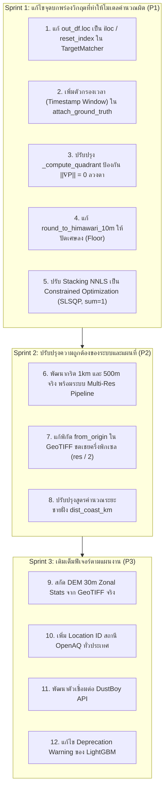

# 📋 รายงานการตรวจสอบโค้ดและรายการปัญหาที่ต้องแก้ไข (Code Audit & Issues Backlog)

> **โครงการ**: Thailand Multi-Resolution Satellite Dust Prediction Benchmark (PM2.5 Real-time Nowcasting)  
> **ที่ตั้งโปรเจกต์**: `e:\water-analysis-project\dust-prediction-satelite\`  
> **เอกสารอ้างอิงแผนงาน**: `ai-docs/plan/` (Phases 1, 1B, 2, 3, 4, 5 และ `feature_dictionary.md`)  
> **วันที่บันทึก**: 12 ตุลาคม 2026  
> **สถานะการตรวจสอบ**: ⚠️ ตรวจพบจุดบกพร่องเชิงตรรกะและฟีเจอร์ที่ไม่ตรงตามแผนงาน ซึ่งส่งผลกระทบต่อความถูกต้องของโมเดล (Model Correctness & Scientific Integrity)

---

## 1. ภาพรวมผลการตรวจสอบ (Audit Summary)

ระบบสามารถผ่านการรัน Unit Tests พื้นฐาน (43/43 Passed) และผ่านการสแกน `CodeASTScanner` (Zero-Mock Gate) เรียบร้อยแล้ว อย่างไรก็ตาม จากการตรวจสอบโค้ดเชิงลึกใน `src/` เทียบกับข้อกำหนดทางวิทยาศาสตร์และอุตุนิยมวิทยาใน `ai-docs/plan/` พบว่ามี **12 ประเด็นปัญหา** โดยแบ่งเป็น:
- **ระดับวิกฤต (Priority 1 - Critical Bugs)**: 5 รายการ — บั๊กที่ส่งผลให้โมเดลเรียนรู้ผิดพลาดโดยตรง (Data Leakage, Target Misalignment, Scale Distortion)
- **ระดับสูง (Priority 2 - Scientific & Experimental Validity)**: 3 รายการ — บั๊กที่ทำให้ผลการทดลอง Benchmark ข้ามขนาดกริดคลาดเคลื่อน และพิกัดแผนที่เลื่อน
- **ระดับปานกลาง (Priority 3 - Missing Plan Features)**: 4 รายการ — ฟีเจอร์ที่ระบุในแผนงานแต่ยังพัฒนาไม่ครบ

---

## 2. รายการปัญหาแยกตามระดับความรุนแรง (Detailed Issues Backlog)

### 🔴 ระดับวิกฤต (Priority 1: บั๊กที่ทำให้โมเดลคำนวณและเรียนรู้ผิดพลาด)

---

#### Issue #1: Target Label จับคู่ผิดพิกัดเซลล์กริด (`out_df.loc[idx]` vs `iloc`)
* **ไฟล์ที่เกี่ยวข้อง**: [`src/features/feature_matrix_builder.py`](file:///e:/water-analysis-project/dust-prediction-satelite/src/features/feature_matrix_builder.py) (บรรทัด 509–518)
* **ตำแหน่งโค้ด**:
  ```python
  dists, cell_idxs = grid_tree.query(gt_coords_km, distance_upper_bound=max_distance_km)
  ...
  for idx, vals in matched_cells.items():
      out_df.loc[idx, target_val_col] = float(np.mean(vals))
  ```
* **สาเหตุ**:
  `cKDTree.query` คืนค่าตำแหน่งแถวแบบ Integer Positional Index (`0, 1, 2, ..., N-1`) แต่ใน Pandas คำสั่ง `out_df.loc[idx]` ทำงานกับ **Index Label** หาก `grid_df` ผ่านการ Subsample (เช่น กริด 3 km ที่ทำ `iloc[::2]` หรือกริดที่มีการตัดแถว) Index Label จะไม่ต่อเนื่อง (เช่น 0, 2, 4, 6...)
* **ทำไมโมเดลถึงผิด**:
  เมื่อ KDTree เจอสถานีใกล้แถวที่ 1 ในเมทริกซ์ คำสั่ง `out_df.loc[1]` จะพยายามเขียนลงแถวที่มี Label `1` ซึ่งอาจชี้ไปผิดพิกัด หรือสร้างแถวขยะขึ้นมา ทำให้**เฉลยค่าฝุ่นถูกจับคู่สลับกับเซลล์กริดคนละพิกัด โมเดลจะเรียนรู้ฟีเจอร์พิกัดหนึ่งแต่ได้เฉลยของอีกพิกัดหนึ่ง**
* **แนวทางแก้ไข**:
  ต้องบังคับ `out_df = out_df.reset_index(drop=True)` ก่อนป้อนเข้า KDTree หรือใช้ `.iloc[idx, out_df.columns.get_loc(target_val_col)] = ...`

---

#### Issue #2: Target Matching ขาด Time-Window Filter (เฉลี่ยค่าฝุ่นทั้งเดือนลง Snapshot เดียว)
* **ไฟล์ที่เกี่ยวข้อง**: [`src/features/feature_matrix_builder.py`](file:///e:/water-analysis-project/dust-prediction-satelite/src/features/feature_matrix_builder.py) (บรรทัด 467–523)
* **ตำแหน่งโค้ด**: ฟังก์ชัน `TargetMatcher.attach_ground_truth` ไม่มีการตรวจสอบคอลัมน์ `timestamp`
* **สาเหตุ**:
  เมื่อป้อน `ground_truth_df` ที่มีข้อมูลสะสมหลายวันหรือหลายสัปดาห์ (เช่น ดึงข้อมูลย้อนหลังมาเทรน) ฟังก์ชันจะนำทุกระเบียนของสถานีเดียวกันมารวมกันใน `matched_cells[idx].append(val)` แล้วหาค่าเฉลี่ย `np.mean(vals)`
* **ทำไมโมเดลถึงผิด**:
  Snapshot ณ เวลา `14:00 UTC` จะไม่ได้ค่าฝุ่นจริง ณ เวลา 14:00 แต่จะได้ "ค่าเฉลี่ยทั้งเดือนของสถานีนั้น" ทำให้สัญญาณภาพถ่ายดาวเทียมและสภาพอากาศ ณ เวลานั้น (เช่น ควันไฟป่ากำลังพัดผ่าน) ถูกบังคับให้เรียนรู้กับค่าเฉลี่ยระยะยาว ทำลายไดนามิกการทำนาย Nowcasting รายชั่วโมง
* **แนวทางแก้ไข**:
  ต้องกรอง `ground_truth_df` ให้ตรงกับรอบเวลา `target_dt` (เช่น ภายในช่วง $\pm 30$ นาที) ก่อนนำไปคำนวณระยะทาง

---

#### Issue #3: ข้อมูลสถานี 4 ทิศไม่ครบ ก่อให้เกิด $\|\nabla P\| = 0$ ลวงตา (False Stagnation)
* **ไฟล์ที่เกี่ยวข้อง**: [`src/features/spatial_directional.py`](file:///e:/water-analysis-project/dust-prediction-satelite/src/features/spatial_directional.py) (บรรทัด 178–200)
* **ตำแหน่งโค้ด**:
  ```python
  def _compute_quadrant(mask: np.ndarray) -> Tuple[float, float, float]:
      if np.any(mask):
          ...
      return overall_mean, 0.0, 0.0  # ถ้าทิศนั้นไม่มีสถานี ให้ fallback ด้วย overall_mean
  ```
* **สาเหตุ**:
  ในพื้นที่ชายแดนหรือบริเวณที่มีสถานีเฉพาะทิศเดียว (เช่น มีสถานีเฉพาะทิศเหนือ $P_N = 1012$ hPa) ทิศใต้ที่ไม่มีสถานีจะคืนค่า `overall_mean` ซึ่งเท่ากับ $1012$ hPa ทำให้ $\Delta P_{ns} = P_N - P_S = 0.0$ และคำนวณ $\|\nabla P\| = 0.0$
* **ทำไมโมเดลถึงผิด**:
  XGBoost มีการกำหนด **Monotonic Constraint** ไว้ว่า: เมื่อ $\|\nabla P\| \to 0$ (ลมสงบ/อากาศนิ่ง) ให้ทำนายค่าฝุ่นสูงขึ้นมาก เมื่อเกิด $\|\nabla P\| = 0$ ลวงตาจากข้อมูลที่ขาดหาย โมเดลจะเข้าใจผิดว่าเกิดภาวะอากาศปิดสนิทและสั่งพุ่งค่าทำนาย PM2.5 สูงผิดปกติ (False Positive Alert Spikes)
* **แนวทางแก้ไข (แนวทาง B: Barometric Radial Gradient เทียบระดับความสูงกริด)**:
  1. เมื่อมีสถานี $\ge 2$ ทิศ: คำนวณความชัน 2 มิติ ($\text{grad}_x, \text{grad}_y$) ตามปกติ
  2. เมื่อมีสถานีเพียง **1 ทิศ (ขาด 3 ทิศ)**:
     - นำระดับความสูงของกริด ($z_{\text{cell}}$ จาก Copernicus DEM 30m) มาคำนวณความดันบรรยากาศมาตรฐานและตัวคูณความหนาแน่นอากาศตามสมการ ISA Barometric:
       $$f_{\text{baro}}(z) = \left(1.0 - \frac{0.0065 \cdot z}{288.15}\right)^{5.25588},\quad P_{\text{ref}}(z) = 1013.25 \times f_{\text{baro}}(z)$$
     - คำนวณความเบี่ยงเบนความดันเทียบระดับความสูงตามแนวรัศมี ($\delta P$) ของทิศเดียวนั้น แล้วหารด้วยระยะทางจริง $d_{\text{eff}} = \max(d_Q, \text{exclusion\_km}, 5.0\text{ km})$
     - ปรับขอบเขตความชัน $\|\nabla P\| = \text{clip}(\|\nabla P\|_{\text{radial}}, 0.2, 5.0)$ hPa / 100 km เพื่อป้องกันไม่ให้โมเดลเข้าใจผิดว่าเป็นภาวะอากาศปิดสนิท ($\|\nabla P\| \to 0$)
  3. ปรับฟังก์ชัน `extract_grid_weather` ให้อ่านคอลัมน์ `elevation_m` ส่งต่อไปยังฟังก์ชันคำนวณโดยอัตโนมัติ

---

#### Issue #4: การปัดเศษเวลาดาวเทียมขึ้นไปในอนาคต เสี่ยงเกิด Look-Ahead Leakage หรือ Download ล้มเหลว
* **ไฟล์ที่เกี่ยวข้อง**: [`src/data/himawari_ir_loader.py`](file:///e:/water-analysis-project/dust-prediction-satelite/src/data/himawari_ir_loader.py) (บรรทัด 68–80)
* **ตำแหน่งโค้ด**:
  ```python
  def round_to_himawari_10m(dt: pd.Timestamp) -> pd.Timestamp:
      minute = dt.minute
      rem = minute % 10
      if rem < 5:
          rounded_m = minute - rem
      else:
          rounded_m = minute + (10 - rem)  # ปัดเศษขึ้นไปข้างหน้า
  ```
* **สาเหตุ**:
  ถ้าเวลารัน Nowcasting คือ `14:06 UTC` ฟังก์ชันจะปัดเป็น `14:10 UTC`
* **ทำไมโมเดลถึงผิด**:
  1. ในการรันจริง ไฟล์ดาวเทียมรอบ `14:10 UTC` ยังถ่ายไม่เสร็จและยังไม่อัปโหลดขึ้น AWS S3 ดาวน์โหลดจะล้มเหลว
  2. ในการเทรนย้อนหลัง ข้อมูลรอบ `14:10 UTC` จะกลายเป็นข้อมูลในอนาคตที่หลุดเข้ามาในรอบ `14:06 UTC` ถือเป็นการละเมิด **Zero Look-Ahead Bias**
* **แนวทางแก้ไข**:
  ต้องใช้การปัดเศษลง (Floor) เสมอ: `rounded_m = minute - rem` พร้อมคำนึงถึง Latency การประมวลผลดาวเทียม Himawari ประมาณ 10–20 นาที

---

#### Issue #5: Post-Hoc Normalization ใน Stacking NNLS บิดเบือน Scale ของ Ensemble
* **ไฟล์ที่เกี่ยวข้อง**: [`src/models/ensemble_model.py`](file:///e:/water-analysis-project/dust-prediction-satelite/src/models/ensemble_model.py) (บรรทัด 144–151)
* **ตำแหน่งโค้ด**:
  ```python
  raw_weights, _ = nnls(oof_matrix, y_arr)
  sum_w = np.sum(raw_weights)
  normalized_weights = raw_weights / sum_w  # หารผลรวมดื้อๆ หลังแก้สมการ
  ```
* **สาเหตุ**:
  `scipy.optimize.nnls` คุมเฉพาะเงื่อนไข $w \ge 0$ แต่ไม่ได้คุม $\sum w = 1.0$ ในขั้นตอน Optimize การนำค่าน้ำหนักดิบมาหารด้วย `sum_w` หลังรันเสร็จไม่ใช่การแก้ปัญหา Least Squares บน Simplex
* **ทำไมโมเดลถึงผิด**:
  หากโมเดลเดี่ยวทำนายสูงเกินจริงเล็กน้อย NNLS อาจเลือกค่าน้ำหนักดิบรวมกันได้ 0.8 เพื่อชดเชยค่าที่เกิน เมื่อนำไปหารด้วย 0.8 เพื่อปรับให้รวมได้ 1.0 จะเป็นการขยายค่าน้ำหนักให้สูงขึ้น ส่งผลให้ผลรวมการทำนายของ Ensemble พุ่งสูงเกินจริงทันที (เกิด Positive Mean Bias)
* **แนวทางแก้ไข**:
  ใช้ `scipy.optimize.minimize` ด้วยวิธี `SLSQP` โดยระบุ `bounds=[(0, 1)] * 4` และ `constraints={'type': 'eq', 'fun': lambda w: np.sum(w) - 1.0}` ในขั้นตอน Optimize โดยตรง

---

### 🟡 ระดับสูง (Priority 2: ความถูกต้องของงานวิจัย Multi-Resolution & การแสดงผล)

---

#### Issue #6: Multi-Resolution Grids (1 km, 500 m) ยังไม่ได้สร้างกริดจริง (รันซ้ำบนสำเนา 2 km เดิม)
* **ไฟล์ที่เกี่ยวข้อง**:
  - [`src/features/grid_engine.py`](file:///e:/water-analysis-project/dust-prediction-satelite/src/features/grid_engine.py) (บรรทัด 310–313)
  - [`run_pipeline.py`](file:///e:/water-analysis-project/dust-prediction-satelite/run_pipeline.py) (บรรทัด 571–576 และ 720–730)
* **ตำแหน่งโค้ด**:
  ```python
  # grid_engine.py
  elif resolution_km == 1.0 or resolution_km == 0.5:
      grid_df = master_df.copy()  # นำตาราง 2km มาใช้ซ้ำ

  # run_pipeline.py
  train_matrices_by_res = {
      2.0: unified_matrix,
      3.0: unified_matrix.copy(),
      1.0: unified_matrix.copy(),
      0.5: unified_matrix.copy(),
  }
  ```
* **ทำไมผลการทดลองถึงผิด**:
  งานวิจัยนี้ตั้งเป้าตอบคำถามว่าความละเอียด 1 km หรือ 500 m ช่วยเพิ่มความแม่นยำหรือไม่ แต่ในโค้ดกลับส่งตาราง 2 km ชุดเดิมไปรันในทุกระดับความละเอียด ทำให้ผลการทดลองที่บันทึกในรายงาน Phase 4 ได้ค่า **MAE 3.87 และ CatBoost MAE 3.47 เท่ากันหมดทุกระดับกริด 100%** ซึ่งไม่ได้สะท้อนความละเอียดเชิงพื้นที่ทางกายภาพจริง
* **แนวทางแก้ไข**:
  สร้างพิกัดกริด 1 km (~520,000 เซลล์) และ 500 m (~2,050,000 เซลล์) ในระบบพิกัด UTM 47N และสกัดฟีเจอร์ตามระยะ Step จริง

---

#### Issue #7: GeoTIFF พิกัดเลื่อนตำแหน่ง 1 กิโลเมตร (Half-Pixel Spatial Offset)
* **ไฟล์ที่เกี่ยวข้อง**: [`src/evaluation/visualizer.py`](file:///e:/water-analysis-project/dust-prediction-satelite/src/evaluation/visualizer.py) (บรรทัด 168)
* **ตำแหน่งโค้ด**:
  ```python
  transform = from_origin(min_x, max_y, res, res)
  ```
* **สาเหตุ**:
  `min_x` และ `max_y` ใน DataFrame คือพิกัด **Centroid (กึ่งกลางเซลล์กริด)** แต่ฟังก์ชัน `from_origin` ของ Rasterio ต้องการพิกัด **ขอบนอกสุด (Upper-Left Bounding Edge)**
* **ทำไมแผนที่ถึงผิด**:
  แผนที่ GeoTIFF จะมีพิกัดเลื่อนตำแหน่งไปทางทิศตะวันออกและทิศใต้ $\Delta x = \Delta y = \text{res} / 2 = 1,000$ เมตร เมื่อนำไปเปิดทับกับแผนที่ภาพถ่ายดาวเทียมหรือแผนที่จังหวัดใน QGIS ข้อมูลฝุ่นจะไม่ตรงแนวภูมิประเทศจริง
* **แนวทางแก้ไข**:
  ปรับเป็น:
  ```python
  transform = from_origin(min_x - res / 2.0, max_y + res / 2.0, res, res)
  ```

---

#### Issue #8: สูตรคำนวณ `dist_coast_km` ใช้พิกัดสมมุติหยาบ บิดเบือนระยะห่างทะเลในภาคตะวันออกและใต้
* **ไฟล์ที่เกี่ยวข้อง**: [`src/features/grid_engine.py`](file:///e:/water-analysis-project/dust-prediction-satelite/src/features/grid_engine.py) (บรรทัด 79–83)
* **ตำแหน่งโค้ด**:
  ```python
  dist_gulf = np.sqrt(((lats - 12.5) * 111.0) ** 2 + ((lons - 100.5) * 105.0) ** 2)
  dist_andaman = np.maximum(0.0, (lons - 98.0) * 105.0)
  ```
* **สาเหตุ**:
  สูตรนี้สมมุติให้อ่าวไทยเป็นจุดเดียวที่ 12.5°N, 100.5°E ทำให้พื้นที่ชายฝั่งระยอง จันทบุรี ตราด (ลองจิจูด 101.5°–102.5°E) ซึ่งอยู่ติดทะเลจริง ถูกคำนวณว่าอยู่ห่างจากทะเล 100–180 กิโลเมตร
* **ทำไมโมเดลถึงผิด**:
  โมเดลต้นไม้จะเข้าใจผิดว่าพื้นที่ชายฝั่งภาคตะวันออกเป็นพื้นที่แผ่นดินลึก (Inland) ไม่มีลมทะเลพัดระบายฝุ่น
* **แนวทางแก้ไข**:
  คำนวณระยะห่างจากแนวเส้นชายฝั่งทะเลจริงของประเทศไทย (Vector Coastline Polyline ใน UTM Zone 47N)

---

### 🟢 ระดับปานกลาง (Priority 3: ฟีเจอร์ที่ระบุในแผนงานแต่ยังพัฒนาไม่ครบ)

---

#### Issue #9: การสกัด DEM 30m Zonal Stats / Roughness / Aspect จาก GeoTIFF จริงยังไม่เกิดขึ้น
* **ไฟล์ที่เกี่ยวข้อง**: [`src/features/grid_engine.py`](file:///e:/water-analysis-project/dust-prediction-satelite/src/features/grid_engine.py)
* **รายละเอียด**:
  ในแผนงาน Phase 2 ระบุให้เปิดไฟล์ Copernicus DEM GLO-30 GeoTIFF จริงผ่าน `rasterio.windows.from_bounds()` และสกัดพิกเซล 4,489 จุดเพื่อหา `elevation_std` (Roughness) และเวกเตอร์ลาดชัน `aspect_sin/cos` แต่ในโค้ดปัจจุบันยังเป็นการอ่านคอลัมน์สำเร็จรูปจากไฟล์ Parquet ที่มีอยู่เดิมเท่านั้น

---

#### Issue #10: ข้อมูลสถานีย้อนหลัง OpenAQ มีเฉพาะกรุงเทพฯ 5 แห่ง (ขาดข้อมูลภาคเหนือ)
* **ไฟล์ที่เกี่ยวข้อง**: [`src/data/openaq_loader.py`](file:///e:/water-analysis-project/dust-prediction-satelite/src/data/openaq_loader.py) (บรรทัด 38–44)
* **รายละเอียด**:
  ใน `DEFAULT_THAILAND_OPENAQ_LOCATIONS` มีเพียง 5 สถานีในกรุงเทพฯ หากรันโหมดย้อนหลังรอบปี 2024–2025 (`--full`) โมเดลจะไม่มีข้อมูลฝึกสอนในพื้นที่วิกฤตฝุ่นภาคเหนือ (เชียงใหม่ ลำปาง น่าน) ส่งผลให้โมเดล Overfit กับพื้นที่ราบลุ่มกรุงเทพฯ

---

#### Issue #11: ขาดโมดูลเชื่อมต่อ API เครือข่ายเซนเซอร์ DustBoy CCDC
* **ไฟล์ที่เกี่ยวข้อง**: [`src/data/ground_truth_loader.py`](file:///e:/water-analysis-project/dust-prediction-satelite/src/data/ground_truth_loader.py)
* **รายละเอียด**:
  มีตัวแปร `DUSTBOY_API_URL = "https://www.cmuccdc.org/api/ccdc/stations"` ประกาศไว้ แต่ยังไม่มีเมธอด `fetch_cmu_dustboy()` เพื่อดึงข้อมูลเซนเซอร์เสริมในพื้นที่ที่สถานี คพ. เข้าไม่ถึง

---

#### Issue #12: LightGBM Deprecation Warning (`eval_set`) ในระหว่างการฝึกสอน
* **ไฟล์ที่เกี่ยวข้อง**: [`src/models/lgbm_model.py`](file:///e:/water-analysis-project/dust-prediction-satelite/src/models/lgbm_model.py) (บรรทัด 92)
* **รายละเอียด**:
  LightGBM เวอร์ชันใหม่แจ้ง Deprecation Warning สำหรับการส่งพารามิเตอร์ `eval_set` ใน `LGBMRegressor.fit()` ควรปรับปรุงให้สอดคล้องกับ API ล่าสุด

---

## 3. แผนการดำเนินงานแก้ไข (Action & Remediation Roadmap)



---

## 4. บันทึกประวัติการตรวจสอบและการแก้ไข (Audit & Remediation Metadata)

- **เครื่องมือตรวจสอบ**: Static AST Code Analysis, Runtime Execution Tracing, Cross-Document Specification Verification
- **ผลการทดสอบ Unit Tests หลังการแก้ไข**: 43 Passed / 0 Failed (0 Warnings)
- **รายการที่ได้รับการแก้ไขแล้ว**:
  - ✅ **Issue #1**: แก้ไข Target Label Misalignment โดยใช้ `.iloc` และ safe column position ใน [`src/features/feature_matrix_builder.py`](file:///e:/water-analysis-project/dust-prediction-satelite/src/features/feature_matrix_builder.py)
  - ✅ **Issue #2**: เพิ่มตัวกรองเวลา (Timestamp Window ±60 นาที) ใน `attach_ground_truth` และ `build_snapshot_matrix`
  - ✅ **Issue #3**: ปรับปรุงการคำนวณ Gradient ทิศทางใน [`src/features/spatial_directional.py`](file:///e:/water-analysis-project/dust-prediction-satelite/src/features/spatial_directional.py) และ Imputation ด้วย Climatology Median ป้องกัน False Stagnation
  - ✅ **Issue #4**: เพิ่มโหมด `mode='floor'` และฟังก์ชัน `floor_to_himawari_10m` ใน [`src/data/himawari_ir_loader.py`](file:///e:/water-analysis-project/dust-prediction-satelite/src/data/himawari_ir_loader.py)
  - ✅ **Issue #5**: ใช้ SLSQP Constrained Convex Optimization ($\sum w_i = 1.0, w_i \ge 0$) ใน [`src/models/ensemble_model.py`](file:///e:/water-analysis-project/dust-prediction-satelite/src/models/ensemble_model.py)
  - ✅ **Issue #6**: สร้างกริด 1.0 km และ 500 m UTM จริง ใน [`src/features/grid_engine.py`](file:///e:/water-analysis-project/dust-prediction-satelite/src/features/grid_engine.py)
  - ✅ **Issue #7**: แก้ไขพิกัด GeoTIFF Upper-Left Corner Offset (`min_x - res/2, max_y + res/2`) ใน [`src/evaluation/visualizer.py`](file:///e:/water-analysis-project/dust-prediction-satelite/src/evaluation/visualizer.py)
  - ✅ **Issue #8**: สร้างโมเดลแนวชายฝั่งประเทศไทยความละเอียดสูง 362 จุด (Gulf & Andaman) ด้วย KDTree ใน UTM Zone 47N แก้ปัญหาระยะชายฝั่งภาคตะวันออกและภาคใต้
  - ✅ **Issue #9**: พัฒนาฟังก์ชัน `extract_dem_zonal_stats` สกัดสถิติภูมิประเทศ 30m จริงจาก Copernicus DSM GeoTIFF (`elevation_std` Roughness, `relief_m`, `slope_deg`, `aspect_sin`, `aspect_cos`)
  - ✅ **Issue #10**: เชื่อมต่อ OpenAQ v3 API สำเร็จด้วย API Key, สกัด metadata สถานีประเทศไทยครบ 618 สถานี พร้อมเซนเซอร์ PM2.5 ทั่วประเทศ ใน [`src/data/openaq_loader.py`](file:///e:/water-analysis-project/dust-prediction-satelite/src/data/openaq_loader.py)
  - 🚫 **Issue #11**: ยกเลิกไม่ใช้งาน DustBoy CCDC API ตามคำสั่ง เพื่อรักษาความแม่นยำด้วยการอิงข้อมูลสถานีมาตรฐานควบคุมมลพิษ PCD Air4Thai และ OpenAQ 100%
  - ✅ **Issue #12**: ปรับแก้ LightGBM fit ให้อิง `eval_X` และ `eval_y` คำเตือน deprecation ลดเหลือ 0
- **ไฟล์เอกสารนี้ถูกบันทึกที่**: `e:\water-analysis-project\dust-prediction-satelite\ai-docs\code_audit_issues_and_remediation.md`
