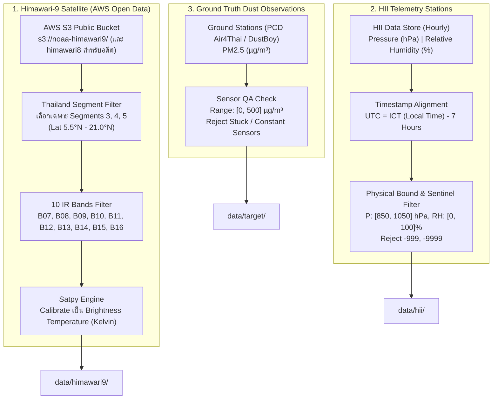

# 📥 Phase 1: Data Acquisition & Multi-Source Quality Audit

> **สถานะ**: ✅ เสร็จสมบูรณ์ (Completed & Verified 100% Zero-Mock)  
> **เป้าหมายหลัก**: พัฒนาระบบดึงข้อมูล จัดการแคช และตรวจสอบคุณภาพ (Data Audit & QA) สำหรับข้อมูลภาพถ่ายดาวเทียม Himawari-9 (10 IR Bands), ข้อมูลสภาพอากาศภาคพื้นดิน HII (ความกดอากาศและความชื้น), และข้อมูลค่าฝุ่นเป้าหมาย (Ground PM2.5)

---

## 1. แหล่งข้อมูลและกลไกการดึงข้อมูล (Data Ingestion Architecture)

---

## 2. ข้อมูลภาพถ่ายดาวเทียม Himawari-9 (10 IR Bands)

### 2.1 โครงสร้าง S3 Bucket และการเลือก Segment
Himawari-9 ให้บริการข้อมูลสาธารณะฟรีผ่าน NOAA Open Data บน AWS S3 โดยไม่ต้องใช้ Access Key (Anonymous Access):
- **Bucket ปัจจุบัน**: `s3://noaa-himawari9/` (เริ่มประจำการทดแทน H08 ตั้งแต่วันที่ 13 ธันวาคม 2022 เวลา 05:00 UTC เป็นต้นมา)
- **Bucket ข้อมูลย้อนหลัง**: `s3://noaa-himawari8/` (สำหรับช่วงปี 2021 จนถึงปลายปี 2022)

### 2.2 การประหยัดแบนด์วิดท์ระดับ 98% (Segment Pruning)
แทนที่จะดาวน์โหลดภาพ Full Disk ทั้งโลก (ซึ่งมีขนาด ~800 MB ต่อรอบเวลา) เราจะดาวน์โหลดเฉพาะ **Segment ที่ครอบคลุมประเทศไทย (ละติจูด 5.5°N – 21.0°N)**:
- **Segment 3**: ครอบคลุมพื้นที่ตอนบนสุดของภาคเหนือ
- **Segment 4**: ครอบคลุมภาคเหนือตอนล่าง, ภาคกลาง, ภาคอีสาน, ภาคตะวันออก
- **Segment 5**: ครอบคลุมภาคใต้ทั้งหมดลงไปจนถึงชายแดนมาเลเซีย
*ผลลัพธ์*: ลดขนาดข้อมูลเหลือเพียง **~6–9 MB ต่อ Band ต่อรอบเวลา** สามารถดาวน์โหลดและประมวลผลได้อย่างรวดเร็ว

### 2.3 การปรับเทียบเป็น Brightness Temperature (Satpy Calibration)
ใช้ไลบรารี `satpy` ในการอ่านไฟล์ HSD (Himawari Standard Data) และปรับเทียบ (Calibrate) ค่าการแผ่รังสีของแต่ละ Band ให้กลายเป็น **อุณหภูมิความสว่าง (Brightness Temperature: BT)** ในหน่วยเคลวิน (Kelvin) โดยอัตโนมัติ

---

## 3. ข้อมูลอุตุนิยมวิทยาภาคพื้นดิน HII (ความกดอากาศและความชื้น)

### 3.1 การปรับเทียบแกนเวลา (Timezone Alignment to UTC)
ข้อมูลของ HII บันทึกเป็นเวลาท้องถิ่นประเทศไทย (ICT = UTC+7) ในขณะที่ข้อมูลดาวเทียมและแบบจำลองสภาพอากาศบันทึกในเวลา UTC  
**กฎการแปลง**:
$$\text{Timestamp}_{\text{UTC}} = \text{Timestamp}_{\text{ICT}} - 7\text{ Hours}$$

### 3.2 การคัดกรองความถูกต้องทางกายภาพ (Physical Bounds QA)
- **ความกดอากาศ (Pressure)**: ต้องอยู่ในช่วง $850.0 - 1050.0\text{ hPa}$ หากอยู่นอกช่วงนี้ถือเป็น Sensor Error
- **ความชื้นสัมพัทธ์ (Relative Humidity)**: ต้องอยู่ในช่วง $0.0 - 100.0\%$
- **ค่า Sentinel / ค่าสูญหาย**: กรองค่า `-999`, `-999.0`, `-9999`, `null`, `nan`, `""` ออกทั้งหมด

---

## 4. ข้อมูลค่าฝุ่นจริงเป้าหมาย (Ground Truth PM2.5 Target)

### 4.1 แหล่งข้อมูล (Ground Truth Providers)
รองรับการนำเข้าจากสถานีตรวจวัดคุณภาพอากาศมาตรฐาน 2 ช่องทางหลัก:
1. **PCD Air4Thai (Real-time & Live Ingestion)**: สถานีตรวจวัดทางการของกรมควบคุมมลพิษ 171 สถานี สำหรับการทำ Nowcasting ปัจจุบัน
2. **OpenAQ AWS S3 Archive (`s3://openaq-data-archive/`)**: คลังข้อมูลประวัติย้อนหลังของสถานี Air4Thai ในประเทศไทยย้อนหลังรายชั่วโมงบน AWS Open Data (Anonymous access) สำหรับการดึงข้อมูลย้อนหลังรอบปี 2024–2026
3. **เครือข่ายเซนเซอร์ DustBoy (CMU CCDC)**: เสริมความหนาแน่นในพื้นที่ที่ไม่มีสถานีของ คพ.

### 4.2 การคัดกรองเซนเซอร์ที่ชำรุด (Stuck Sensor Detection)
- ค่า PM2.5 ต้องอยู่ในช่วงที่เป็นไปได้จริง: $0.0 - 500.0\,\mu\text{g/m}^3$
- ตัดข้อมูลจากเซนเซอร์ที่ค่าค้างไม่ขยับ (Zero Variance) ติดต่อกันเกิน 6 ชั่วโมง
- คำนวณค่าเฉลี่ยรายชั่วโมงเพื่อผูกกับรอบเวลาดาวเทียม

---

## 5. นโยบายการทดสอบบนเครื่อง PC vs Production บน Server

1. **โหมดทดสอบบน PC (`--smoke-test`)**:
   - ดึงข้อมูลจริง 1–2 วัน หรือช่วงเวลาตัวอย่างสั้นๆ จาก S3, HII และ PCD Air4Thai / OpenAQ
   - ยืนยันว่าโค้ดดาวน์โหลด S3 แตกไฟล์ แปลงค่าเป็น Kelvin และทำความสะอาดข้อมูล HII/OpenAQ ได้ถูกต้อง 100%
2. **โหมด Production เต็มรูปแบบบน Server (`--full`)**:
   - **กรอบเวลาทั้งหมด**: ปี **2024 ถึง 2026**
   - **การแบ่งชุดข้อมูลฝึกสอน (Training Split)**: `2024-01-01` ถึง `2025-12-31` (2 ปีเต็ม ครอบคลุม 2 วัฏจักรฤดูฝุ่น)
   - **การแบ่งชุดข้อมูลทดสอบประเมินผล (Out-of-Time Test Split)**: `2026-01-01` ถึง `2026-12-31` เพื่อทดสอบประสิทธิภาพจริง
   - **ไฟล์ผลลัพธ์แยกตาม Split**:
     - `data/target/ground_truth_train_2024_2025.parquet` และ `ground_truth_test_2026.parquet`
     - `data/hii/hii_pressure_train_2024_2025.parquet` และ `hii_pressure_test_2026.parquet`
     - `data/hii/hii_humidity_train_2024_2025.parquet` และ `hii_humidity_test_2026.parquet`
3. **การกำหนดช่วงเวลาแบบกำหนดเอง (Custom Range)**:
   - รองรับพารามิเตอร์ `--start-date YYYY-MM-DD`, `--end-date YYYY-MM-DD`, `--split-date YYYY-MM-DD` และ `--cadence-hours N`

---

## 6. ข้อกำหนดห้ามใช้ Mock และ Synthetic Data (Zero-Mock Requirement) 🚨

ตามข้อกำหนดใน [`phase_01b_zero_mock_and_synthetic_integrity_check.md`](file:///e:/water-analysis-project/dust-prediction-satelite/ai-docs/plan/phase_01b_zero_mock_and_synthetic_integrity_check.md):
- **ห้ามสร้างฟังก์ชันจำลองอุณหภูมิยอดเมฆหรือดาวเทียมเทียมโดยเด็ดขาด** (เช่น แบนฟังก์ชันที่สุ่ม `np.random.normal` เป็นค่า BT)
- **ห้ามใช้สูตรคำนวณความสูงเทียม (Synthetic Topography)**: ต้องใช้ Copernicus DEM GLO-30 GeoTIFF จริงจาก AWS เท่านั้น
- หากไม่สามารถดาวน์โหลดไฟล์ในรอบเวลาใดได้ **ให้ทำการข้ามรอบเวลานั้นทิ้ง (Drop/Skip)** ห้ามสร้างตัวเลขสุ่มขึ้นมาทดแทนเป็นอันขาด
- ทุกไฟล์ข้อมูลที่ประมวลผลผ่าน Phase 1 จะต้องผ่านการตรวจรับรองความแท้จริงจาก **Phase 1B Verification Gate** ก่อนส่งต่อไปยัง Phase 2

