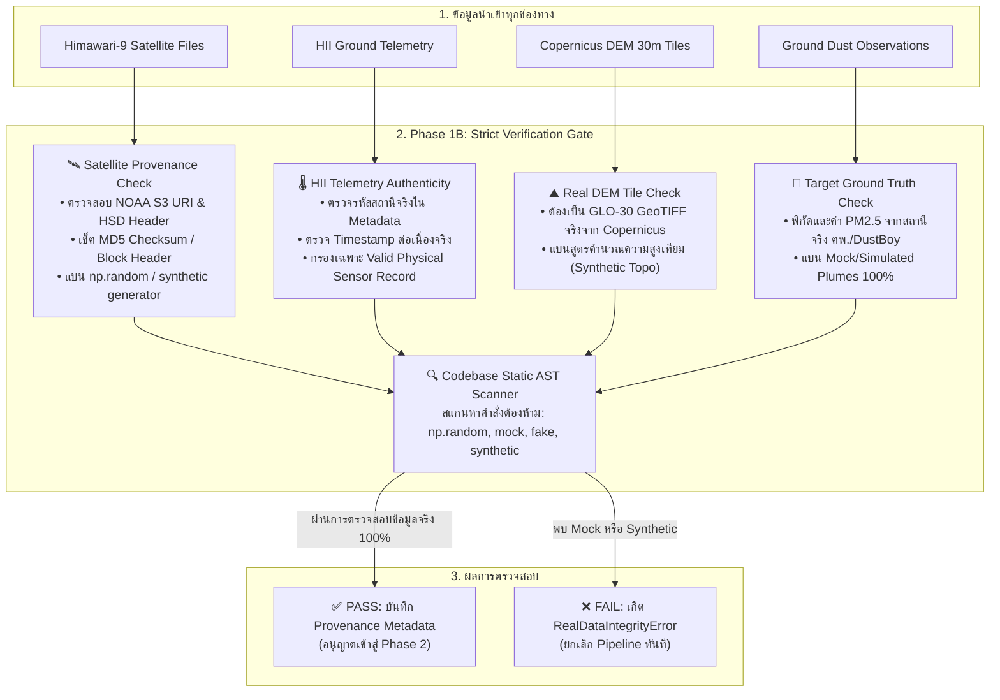

# 🛡️ Phase 1B: Real Data Integrity & Strict Zero-Mock / Zero-Synthetic Verification Gate

> **สถานะ**: ✅ เสร็จสมบูรณ์ (Completed & Verified 100% Zero-Mock Gate Passed)  
> **กฎเหล็กเด็ดขาด (Absolute Non-Negotiable Invariant)**: **ห้ามใช้ Mock Data, ห้ามใช้ข้อมูลจำลอง (Synthetic Simulation), และห้ามใช้สูตรสุ่มตัวเลข (`np.random`) ในการสร้างข้อมูลดาวเทียม ข้อมูลสภาพอากาศ ภูมิประเทศ หรือค่าฝุ่นโดยเด็ดขาด 100%!**  
> ข้อมูลทุกแถวและทุกพิกเซลที่ไหลเข้าสู่ Pipeline จะต้องมาจาก **การตรวจวัดจริงทางกายภาพ (Authentic Physical Observations)** เท่านั้น

---

## 1. วัตถุประสงค์ของ Phase Check นี้ (Why Strict Zero-Mock is Mandatory)

ในงานวิจัยและระบบพยากรณ์อุตุนิยมวิทยา/มลพิษทางอากาศ การใช้ข้อมูลจำลอง (Synthetic/Mock Data) เช่น การสุ่มตัวเลขแบบ Normal Distribution หรือการใช้ฟังก์ชันไซน์/โคไซน์สร้างความสูงและอุณหภูมิยอดเมฆ จะทำให้:
1. **โมเดลเรียนรู้ฟิสิกส์ปลอม (Spurious Correlations)** ที่ไม่มีอยู่จริงในธรรมชาติ
2. **ประเมินผลลัพธ์ลวงตา (False Benchmark)** โมเดลดูเหมือนแม่นยำบนข้อมูลจำลอง แต่พังทลายทันทีเมื่อนำไปใช้งานจริง
3. **ขาดความน่าเชื่อถือทางวิทยาศาสตร์ (Scientific Disqualification)**

ดังนั้น Phase 1B จึงถูกตั้งขึ้นเป็น **"ประตูกักกันและตรวจสอบความแท้จริงของข้อมูล (Verification Gate)"** ก่อนที่จะอนุญาตให้ข้อมูลใดๆ ผ่านเข้าสู่ Phase 2 และ Phase 3 ได้

---

## 2. แผนผังประตูกักกันและตรวจสอบข้อมูลจริง (Zero-Mock Verification Gate)



---

## 3. เกณฑ์การตรวจสอบความแท้จริงแยกตามประเภทข้อมูล (Data Provenance Criteria)

### 3.1 ข้อมูลภาพถ่ายดาวเทียม Himawari-9 (10 IR Bands)
* **แหล่งข้อมูลแท้จริง**: NOAA Open Data บน AWS S3 (`s3://noaa-himawari9/` หรือ `s3://noaa-himawari8/`)
* **เกณฑ์การตรวจสอบ (Verification Rules)**:
  1. ไฟล์ต้องมีโครงสร้าง HSD (Himawari Standard Data) หรือ NetCDF ของแท้ พร้อม Binary Header ที่ระบุ Satellite ID (`H09` หรือ `H08`), Observation Time, Segment Number (3, 4, 5)
  2. ค่า Brightness Temperature ต้องมาจากการ Calibrate รังสีผ่าน `satpy` จากข้อมูลไฟล์จริง
  3. **ข้อห้ามเด็ดขาด**:
     - ❌ **ห้ามใช้ฟังก์ชันจำลองเมฆหรืออุณหภูมิ** เช่น การสุ่มค่า $BT \sim \mathcal{N}(295, 1.5)$ หรือการจำลองค่า Water Vapor
     - ❌ หากดาวน์โหลดไฟล์ดาวเทียมไม่สำเร็จหรือไม่มีไฟล์ในรอบเวลานั้น **ให้ข้ามรอบเวลานั้นทิ้ง (Skip / Drop) ห้ามสุ่มค่า Mock ขึ้นมาแทนเด็ดขาด!**

### 3.2 ข้อมูลความกดอากาศและความชื้นภาคพื้นดิน (HII Telemetry)
* **แหล่งข้อมูลแท้จริง**: ฐานข้อมูลโทรมาตรของสถาบันสารสนเทศทรัพยากรน้ำ (HII)
* **เกณฑ์การตรวจสอบ (Verification Rules)**:
  1. รหัสสถานี (`station_code`) ต้องตรงกับ Master Metadata ของสถานีที่มีตัวตนจริงในประเทศไทย
  2. พิกัดละติจูด/ลองจิจูดของสถานีต้องเป็นพิกัดจริงของสถานีตรวจวัด ไม่ใช่พิกัดสมมุติ
  3. ข้อมูลต้องเป็นตัวเลขที่อ่านได้จากไฟล์ดิบจริงของ HII
  4. **ข้อห้ามเด็ดขาด**:
     - ❌ **ห้ามสร้างสถานีจำลอง (Fake Station)**
     - ❌ หากสถานีใดข้อมูลขาดหายในชั่วโมงนั้น ให้ระบุเป็น `NaN` และใช้ระบบตัดสถานีขาดออก ห้ามเติมค่าด้วยตัวเลขสุ่ม

### 3.3 ข้อมูลความสูงและภูมิประเทศ (Topography & DEM)
* **แหล่งข้อมูลแท้จริง**: **Copernicus DEM GLO-30 (ความละเอียด 30 เมตร)** จาก AWS Open Data (`s3://copernicus-dem-30m/`)
* **เกณฑ์การตรวจสอบ (Verification Rules)**:
  1. ค่าความสูง (`elevation_m`), ความลาดชัน (`slope_deg`), และทิศทางลาดชัน (`aspect`) ต้องถูกสกัดจากไฟล์ GeoTIFF จริงของ Copernicus DEM เท่านั้น
  2. **ข้อห้ามเด็ดขาด**:
     - ❌ **แบนฟังก์ชัน `estimate_synthetic_topography` โดยเด็ดขาด 100%!** (ห้ามใช้สูตรคณิตศาสตร์จำลองเทือกเขาหรือที่ราบ เช่น ห้ามใช้ $lat \times 200$ หรือฟังก์ชัน $\sin/\cos$ จำลองความสูง)
     - ❌ หากไฟล์ DEM ไทล์ใดยังไม่ได้ดาวน์โหลด ให้ดาวน์โหลดไทล์จริงจาก Copernicus S3 ห้ามเดาค่าความสูง

### 3.4 ข้อมูลค่าฝุ่นเป้าหมาย (Ground PM2.5 Target)
* **แหล่งข้อมูลแท้จริง**: สถานีตรวจวัดคุณภาพอากาศของกรมควบคุมมลพิษ (PCD / Air4Thai) และเครือข่าย DustBoy
* **เกณฑ์การตรวจสอบ (Verification Rules)**:
  1. ต้องเป็นค่าจริงที่บันทึกโดยเครื่องวัดฝุ่นทางกายภาพ (Beta Attenuation Monitor / Light Scattering Sensor)
  2. มีการตรวจสอบ Timestamp และพิกัดสถานีจริง
  3. **ข้อห้ามเด็ดขาด**:
     - ❌ **ห้ามสร้างค่าฝุ่นสุ่ม (Synthetic PM2.5)**
     - ❌ ห้ามสร้างแบบจำลองการแพร่กระจายฝุ่นแบบหลอกๆ (Simulated Gaussian Plume) มาเป็น Target

---

## 4. กลไกตรวจสอบระดับโค้ดอัตโนมัติ (Automated Code & Data Audit Engine)

เราจะสร้างโมดูลตรวจสอบความถูกต้อง `src/data/provenance_auditor.py` เพื่อทำหน้าที่:

### 4.1 Static Code AST Scanner (สแกนโค้ดหาคำสั่งต้องห้าม)
ก่อนรัน Pipeline สคริปต์จะสแกนโค้ดทั้งหมดใน `src/`:
- หากพบการใช้งานคำสั่ง:
  - `np.random.normal`, `np.random.uniform`, `np.random.rand`
  - `random.random`, `random.choice`
  - คีย์เวิร์ด `mock`, `synthetic`, `simulate`, `fake`, `dummy`
  ในโมดูลการประมวลผลข้อมูลหรือฟีเจอร์ $\rightarrow$ **ระบบจะสั่งหยุดทำงานทันที (Raise `ForbiddenSyntheticDataError`)**

### 4.2 Data Origin Fingerprinting & Checksum
- ทุกไฟล์ Parquet ที่ถูกเซฟใน `data/features/` จะต้องมี Metadata บันทึกที่มาของข้อมูล (Provenance Tracker):
  ```json
  {
    "provenance_status": "VERIFIED_REAL_OBSERVATION",
    "himawari_s3_bucket": "noaa-himawari9",
    "dem_source": "Copernicus_GLO_30_AWS_OpenData",
    "hii_source": "HII_Official_Telemetry",
    "is_synthetic": false,
    "audit_timestamp": "2026-10-12T03:22:00Z"
  }
  ```
- หากค่า `is_synthetic != false` หรือไม่พบไฟล์หลักฐานของ S3/HII โมเดลใน Phase 4 จะปฏิเสธการเทรนทันที

---

## 5. สรุปบทบัญญัติการดำเนินงาน

1. **โหมดทดสอบบน PC (`--sample` / `--smoke-test`)**:
   - ให้ใช้ข้อมูลจริง **แต่ลดขนาดวันหรือพื้นที่ให้สั้นลง** (เช่น ดึงข้อมูลจริงของวันที่ 1 มกราคม 2024 เพียง 1 รอบเวลา เพื่อทดสอบ Pipeline) **ห้ามแก้ปัญหาด้วยการสร้าง Mock Data มาทดสอบเป็นอันขาด!**
2. **หากข้อมูลไม่ครบ**:
   - ใช้วิธีทางวิทยาศาสตร์ที่ถูกต้อง: กรองรอบเวลาที่ข้อมูลไม่สมบูรณ์ทิ้ง (Drop/Mask) ไม่แต่งเติมข้อมูลเทียม
