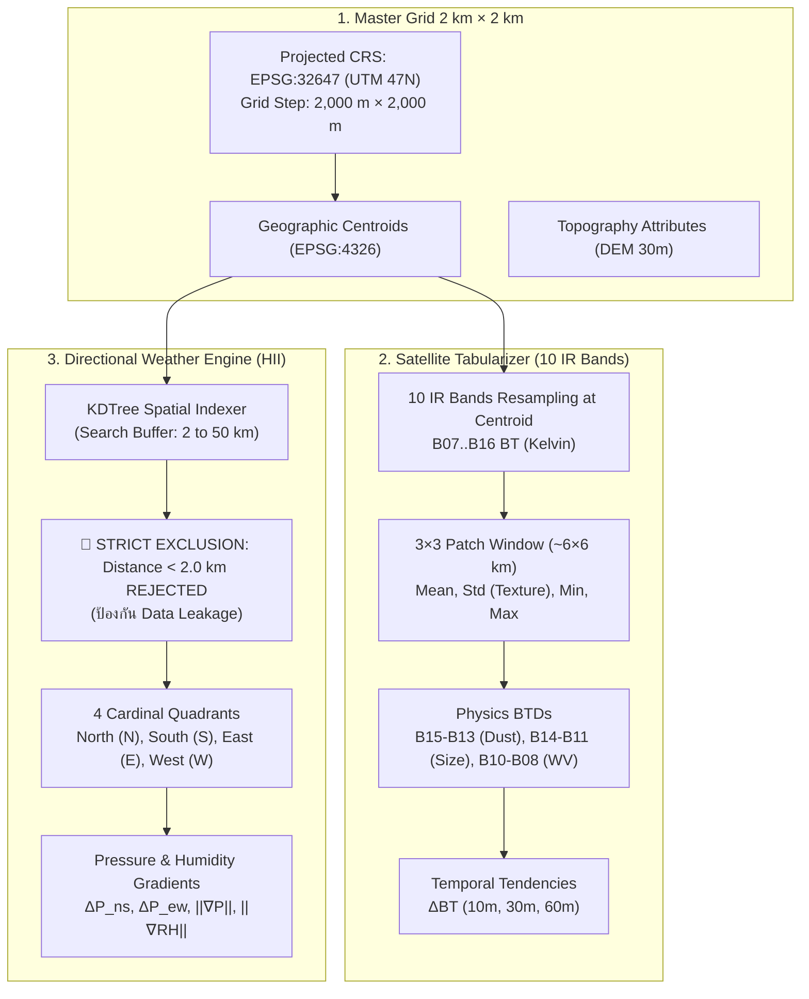

# 🗺️ Phase 2: Spatial Grid & Feature Engineering

> **สถานะ**: ✅ พัฒนาและผ่านการทดสอบสมบูรณ์ (Implemented & Verified 100%)  
> **เป้าหมายหลัก**: พัฒนาระบบแปลงภาพถ่ายดาวเทียมราสเตอร์ 10 IR Bands ให้เป็นตารางฟีเจอร์ตัวเลข (Satellite Tabularization) และสร้างโมดูลคำนวณความกดอากาศ 4 ทิศทาง (Directional Atmospheric Pressure) บนกริดแม่แบบ 2 km × 2 km โดยบังคับใช้กฎตัดข้อมูลในกริด (< 2 km) อย่างเด็ดขาด

---

## 1. ผังการทำงานของ Phase 2 (Feature Engineering Workflow)



---

## 2. กรอบการทดลอง Multi-Resolution Grids (3×3 km, 2×2 km, 1×1 km, 500m×500m) และการสกัด DEM 30m จริง

> 🚨 **การทดลองเปรียบเทียบขนาดกริดเชิงพื้นที่**: เพื่อตอบคำถามวิจัยว่า **"ความละเอียดเชิงพื้นที่ระดับใดให้ความแม่นยำสูงสุดในการทำนายฝุ่น PM2.5 โดยคุ้มค่าต่อเวลาและหน่วยความจำที่สุด"** ระบบจะสร้าง Grid และ Feature Pipeline ที่รองรับพารามิเตอร์ `step_meters` ทั้ง 4 ระดับ:

| ระดับความละเอียด (Grid Step) | จำนวนเซลล์ทั่วประเทศ (โดยประมาณ) | จำนวนพิกเซล DEM 30m จริงต่อเซลล์ | รัศมีตัดสถานีประชิด (Exclusion Buffer) | บทบาทในการทดลอง Benchmark |
| :---: | :---: | :---: | :---: | :--- |
| **3 km × 3 km** (`3000m`) | ~58,000 เซลล์ | $100 \times 100 \approx \mathbf{10,000}$ พิกเซล | $d < 3.0\text{ km}$ | **Coarse/Synoptic Scale**: มองภาพรวมลมมรสุมและการแผ่ของลิ่มความกดอากาศ |
| **2 km × 2 km** (`2000m`) | ~130,000 เซลล์ | $67 \times 67 \approx \mathbf{4,489}$ พิกเซล | $d < 2.0\text{ km}$ | **Satellite Native Baseline**: สอดคล้องกับ Native IR พิกเซลของ Himawari-9 พอดี 1:1 |
| **1 km × 1 km** (`1000m`) | ~520,000 เซลล์ | $33 \times 33 \approx \mathbf{1,111}$ พิกเซล | $d < 1.0\text{ km}$ | **Topographic Downscaling (Sweet Spot)**: สกัดร่องเขาแอ่งกระทะได้คมชัดสูง |
| **500 m × 500 m** (`500m`) | ~2,050,000 เซลล์ | $17 \times 17 \approx \mathbf{278}$ พิกเซล | $d < 0.5\text{ km}$ | **Ultra-High Micro Scale**: ทดสอบขีดจำกัดความแม่นยำและการกินทรัพยากร |

```
       ◄────────────── ขนาดกริดตาม Step Meters (3km, 2km, 1km, 500m) ──────────────►
   ▲  ┌───┬───┬───┬───┬───┬───┬───┬───┬───┬───┬───┬───┬───┬───┬───┬───┐
   │  │30m│30m│30m│30m│   │   │   │   │   │   │   │   │   │   │   │   │
   │  ├───┼───┼───┼───┼───┼───┼───┼───┼───┼───┼───┼───┼───┼───┼───┼───┤
 Step │   │   │   │ Z[i,j] = เมทริกซ์ความสูงจริงจาก Copernicus DEM 30m │   │
Meters│   │   │   │ (ดึงพิกเซลจริง 278 ถึง 10,000 จุด ขึ้นกับขนาดกริด) │   │
   │  ├───┼───┼───┼───┼───┼───┼───┼───┼───┼───┼───┼───┼───┼───┼───┼───┤
   ▼  └───┴───┴───┴───┴───┴───┴───┴───┴───┴───┴───┴───┴───┴───┴───┴───┘
```

### 2.1 ขั้นตอนการเปิด Raster Window บนไฟล์ GeoTIFF จริง (30m Resolution)
สำหรับแต่ละเซลล์กริดที่มีจุดกึ่งกลาง $(x_0, y_0)$ ในพิกัด UTM Zone 47N (`EPSG:32647`) และรัศมีครึ่งเซลล์ $R = \text{step\_meters} / 2$:
1. **คำนวณขอบเขต Bounding Box**:
   $$x_{\min} = x_0 - R,\quad x_{\max} = x_0 + R$$
   $$y_{\min} = y_0 - R,\quad y_{\max} = y_0 + R$$
2. **แปลงเป็นพิกัดแถว/คอลัมน์ของภาพ (Row/Col Indexing)**:
   ใช้ฟังก์ชัน `rasterio.windows.from_bounds()` สกัดชิ้นส่วนภาพ (Raster Patch) ขนาดกว้าง $\approx 67$ คอลัมน์ และสูง $\approx 67$ แถว
3. **โหลดเมทริกซ์ความสูงจริง**:
   $$Z \in \mathbb{R}^{H \times W}\quad (H \approx 67,\, W \approx 67,\, N = H \times W \approx 4,489\text{ จุด})$$
   คัดกรองพิกเซลที่สมบูรณ์ (ตัด NoData ค่าติดลบผิดปกติ เช่น $Z < -100\text{ m}$ หรือ $Z > 9000\text{ m}$) ให้เหลือเฉพาะเซตของความสูงที่ถูกต้อง: $Z_{\text{valid}}$

---

### 2.2 สูตรคำนวณฟีเจอร์แต่ละตัวจากพิกเซล 30m จริงนับพันจุด

#### 1) `elevation_m` (ความสูงเฉลี่ยระดับเซลล์ 2 km)
คำนวณค่าเฉลี่ยเลขคณิตจากพิกเซล 30m ทั้งหมดในกรอบ:
$$\text{elevation\_m} = \frac{1}{|Z_{\text{valid}}|} \sum_{p \in Z_{\text{valid}}} Z_p$$
*(สะท้อนระดับความสูงเฉลี่ยของภูมิประเทศทั้งบล็อก 2 km ไม่ใช่แค่จุดใดจุดหนึ่ง)*

#### 2) `elevation_std` (ความขรุขระของภูมิประเทศ / Terrain Roughness)
คำนวณส่วนเบี่ยงเบนมาตรฐาน (Standard Deviation) จากพิกเซล 30m ทั้งหมดในบล็อก:
$$\text{elevation\_std} = \sqrt{\frac{1}{|Z_{\text{valid}}| - 1} \sum_{p \in Z_{\text{valid}}} \left(Z_p - \text{elevation\_m}\right)^2}$$
*(หากเป็นที่ราบลุ่มเจ้าพระยา $\text{std} \approx 1 - 5\text{ m}$ หากเป็นเทือกเขาสลับซับซ้อนในเชียงใหม่/แม่ฮ่องสอน $\text{std} \approx 80 - 250\text{ m}$ ซึ่งชี้วัดความฝืดต้านกระแสลมพื้นผิวได้อย่างแม่นยำ)*

#### 3) `relief_m` (ความต่างระดับความสูงสูงสุด-ต่ำสุด / Topographic Relief)
คำนวณช่วงความต่างของความสูงในกรอบ 2 km:
$$\text{relief\_m} = \max(Z_{\text{valid}}) - \min(Z_{\text{valid}})$$
*(ชี้วัดว่าภายในกริด 2 km มีหน้าผาหรือความชันแบบก้าวกระโดดหรือไม่)*

#### 4) `slope_deg` (ความลาดชันเฉลี่ยของภูมิประเทศ)
*ขั้นตอนการคำนวณที่ความละเอียด 30m ดั้งเดิม*:
1. คำนวณ Spatial Gradient $2\text{D}$ บนเมทริกซ์ $Z$ ที่ระยะกริด $\Delta x = \Delta y = 30.0\text{ m}$:
   $$g_x(i,j) = \frac{\partial Z}{\partial x} \approx \frac{Z_{i, j+1} - Z_{i, j-1}}{2 \times 30},\quad g_y(i,j) = \frac{\partial Z}{\partial y} \approx \frac{Z_{i+1, j} - Z_{i-1, j}}{2 \times 30}$$
2. คำนวณความลาดชันแต่ละพิกเซล $30\text{m}$:
   $$\text{slope}_{i,j} = \arctan\left(\sqrt{g_x(i,j)^2 + g_y(i,j)^2}\right) \times \frac{180^\circ}{\pi}$$
3. หาค่าเฉลี่ยความลาดชันทั่วทั้งกริด $2\text{ km}$:
   $$\text{slope\_deg} = \frac{1}{N} \sum_{i,j} \text{slope}_{i,j}$$

#### 5) `aspect_sin` และ `aspect_cos` (การเฉลี่ยเวกเตอร์ทิศทางลาดชัน)
*ปัญหาคณิตศาสตร์*: ทิศทางเข็มทิศ ($0^\circ - 360^\circ$) เป็นมุมวงกลม หากนำมุม $359^\circ$ (เหนือค่อนไปทางตะวันตก) กับ $1^\circ$ (เหนือค่อนไปทางตะวันออก) มาเฉลี่ยตรงๆ จะได้ $\frac{359+1}{2} = 180^\circ$ (ทิศใต้!) ซึ่งผิดหลักการ  
*วิธีคำนวณเวกเตอร์ที่ถูกต้อง*:
1. คำนวณมุมทิศทางลาดชันของแต่ละพิกเซล 30m:
   $$\theta_{i,j} = \text{atan2}(-g_x(i,j),\, g_y(i,j)) \pmod{2\pi}$$
2. แตกเป็นเวกเตอร์ Sine และ Cosine ระดับพิกเซล 30m:
   $$u_{i,j} = \sin(\theta_{i,j}),\quad v_{i,j} = \cos(\theta_{i,j})$$
3. เฉลี่ยเวกเตอร์ทั้งหมดในบล็อก $2\text{ km}$:
   $$\text{aspect\_sin} = \frac{1}{N} \sum_{i,j} u_{i,j},\quad \text{aspect\_cos} = \frac{1}{N} \sum_{i,j} v_{i,j}$$
*(ค่าที่ได้จะบอกทิศรับลมมรสุมหรือทิศอับลมอย่างถูกต้อง 100%)*

#### 6) `tpi_index` (Topographic Position Index - ดัชนีแอ่งกระทะหุบเขา)
*ขั้นตอนการคำนวณ*:
1. ขยายหน้าต่าง Raster Window ออกไปในรัศมีรอบข้าง $R = 6\text{ km}$ (ขนาดหน้าต่าง $\approx 201 \times 201$ พิกเซลของ DEM 30m หรือพื้นที่ $\approx 12\text{ km} \times 12\text{ km}$)
2. คำนวณค่าเฉลี่ยความสูงของภูมิประเทศในรัศมีวงกว้าง 6 km:
   $$\bar{Z}_{6\text{km}} = \frac{1}{N_{6\text{km}}} \sum_{p \in \text{Window}_{6\text{km}}} Z_p$$
3. คำนวณดัชนี $TPI$:
   $$\text{tpi\_index} = \text{elevation\_m} - \bar{Z}_{6\text{km}}$$
* **การตีความทางฟิสิกส์**:
  - $TPI < -25\text{ m}$: **ก้นหุบเขา / แอ่งกระทะ (Basin Bottom)** $\rightarrow$ อากาศเย็นไหลลงมากักเก็บฝุ่น เกิด Inversion Layer
  - $-15\text{ m} \le TPI \le +15\text{ m}$: **ที่ราบเปิดกว้าง (Open Flat Plains)**
  - $TPI > +25\text{ m}$: **สันเขา / ยอดดอย (Ridge Crest)** $\rightarrow$ ลมพัดระบายฝุ่นได้ดี

#### 7) `dist_coast_km` และ `coriolis_param`
- `dist_coast_km`: คำนวณระยะทางเรขาคณิต Euclidean สั้นที่สุดจากกึ่งกลางกริดไปยังเส้นแนวชายฝั่งทะเลอ่าวไทย/อันดามัน (กม.)
- `coriolis_param`: $f = 2\Omega\sin(\phi)$ โดย $\Omega = 7.2921159 \times 10^{-5}\text{ rad/s}$ และ $\phi$ คือละติจูด (Radian)

---

## 3. กลไกความกดอากาศ 4 ทิศทางและกฎตัดข้อมูลในกริด (Directional Pressure Engine)

### 3.1 กฎการตัดทิ้งสถานีระยะประชิด (Strict Proximity Exclusion $< 2.0\text{ km}$)
เพื่อป้องกันปัญหาที่โมเดลจดจำข้อมูลจากสถานีในกริดตัวเอง (Memorization / Shortcut Learning):
- คำนวณระยะห่าง Euclidean ระหว่างกึ่งกลางกริด $(x_0, y_0)$ กับสถานี $(x_i, y_i)$
- **หากระยะทาง $d_i < 2.0\text{ km}$ จะต้องตัดทิ้งทันที**
- สถานีที่นำมาใช้ต้องอยู่ในระยะ $2.0\text{ km} \le d_i \le 50.0\text{ km}$

### 3.2 การแบ่งพื้นที่ออกเป็น 4 ทิศ (4 Cardinal Quadrants)
กำหนดเวกเตอร์การกระจัด $\Delta x = x_i - x_0$ และ $\Delta y = y_i - y_0$:
1. **ทิศเหนือ (North - N)**: $\Delta y > 0$ และ $|\Delta y| \ge |\Delta x|$  
   $\rightarrow$ คำนวณ $P_{\text{north}}$ ด้วยวิธี Inverse Distance Weighting (IDW)
2. **ทิศใต้ (South - S)**: $\Delta y < 0$ และ $|\Delta y| \ge |\Delta x|$  
   $\rightarrow$ คำนวณ $P_{\text{south}}$
3. **ทิศตะวันออก (East - E)**: $\Delta x > 0$ และ $|\Delta x| > |\Delta y|$  
   $\rightarrow$ คำนวณ $P_{\text{east}}$
4. **ทิศตะวันตก (West - W)**: $\Delta x < 0$ และ $|\Delta x| > |\Delta y|$  
   $\rightarrow$ คำนวณ $P_{\text{west}}$

### 3.3 การคำนวณเวกเตอร์ความชัน (Atmospheric Gradients)
- **ความต่างเหนือ-ใต้ ($\Delta P_{ns}$)**: $P_{\text{north}} - P_{\text{south}}$ (ชี้วัดแรงกดมวลอากาศเย็นจากจีน)
- **ความต่างตะวันออก-ตะวันตก ($\Delta P_{ew}$)**: $P_{\text{east}} - P_{\text{west}}$
- **ขนาดของเกรเดียนต์ ($\|\nabla P\|$)**:
  $$\frac{\partial P}{\partial x} \approx \frac{\Delta P_{ew}}{\Delta x},\quad \frac{\partial P}{\partial y} \approx \frac{\Delta P_{ns}}{\Delta y}$$
  $$\|\nabla P\| = \sqrt{\left(\frac{\partial P}{\partial x}\right)^2 + \left(\frac{\partial P}{\partial y}\right)^2} \times 100\quad (\text{hPa / 100 km})$$
- **ความหมายทางอุตุนิยมวิทยา**:
  - เมื่อ $\|\nabla P\| \approx 0$: แสดงถึง **"สภาวะลมสงบ / อากาศปิดสนิท"** ฝุ่นและควันจะสะสมตัวหนาแน่นที่สุด
  - เมื่อ $\|\nabla P\| \gg 0$: แสดงว่ามีความกดอากาศแตกต่างกันมาก เกิดลมพัดระบายฝุ่นออกจากพื้นที่

---

## 4. การแปลงภาพดาวเทียม 10 Bands ให้เป็นตัวเลข (Satellite Tabularizer)

### 4.1 การดึงค่า Brightness Temperature (BT) ณ กึ่งกลางกริด
- นำพิกัดกึ่งกลางกริด $(Lat, Lon)$ ดึงค่า BT จากภาพดาวเทียม 10 IR Bands (B07 ถึง B16)
- บันทึกเป็นตัวเลขทศนิยม 10 ค่า: `bt_b07, bt_b08, ..., bt_b16`

### 4.2 การสกัดเนื้อสัมผัสเชิงพื้นที่ (Spatial 3×3 Texture)
สำหรับ Band 13 (Clean IR) และ Band 15 (Dirty IR):
- กำหนดหน้าต่าง $3 \times 3$ พิกเซลรอบจุดกึ่งกลาง
- คำนวณ:
  - `b13_mean_3x3`, `b13_std_3x3`, `b13_min_3x3`, `b13_max_3x3`
  - `b15_mean_3x3`, `b15_std_3x3`
- *การจำแนก*: กลุ่มฝุ่นละอองที่แผ่คลุมกว้างจะมีค่า `std` ต่ำมาก (< 1.2 K) ส่วนเมฆน้ำจะมีค่า `std` สูงมาก (> 3.0 K)

### 4.3 การคำนวณ Physics-Informed BTDs
- **$BTD_{15-13} = BT_{B15} - BT_{B13}$**: ดัชนีตรวจจับฝุ่นซิลิเกต/แอโรซอลตามเกณฑ์ WMO (ค่าจะติดลบเมื่อมีฝุ่นหนาทึบ)
- **$BTD_{14-11} = BT_{B14} - BT_{B11}$**: ชี้วัดขนาดอนุภาค (Particle Size & Optical Depth)
- **$BTD_{13-07} = BT_{B13} - BT_{B07}$**: วัดความต่างอุณหภูมิชั้นหมอกควันกับผิวโลก
- **$BTD_{10-08} = BT_{B10} - BT_{B08}$**: ตรวจสอบการผกผันของอุณหภูมิในชั้นบรรยากาศ (Inversion Layer)

### 4.4 การคำนวณการเปลี่ยนแปลงตามเวลา (Temporal Tendencies)
ดึงภาพดาวเทียมย้อนหลัง:
- $\Delta BT_{13}(10\text{m}) = BT_{13}(t) - BT_{13}(t - 10\text{m})$
- $\Delta BT_{13}(30\text{m}) = BT_{13}(t) - BT_{13}(t - 30\text{m})$
- $\Delta BTD_{15-13}(30\text{m}) = BTD_{15-13}(t) - BTD_{15-13}(t - 30\text{m})$ (แสดงอัตราการสะสมตัวของฝุ่น)
