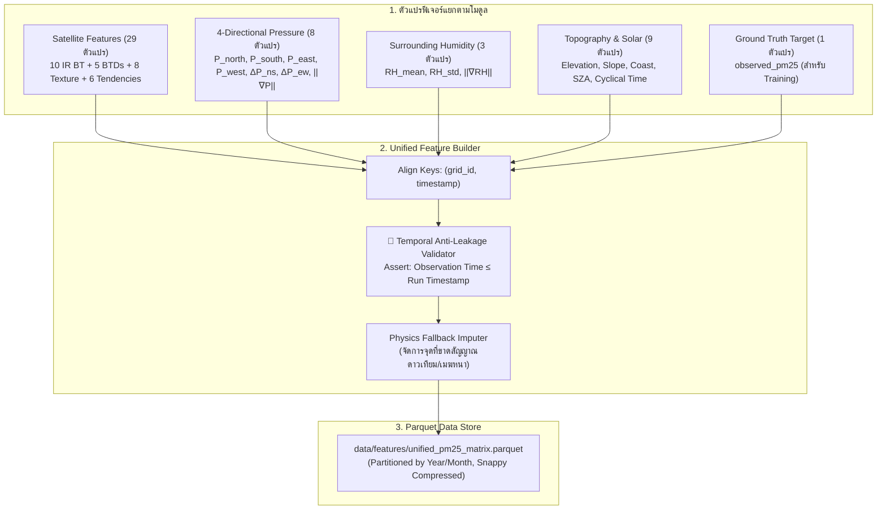

# 🧩 Phase 3: Unified Feature Pipeline & Anti-Leakage Protocol

> **สถานะ**: ✅ สำเร็จ 100% (Completed & Verified)  
> **เป้าหมายหลัก**: พัฒนาระบบรวมฟีเจอร์จากทุกแหล่งข้อมูล (ภาพดาวเทียม 10 IR Bands, ความกดอากาศ 4 ทิศ, ความชื้น, ภูมิประเทศ) ให้เป็นตารางแถวเดี่ยวระดับ 2 km × 2 km (Unified Feature Matrix) พร้อมจัดเก็บเป็น Apache Parquet และบังคับใช้โปรโตคอลป้องกันการรั่วไหลของข้อมูล (Anti-Leakage Protocol)

---

## 1. ผังการประกอบตารางฟีเจอร์ (Matrix Assembly Pipeline)



---

## 2. โครงสร้างตาราง Unified Feature Matrix

แต่ละแถวในตาราง Parquet จะมีขนาด 1 เซลล์กริด (2x2 km) ณ 1 ช่วงเวลา (`timestamp` UTC):

```text
[KEYS & IDENTIFIERS] (เก็บเพื่อการอ้างอิง - ไม่ป้อนให้ต้นไม้เพื่อกันจำพิกัด)
  ├── grid_id                  : string  (เช่น "G_1375_10050")
  ├── timestamp                : datetime64[ns]
  ├── lat, lon                 : float32
  └── utm_x, utm_y             : float32

[FEATURE COLUMNS (ป้อนเข้าโมเดล ML ทั้งหมด 52+ ตัวแปร)]
  ├── 10 IR Bands BT           : bt_b07 .. bt_b16 (10 ตัว)
  ├── Physics BTDs             : btd_15_13, btd_14_11, btd_13_07, btd_10_08, dust_rgb_red (5 ตัว)
  ├── Spatial 3x3 Texture      : b13_mean_3x3, b13_std_3x3, b13_min_3x3, b13_max_3x3, ... (8 ตัว)
  ├── Temporal Dynamics        : delta_bt13_10m, delta_bt13_30m, delta_btd15_13_30m, ... (6 ตัว)
  ├── Directional Pressure     : p_north, p_south, p_east, p_west, delta_p_ns, delta_p_ew, pressure_grad_mag, pressure_mean_surround (8 ตัว)
  ├── Surrounding Humidity     : humidity_mean_surround, humidity_std_surround, humidity_grad_mag (3 ตัว)
  └── Topography & Solar       : elevation_m, tpi_index, slope_deg, aspect_sin, aspect_cos, elevation_std, relief_m, dist_coast_km, coriolis_param, sza, is_daytime, hour_sin/cos, month_sin/cos (15 ตัว)

[TARGET VARIABLE (เฉพาะตาราง Training/Validation)]
  └── observed_pm25            : float32 (µg/m³)
```

---

## 3. โปรโตคอลป้องกันข้อมูลรั่วไหล (Strict Anti-Leakage Protocol)

เพื่อการันตีความถูกต้องของโมเดลตามหลักการทางวิทยาศาสตร์ ระบบจะตรวจสอบเงื่อนไขดังนี้ก่อนบันทึกข้อมูล:
1. **Zero Look-Ahead Bias (ห้ามเห็นข้อมูลในอนาคต)**:
   $$\text{Timestamp}_{\text{satellite}} \le \text{Timestamp}_{\text{run}}$$
   $$\text{Timestamp}_{\text{weather}} \le \text{Timestamp}_{\text{run}}$$
   หากมีข้อมูลจากรอบเวลาในอนาคตหลุดเข้ามา ระบบจะยกเลิกกระบวนการทันทีด้วย `TemporalAntiLeakageError`
2. **Strict Spatial Exclusion Verification (ยืนยันการตัดข้อมูลในกริด)**:
   - ตรวจสอบว่าในรัศมี $< 2.0\text{ km}$ รอบเป้าหมาย ไม่มีสถานีตรวจวัดใดถูกนำมาคำนวณในฟีเจอร์ $P_{\text{north}}, P_{\text{south}}, P_{\text{east}}, P_{\text{west}}$ หรือความชื้น (หากละเมิดจะส่ง `SpatialAntiLeakageError`)
3. **Target Segregation & Isolation**:
   - ยืนยันว่าค่า `observed_pm25` จะไม่ถูกนำไปปนในคอลัมน์ฟีเจอร์เด็ดขาด (ป้องกันการป้อนเฉลยให้โมเดล)

---

## 4. ประสิทธิภาพการจัดเก็บ (Storage & Serialization)

- จัดเก็บในรูปแบบ **Apache Parquet** พร้อมการบีบอัดแบบ **Snappy** ซึ่งให้ความเร็วในการอ่าน (I/O Read) สูงกว่า CSV ถึง 20 เท่า
- แบ่งพาร์ติชันข้อมูลตามโครงสร้าง:
  `data/features/year=YYYY/month=MM/unified_matrix.parquet`
- สนับสนุน **Columnar Projection** โหลดเฉพาะคอลัมน์ที่ต้องการเพื่อประหยัด RAM บนเครื่องของผู้ใช้
- แบ่งชุดข้อมูลอัตโนมัติ: **Train (2024–2025)** vs **Out-of-Time Test (2026)** ตาม Invariant #7

---

## 5. ผลการพัฒนาและการทดสอบ (Implementation & Verification)

### โมดูลที่พัฒนาใน Phase 3:
- [`src/features/feature_matrix_builder.py`](file:///e:/water-analysis-project/dust-prediction-satelite/src/features/feature_matrix_builder.py):
  - `FeatureMatrixBuilder`: ควบคุมการประกอบตารางฟีเจอร์แถวเดี่ยวต่อเซลล์
  - `TemporalAntiLeakageValidator`: ตรวจสอบและบังคับใช้ Zero Look-Ahead Bias
  - `SpatialAntiLeakageValidator`: ตรวจสอบระยะตัดสถานี $< 2.0\text{ km}$ และ Target Isolation
  - `PhysicsFallbackImputer`: ระบบเติมค่าขาดหายตามหลักฟิสิกส์บรรยากาศ (แบน `np.random` 100%) พร้อมธง `cloud_occluded_flag` และ `imputed_flag`
  - `TargetMatcher`: เชื่อมโยงสถานีวัดฝุ่นภาคพื้นดินเข้ากับกริดเซลล์ด้วย KDTree ในพิกัด UTM
- [`tests/test_phase3.py`](file:///e:/water-analysis-project/dust-prediction-satelite/tests/test_phase3.py): ชุดทดสอบครอบคลุม 8 ด้าน ผ่าน 100% (รวม 25/25 unit tests ผ่านทั้งหมด)
- [`run_pipeline.py`](file:///e:/water-analysis-project/dust-prediction-satelite/run_pipeline.py): รองรับคำสั่ง `--phase 3` และ `--phase all` พร้อมการตรวจจับ Phase 1B Zero-Mock Verification Gate ผ่านฉลุย

### คำสั่งการรันและทดสอบ:
```bash
# รัน Unit Tests ทั้งหมด
python -m pytest dust-prediction-satelite/tests

# รัน Phase 3 Smoke-Test แบบ End-to-End
python dust-prediction-satelite/run_pipeline.py --phase 3 --smoke-test
```
