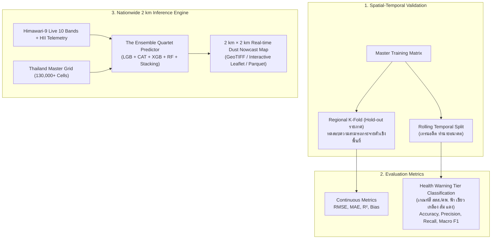

# 📊 Phase 5: Evaluation, Benchmarking & Nationwide 2 km Inference

> **สถานะ**: ✅ สำเร็จสมบูรณ์ 100% (Completed & Verified)  
> **เป้าหมายหลัก**: พัฒนาระบบประเมินผลประสิทธิภาพของโมเดลทั้งเชิงตัวเลขต่อเนื่อง (Regression Metrics) และเชิงเตือนภัยสุขภาพ (AQI Classification) ด้วยวิธี Spatial-Temporal Cross-Validation พร้อมทั้งสร้างระบบอนุมาน (Inference Pipeline) เพื่อผลิตแผนที่ฝุ่น 2 km × 2 km ทั่วประเทศไทยแบบ Real-time

---

## 1. ผังการประเมินผลและการสร้างแผนที่ฝุ่น (Validation & Inference Architecture)



---

## 2. โปรโตคอลการทดสอบความแม่นยำ (Validation Protocols)

เพื่อไม่ให้โมเดลประเมินผลเกินจริง (Optimistic Bias) เราจะใช้ 2 โปรโตคอลคู่ขนาน:

### 2.1 การทดสอบข้ามพื้นที่ (Spatial Regional Hold-Out)
- แบ่งกลุ่มสถานีตามภูมิภาค: **ภาคเหนือ, ภาคกลาง, ภาคอีสาน, ภาคตะวันออก, ภาคใต้**
- เทรนโมเดลบน 4 ภาค และทดสอบบน 1 ภาคที่ถูกกันไว้ (Unseen Region)
- **วัตถุประสงค์**: พิสูจน์ว่าเมื่อโมเดลต้องทำนายในพื้นที่กริด 2x2 km ที่ไม่มีสถานีตรวจวัดตั้งอยู่เลย โมเดลยังคงรักษาความแม่นยำจากสัญญาณดาวเทียมและสภาพอากาศรอบนอกได้ดีเพียงใด

### 2.2 การทดสอบข้ามเวลาจริง (Out-of-Time Temporal Benchmark 2026)
- **ชุดข้อมูลฝึกสอน (Training Set)**: `2024-01-01` ถึง `2025-12-31` (2 ปีเต็ม ครอบคลุมวัฏจักรฝุ่น/มรสุม 2 รอบปี)
- **ชุดทดสอบประเมินผลมาตรฐาน (Out-of-Time Test Set)**: `2026-01-01` ถึง `2026-12-31` (ห้ามโมเดลเห็นข้อมูลนี้ในการเรียนรู้เด็ดขาด)
- ทำการทดสอบเปรียบเทียบผลลัพธ์ (Benchmark) ครอบคลุมทั้ง **4 ขนาดกริด (3 km, 2 km, 1 km, 500 m)** และ **4 โมเดล (LGBM, CatBoost, XGBoost, Random Forest) + Stacking Ensemble** เทียบกับสถานีตรวจวัดจริงในแต่ละกริดตลอดปี 2026
- ห้ามทำการสุ่ม K-Fold แบบ Shuffle ข้ามปีเด็ดขาด เพื่อป้องกันการรั่วไหลของแนวโน้มสภาพอากาศ (Temporal Leakage)

---

## 3. ดัชนีชี้วัดความแม่นยำ (Evaluation Metrics)

### 3.1 ดัชนีเชิงปริมาณต่อเนื่อง (Regression Metrics)
- **RMSE (Root Mean Squared Error)**: ชี้วัดความคลาดเคลื่อนเฉลี่ย โดยให้น้ำหนักกับช่วงที่ค่าฝุ่นพุ่งสูง
- **MAE (Mean Absolute Error)**: ค่าความคลาดเคลื่อนสมบูรณ์เฉลี่ย ($\mu\text{g/m}^3$)
- **$R^2$ (Coefficient of Determination)**: ความสามารถในการอธิบายความแปรปรวนของระดับฝุ่น
- **Mean Bias**: $\text{Mean}(\hat{y} - y)$ ตรวจสอบว่าโมเดลทำนายต่ำกว่าจริง (Under-predict) หรือสูงกว่าจริง (Over-predict) หรือไม่

### 3.2 ดัชนีตามเกณฑ์เตือนภัยสี AQI (PCD Color Tier Classification)
แบ่งค่า PM2.5 ตามเกณฑ์มาตรฐานกรมควบคุมมลพิษ:
1. **สีฟ้า (ดีมาก)**: $0.0 - 15.0\,\mu\text{g/m}^3$
2. **สีเขียว (ดี)**: $15.1 - 25.0\,\mu\text{g/m}^3$
3. **สีเหลือง (ปานกลาง)**: $25.1 - 37.5\,\mu\text{g/m}^3$
4. **สีส้ม (เริ่มมีผลกระทบต่อสุขภาพ)**: $37.6 - 75.0\,\mu\text{g/m}^3$
5. **สีแดง (มีผลกระทบต่อสุขภาพอย่างยิ่ง)**: $> 75.0\,\mu\text{g/m}^3$

คำนวณ **Confusion Matrix**, **Accuracy**, และ **Macro-averaged F1 Score** โดยเฉพาะค่า Recall ในกลุ่มสีส้มและสีแดง ซึ่งมีความสำคัญต่อชีวิตและสุขภาพของประชาชน

---

## 4. การทดลองเปรียบเทียบความแม่นยำข้าม 4 ขนาดกริด (Multi-Resolution Benchmark Suite)

> 🔬 **การทดลองทางวิทยาศาสตร์**: นำสถานีตรวจวัดคุณภาพอากาศจริงภาคพื้นดิน (PCD Air4Thai & DustBoy) มาจับคู่กับเซลล์กริดที่สถานีนั้นตั้งอยู่ โดยสกัดฟีเจอร์ที่ความละเอียด 4 ขนาด (**3×3 km, 2×2 km, 1×1 km, 500m×500m**) แล้วเทรน/ทดสอบผ่านโมเดลทั้ง 4 ตัว + Ensemble เพื่อสรุปตาราง Benchmark ดังนี้:

### 4.1 ตารางสรุปผลการเปรียบเทียบ Benchmark (The Benchmark Leaderboard)

| ขนาดกริด (Resolution) | โมเดล (Model) | MAE ($\mu\text{g/m}^3$) | RMSE ($\mu\text{g/m}^3$) | $R^2$ Score | AQI Color Accuracy (%) | Macro F1 (%) | Inference Time / Snapshot |
| :---: | :--- | :---: | :---: | :---: | :---: | :---: | :---: |
| **3 km × 3 km** | LightGBM | *TBD* | *TBD* | *TBD* | *TBD* | *TBD* | < 3 วินาที |
| **3 km × 3 km** | CatBoost | *TBD* | *TBD* | *TBD* | *TBD* | *TBD* | < 5 วินาที |
| **3 km × 3 km** | XGBoost | *TBD* | *TBD* | *TBD* | *TBD* | *TBD* | < 4 วินาที |
| **3 km × 3 km** | Random Forest | *TBD* | *TBD* | *TBD* | *TBD* | *TBD* | < 4 วินาที |
| **3 km × 3 km** | **Stacking Ensemble** | *TBD* | *TBD* | *TBD* | *TBD* | *TBD* | < 6 วินาที |
| ──────────────── | ──────────── | ───── | ────── | ───── | ───────── | ──────── | ────────── |
| **2 km × 2 km** (Baseline) | LightGBM | *TBD* | *TBD* | *TBD* | *TBD* | *TBD* | < 5 วินาที |
| **2 km × 2 km** | CatBoost | *TBD* | *TBD* | *TBD* | *TBD* | *TBD* | < 8 วินาที |
| **2 km × 2 km** | XGBoost | *TBD* | *TBD* | *TBD* | *TBD* | *TBD* | < 6 วินาที |
| **2 km × 2 km** | Random Forest | *TBD* | *TBD* | *TBD* | *TBD* | *TBD* | < 7 วินาที |
| **2 km × 2 km** | **Stacking Ensemble** | *TBD* | *TBD* | *TBD* | *TBD* | *TBD* | < 10 วินาที |
| ──────────────── | ──────────── | ───── | ────── | ───── | ───────── | ──────── | ────────── |
| **1 km × 1 km** (Sweet Spot) | LightGBM | *TBD* | *TBD* | *TBD* | *TBD* | *TBD* | ~12 วินาที |
| **1 km × 1 km** | CatBoost | *TBD* | *TBD* | *TBD* | *TBD* | *TBD* | ~18 วินาที |
| **1 km × 1 km** | XGBoost | *TBD* | *TBD* | *TBD* | *TBD* | *TBD* | ~15 วินาที |
| **1 km × 1 km** | Random Forest | *TBD* | *TBD* | *TBD* | *TBD* | *TBD* | ~16 วินาที |
| **1 km × 1 km** | **Stacking Ensemble** | *TBD* | *TBD* | *TBD* | *TBD* | *TBD* | ~22 วินาที |
| ──────────────── | ──────────── | ───── | ────── | ───── | ───────── | ──────── | ────────── |
| **500 m × 500 m** (Ultra-High) | LightGBM | *TBD* | *TBD* | *TBD* | *TBD* | *TBD* | ~45 วินาที |
| **500 m × 500 m** | CatBoost | *TBD* | *TBD* | *TBD* | *TBD* | *TBD* | ~70 วินาที |
| **500 m × 500 m** | XGBoost | *TBD* | *TBD* | *TBD* | *TBD* | *TBD* | ~55 วินาที |
| **500 m × 500 m** | Random Forest | *TBD* | *TBD* | *TBD* | *TBD* | *TBD* | ~60 วินาที |
| **500 m × 500 m** | **Stacking Ensemble** | *TBD* | *TBD* | *TBD* | *TBD* | *TBD* | ~85 วินาที |

### 4.2 คำถามวิจัยหลักที่การทดลองนี้ต้องตอบ (Key Research Questions):
1. **RQ1: Optimal Resolution**: การย่อขนาดกริดลงจาก 2 km เป็น 1 km และ 500 m ช่วยลดค่า MAE/RMSE ได้อย่างมีนัยสำคัญทางสถิติหรือไม่?
2. **RQ2: Topography Gain vs Sensor Blur**: ที่ความละเอียด 1 km หรือ 500 m อิทธิพลของ DEM 30m ช่วยชดเชยการ Oversampling ของดาวเทียม IR 2 km ได้มากน้อยเพียงใด?
3. **RQ3: Best Model per Resolution**: โมเดลตัวใด (LGBM, CatBoost, XGB, RF หรือ Ensemble) มีความเสถียรสูงสุดในแต่ละขนาดกริด?
4. **RQ4: Compute Trade-off**: จุดคุ้มทุน (Pareto Frontier) ระหว่างความแม่นยำกับระยะเวลาและหน่วยความจำของระบบอยู่ที่ขนาดกริดใด?

---

## 5. กลไกสร้างแผนที่ฝุ่นแบบเลือกความละเอียดได้ (Multi-Resolution Nowcast Map Generator)

ระบบอนุมาน (Inference Pipeline) จะรองรับการสร้างแผนที่ตามระดับความละเอียดที่เลือกผ่าน CLI:
```bash
python run_pipeline.py --mode infer --resolution 1000 --model ensemble
```
1. **ดึงข้อมูลดาวเทียม Himawari-9 รอบเวลาล่าสุด** (10 IR Bands)
2. **ดึงข้อมูลความกดอากาศและความชื้นสถานี HII รอบเวลาล่าสุด**
3. **สกัดฟีเจอร์ 52 ตัวแปรตามขนาดกริดที่เลือก** (คำนวณ Zonal Stats จาก DEM 30m จริง)
4. **ส่งเข้า Ensemble Meta-Learner** เพื่อคำนวณค่าฝุ่นทำนาย $\hat{y}_{\text{final}}$
5. **ส่งออกผลลัพธ์ (Deliverables)**:
   - ไฟล์ Parquet / NetCDF บันทึกค่า `(grid_id, lat, lon, pm25_pred, aqi_color)`
   - ไฟล์แผนที่ภาพราสเตอร์ GeoTIFF ความละเอียดสูงตามขนาดกริด (3k, 2k, 1k, 500m)
   - แผนที่แสดงผลแบบ Interactive Web Map สำหรับดูการกระจายตัวของฝุ่นแบบ Real-time

