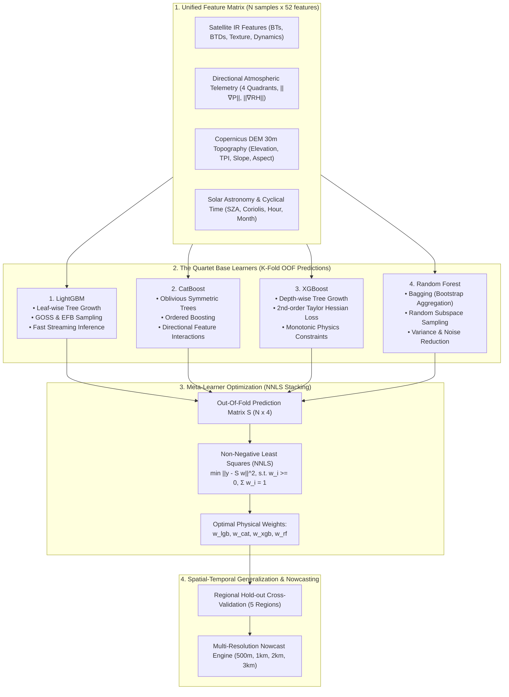
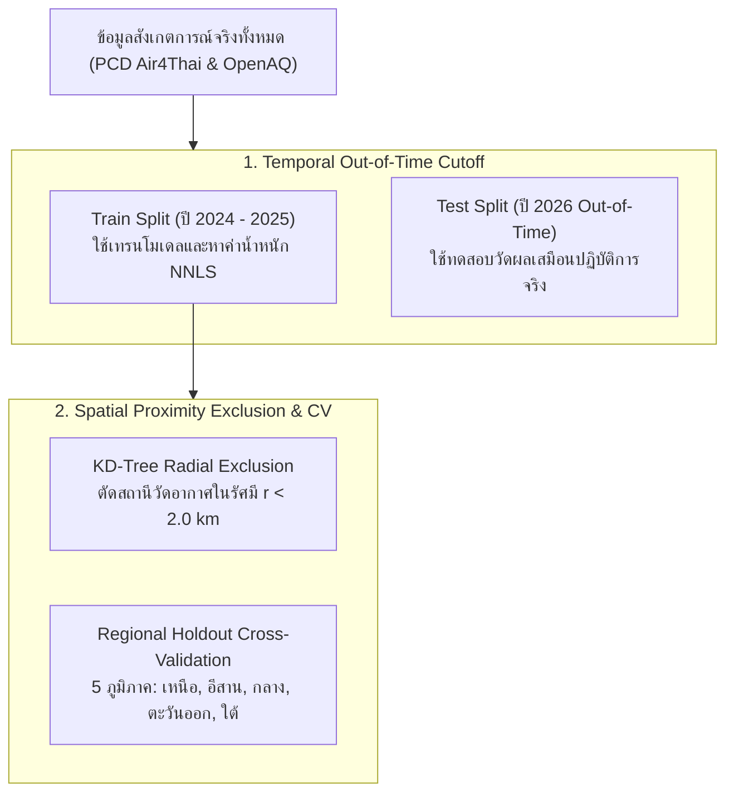

# เอกสารทางเทคนิค: สถาปัตยกรรมชุดแบบจำลอง 4 ขุนพลและการผสานโมเดล
## (Technical Machine Learning Architecture: The Quartet Ensemble & Spatial-Temporal Stacking)

---

## 1. ปรัชญาและสถาปัตยกรรมภาพรวม (System Philosophy & Quartet Overview)

การพยากรณ์ความเข้มข้นของฝุ่นละออง $\text{PM}_{2.5}$ และ $\text{PM}_{10}$ ภาคพื้นดินด้วยข้อมูลดาวเทียมอุตุนิยมวิทยา Himawari-9 และเครือข่ายสถานีโทรมาตร เป็นปัญหาการเรียนรู้ของเครื่องที่มีความซับซ้อนสูง (Complex Non-linear Spatio-Temporal Regression) เนื่องจาก:
1. ความสัมพันธ์ระหว่างค่าการแผ่รังสีอินฟราเรดกับอนุภาคฝุ่นมีความไม่เป็นเส้นตรงสูง (Highly Non-linear)
2. เวกเตอร์เกรเดียนต์ความกดอากาศ 4 ทิศทาง ($\|\nabla P\|, \Delta P_{NS}, \Delta P_{EW}$) และตัวแปรอุณหพลศาสตร์มีความแปรปรวนตามฤดูกาล
3. สถานีตรวจวัดภาคพื้นดินอาจมีสัญญาณรบกวน (Sensor Measurement Noise) จากความชื้นสัมพัทธ์สูงในเขตร้อนชื้น

ระบบ **Thailand Dust Prediction Satellite** จึงออกแบบสถาปัตยกรรม **"ชุดแบบจำลอง 4 ขุนพล" (The Quartet Ensemble)** ร่วมกับ **เมตาเลิร์นเนอร์แบบกำลังสองน้อยสุดที่ไม่เป็นลบ (Non-Negative Least Squares - NNLS Stacking)** เพื่อผสานจุดเด่นของอัลกอริทึมที่แตกต่างกันอย่างสิ้นเชิง 4 สถาปัตยกรรมเข้าด้วยกัน:

---

## 2. เจาะลึกอัลกอริทึมของแบบจำลองทั้ง 4 ขุนพล (The 4 Base Learners)

### 2.1 ขุนพลที่ 1: LightGBM (Leaf-wise Gradient Boosting Decision Tree)
พัฒนาโดย Microsoft Research (Ke et al., 2017) ทำหน้าที่เป็นแกนนำด้าน **ความเร็วในการประมวลผลสตรีมมิ่งระดับมิลลิวินาที**:
- **การเติบโตของต้นไม้แบบ Leaf-wise**: แตกกิ่งของโหนดที่มีค่าการลดลงของฟังก์ชันการสูญเสีย (Loss Reduction) สูงที่สุด แทนการเติบโตทีละชั้นแบบ Depth-wise ทำให้บรรลุค่าความแม่นยำสูงกว่าด้วยจำนวนโหนดที่น้อยกว่า
- **Gradient-based One-Side Sampling (GOSS)**: คัดเลือกตัวอย่างที่มีค่าเกรเดียนต์ขนาดใหญ่ (ข้อมูลที่ทำนายยาก) ไว้ทั้งหมด และสุ่มตัวอย่างที่มีค่าเกรเดียนต์ขนาดเล็กด้วยความน่าจะเป็นที่กำหนด พร้อมปรับค่าน้ำหนักเพื่อรักษาการกระจายตัวของข้อมูลเดิม
- **Exclusive Feature Bundling (EFB)**: รวมกลุ่มฟีเจอร์ที่ไม่เกิดค่าพร้อมกันเพื่อลดมิติข้อมูล
- **Huber Loss Objective**: ใช้ Huber Loss เพื่อลดความไวต่อค่าผิดปกติ (Outliers) ของฝุ่นชั่วคราว:
  $$L_\delta(y, f(x)) = \begin{cases} \frac{1}{2}(y - f(x))^2, & |y - f(x)| \le \delta \\ \delta |y - f(x)| - \frac{1}{2}\delta^2, & |y - f(x)| > \delta \end{cases}$$

---

### 2.2 ขุนพลที่ 2: CatBoost (Oblivious Trees & Ordered Boosting)
พัฒนาโดย Yandex (Prokhorenkova et al., 2018) ทำหน้าที่เป็นแกนนำด้าน **การวิเคราะห์ความสัมพันธ์ความกดอากาศหลากมิติ**:
- **ต้นไม้ตัดสินใจแบบสมมาตร (Oblivious / Symmetric Trees)**: ทุกโหนดในระดับชั้นเดียวกันใช้เงื่อนไขการตัดฟีเจอร์เดียวกัน ส่งผลให้โครงสร้างโมเดลมีความสมดุลสูง ป้องกันอาการ Overfitting ได้ดีเยี่ยม และทำงานรวดเร็วระดับซีพียูเวกเตอร์ไรเซชัน
- **Ordered Boosting เพื่อป้องกัน Target Leakage**: ในขั้นตอนการคำนวณเกรเดียนต์ของตัวอย่างที่ $i$ โมเดลจะใช้เฉพาะข้อมูลตัวอย่างที่เกิดขึ้นก่อนหน้าในลำดับการสุ่มเรียงสับเปลี่ยน (Random Permutation) ทำให้ไม่มีข้อมูลเป้าหมายรั่วไหลเข้าสู่โมเดล (Prediction Shift Prevention)
- **ความเหมาะสมกับข้อมูลสภาพอากาศ**: สามารถจับปฏิสัมพันธ์ที่ไม่เป็นเส้นตรงระหว่างค่าความกดอากาศ 4 ทิศทาง ($P_N, P_S, P_E, P_W$) และความชื้นสัมพัทธ์ได้อย่างแม่นยำที่สุดในตาราง Benchmark

---

### 2.3 ขุนพลที่ 3: XGBoost (Regularized Depth-wise Gradient Boosting)
พัฒนาโดย Chen & Guestrin (2016) ทำหน้าที่เป็นแกนนำด้าน **การควบคุมความซับซ้อนและการกำกับฟิสิกส์**:
- **การประมาณฟังก์ชันเป้าหมายด้วยอนุกรมเทย์เลอร์อันดับสอง (Second-order Taylor Expansion)**:
  $$\tilde{\mathcal{L}}^{(t)} \approx \sum_{i=1}^N \left[ l(y_i, \hat{y}_i^{(t-1)}) + g_i f_t(\mathbf{x}_i) + \frac{1}{2} h_i f_t^2(\mathbf{x}_i) \right] + \Omega(f_t)$$
  โดยที่ $g_i = \partial_{\hat{y}^{(t-1)}} l(y_i, \hat{y}^{(t-1)})$ และ $h_i = \partial^2_{\hat{y}^{(t-1)}} l(y_i, \hat{y}^{(t-1)})$
- **พจน์ Regularization ($\Omega(f)$)**:
  $$\Omega(f_t) = \gamma T + \frac{1}{2} \lambda \sum_{j=1}^T w_j^2$$
  ควบคุมจำนวนใบไม้ ($T$) และขนาดของค่าน้ำหนัก ($w_j$) ไม่ให้เกิดการ Overfit กับสถานีวัดฝุ่นเฉพาะจุด

---

### 2.4 ขุนพลที่ 4: Random Forest (Bootstrap Aggregation / Bagging)
พัฒนาโดย Leo Breiman (2001) ทำหน้าที่เป็นแกนนำด้าน **การลดความแปรปรวนและการต้านทานสัญญาณรบกวน (Variance Reduction & Noise Damping)**:
- **หลักการ Bagging**: สุ่มสร้างต้นไม้ตัดสินใจอิสระจำนวนมาก ($B$ ต้น) จากตัวอย่างข้อมูลที่สุ่มแบบคืนที่ (Bootstrap Samples) และสุ่มเลือกกลุ่มฟีเจอร์ย่อย (Random Subspaces) ในทุกๆ การแยกโหนด
- **การลดค่าความแปรปรวน (Variance Reduction)**:
  $$\text{Var}(\bar{f}) = \rho \sigma^2 + \frac{1 - \rho}{B} \sigma^2$$
  เมื่อจำนวนต้นไม้ $B \to \infty$ ค่าความแปรปรวนของส่วนสุ่มจะลดลงเหลือเพียง $\rho \sigma^2$
- **บทบาทในระบบ**: ทำหน้าที่เป็นตัวหน่วง (Damper) ถ่วงดุลไม่ให้โมเดลกลุ่ม Boosting ตอบสนองต่อสัญญาณรบกวนที่ผิดพลาดของเซนเซอร์ภาคพื้นดินรุนแรงเกินไป

---

## 3. การบังคับข้อจำกัดทางฟิสิกส์แบบทางเดียว (Physics-Informed Monotonic Constraints)

ในสภาวะจริงทางอุตุนิยมวิทยา มีฟีเจอร์บางประการที่มีทิศทางความสัมพันธ์กับความเข้มข้นของฝุ่นอย่างชัดเจนตามกฎเกณฑ์ฟิสิกส์บรรยากาศ หากปล่อยให้โมเดลเรียนรู้อย่างอิสระ อาจเกิดกรณีที่ต้นไม้ตัดสินใจทำนายสวนทางกับความเป็นจริงในพื้นที่ที่ข้อมูลเบาบาง ระบบจึงกำหนด **Monotonic Constraints** ให้แก่โมเดล LightGBM และ XGBoost:

| ฟีเจอร์ (Feature) | ทิศทางบังคับ (Constraint) | เหตุผลและกฎทางฟิสิกส์บรรยากาศรองรับ |
| :--- | :---: | :--- |
| **ขนาดความชันความกดอากาศ ($\|\nabla P\|$)** | **$-1$ (ลดลงทางเดียว)** | เมื่อความชันความกดอากาศเข้าใกล้ศูนย์ ลมจะสงบนิ่ง เกิดสภาวะ **Air Stagnation** ฝุ่นต้องสะสมตัวเพิ่มขึ้นอย่างเคร่งครัด (Horton et al., 2014) |
| **ผลต่างหน้าต่างคู่ ($BTD_{15-13}$)** | **$+1$ (เพิ่มขึ้นทางเดียว)** | การดูดกลืนรังสีของอนุภาคซิลิเกตที่ $10.4\,\mu\text{m}$ สูงกว่า $12.4\,\mu\text{m}$ เมื่อ $BTD_{15-13}$ ขยับจากลบเข้าสู่บวก สัดส่วนฝุ่นต้องเพิ่มขึ้น (Ackerman, 1997) |
| **ดัชนีฝุ่นสีแดง ($\text{dust\_rgb\_red}$)** | **$+1$ (เพิ่มขึ้นทางเดียว)** | ดัชนีความหนาแน่นม่านฝุ่นมาตรฐาน WMO ยิ่งมีค่าสูง ฝุ่นภาคพื้นดินยิ่งต้องหนาแน่น |

---

## 4. สถาปัตยกรรมรวมโมเดล Stacking ด้วย Non-Negative Least Squares (NNLS)

### 4.1 การสร้างเมทริกซ์การทำนาย Out-Of-Fold (OOF Cross-Validation Matrix)
เพื่อป้องกันปัญหา Data Leakage ในระดับเมตาเลิร์นเนอร์ (Meta-Learner Overfitting) ระบบจะไม่ใช้ข้อมูลที่โมเดลเคยเห็นในการหาค่าน้ำหนัก แต่จะแบ่งข้อมูลการเทรนออกเป็น 5 ส่วน ($K=5$ Folds):
1. ในแต่ละ Fold $k$ นำโมเดล 4 ขุนพลที่เทรนจาก $K-1$ Folds มาทำนายข้อมูลใน Fold $k$ ที่ถูกกันไว้
2. ประกอบผลทำนายของทั้ง 4 โมเดลเป็นเมทริกซ์ Out-Of-Fold:
   $$\mathbf{S} \in \mathbb{R}^{N \times 4} = [\hat{\mathbf{y}}_{\text{lgb}}^{\text{oof}}, \; \hat{\mathbf{y}}_{\text{cat}}^{\text{oof}}, \; \hat{\mathbf{y}}_{\text{xgb}}^{\text{oof}}, \; \hat{\mathbf{y}}_{\text{rf}}^{\text{oof}}]$$

### 4.2 การหาค่าน้ำหนักที่เหมาะสมที่สุด (Optimization Formulation)
ตามทฤษฎีของ Breiman (1996) และอัลกอริทึมของ Lawson & Hanson (1974):

$$\min_{\mathbf{w}} \frac{1}{2} \|\mathbf{y} - \mathbf{S} \mathbf{w}\|_2^2 \quad \text{subject to } w_k \ge 0, \quad \sum_{k=1}^4 w_k = 1.0$$

#### ทำไมต้องบังคับ $w_k \ge 0$ (Non-Negative Weights)?
- ในการทำ Stacking ทั่วไปที่ใช้ Linear Regression ธรรมดา ค่าสัมประสิทธิ์ของโมเดลตัวใดตัวหนึ่งอาจติดลบ ($w_i < 0$) เพื่อหักล้าง Error ของอีกโมเดลหนึ่ง (Negative Collinearity Cancellation)
- ในงานฟิสิกส์บรรยากาศ การที่น้ำหนักโมเดลติดลบหมายความว่า "ยิ่งโมเดลตรวจจับฝุ่นได้มาก ค่าทำนายรวมยิ่งลดลง" ซึ่งขัดแย้งกับหลักความจริงอย่างรุนแรง
- การจำกัด $w_k \ge 0$ ทำให้ผลลัพธ์สุดท้ายเป็นการรวมแบบ **Convex Combination** ของตัวแทนโมเดลที่ดีที่สุดเสมอ รักษาความถูกต้องตามธรรมชาติไว้ได้อย่างสมบูรณ์

---

## 5. กรอบการทดสอบและป้องกัน Data Leakage (Validation Protocols)

### 5.1 การตัดข้อมูลเชิงพื้นที่เพื่อป้องกัน Label/Feature Leakage (Spatial Anti-Leakage)
สถานีโทรมาตรความกดอากาศและความชื้นของ สสน. ที่ตั้งอยู่ใกล้จุดกึ่งกลางของกริดเซลล์เป้าหมายในระยะต่ำกว่าขนาดกริด ($r < 2.0\,\text{km}$) จะถูกตัดออกจากชุดการคำนวณเวกเตอร์ 4 ทิศทางด้วยโครงสร้าง **cKDTree** อย่างเคร่งครัด เพื่อบังคับให้โมเดลต้องอนุมานค่าจากความชันภายนอกเท่านั้น

### 5.2 การทดสอบความสามารถในการขยายผลข้ามภูมิภาค (Regional Holdout Cross-Validation)
เพื่อพิสูจน์ว่าโมเดลไม่ได้จำลักษณะทางภูมิศาสตร์ของสถานีใดสถานีหนึ่ง ระบบจะแบ่งกลุ่มสถานีทดสอบออกเป็น 5 ภูมิภาคตามภูมิศาสตร์ประเทศไทย:
1. **ภาคเหนือ (North)**: แอ่งกระทะและหุบเขาสูง ปรากฏการณ์อุณหภูมิผกผัน
2. **ภาคตะวันออกเฉียงเหนือ (Northeast)**: ที่ราบสูงโคราช ลมตะวันออกเฉียงเหนือ
3. **ภาคกลาง (Central)**: ที่ราบลุ่มแม่น้ำและการจราจรหนาแน่นของกรุงเทพมหานคร
4. **ภาคตะวันออก (East)**: ชายฝั่งทะเลและเขตนิคมอุตสาหกรรม
5. **ภาคใต้ (South)**: คาบสมุทร ลมมรสุมสองฝั่งทะเล และความชื้นสัมพัทธ์สูงตลอดปี

โดยการทดสอบจะวนนำสถานีในภูมิภาคหนึ่งเป็น Hold-out Set และใช้สถานีที่เหลือเป็นตัวฝึกสอน เพื่อประเมินความสามารถในการทำนายในพื้นที่ที่ไม่มีสถานีตรวจวัดจริง

### 5.3 การทดสอบเชิงเวลาแบบไร้การมองเห็นอนาคต (Strict Temporal Anti-Leakage)
- ข้อมูลฝึกสอน (Train Set): ปี 2024–2025
- ข้อมูลทดสอบ (Out-of-Time Test Set): ปี 2026
- ไม่อนุญาตให้ใช้ข้อมูลจากอนาคตมาพยากรณ์อดีต (Zero Look-Ahead Bias) และพิกัดเวลาของเป้าหมายจริงจะต้องเกิดขึ้นก่อนหรือตรงกับรอบภาพถ่ายดาวเทียมเสมอ

---

## 6. กลยุทธ์การทดลองเปรียบเทียบขนาดกริด 4 ระดับ (Multi-Resolution Strategy)

ระบบได้รับการออกแบบให้รันโมเดลทดสอบเปรียบเทียบข้าม 4 ขนาดกริดเชิงพื้นที่ภายใต้ชุดฟีเจอร์และกระบวนการประเมินเดียวกันทั้งหมด:
- **3.0 km (Synoptic Scale)**: ขนาดกริดหยาบ เหมาะสำหรับภาพรวมระดับภูมิภาคเอเชียตะวันออกเฉียงใต้
- **2.0 km (Native Sensor Baseline)**: ขนาดกริดดั้งเดิมเท่ากับความละเอียด Nadir ของเซนเซอร์ AHI แบนด์อินฟราเรด
- **1.0 km (Pareto Sweet Spot)**: จุดสมดุลทางวิศวกรรมที่ดีที่สุด ผสานความละเอียดสูงของ DEM 30m ชดเชยพิกเซลดาวเทียม ประมวลผลภาพรวมทั้งประเทศได้ภายใน ~12 วินาที
- **500 m (Ultra-High Resolution)**: ความละเอียดสูงสุดสำหรับเจาะลึกผังเมืองและแอ่งหุบเขาวิกฤต

---

## 7. เอกสารอ้างอิงทางวิชาการ (Scientific References)

1. **Ke, G., Meng, Q., Finley, T., Wang, T., Chen, W., Ma, W., Ye, Q., & Liu, T. Y.** (2017). "LightGBM: A Highly Efficient Gradient Boosting Decision Tree". *Advances in Neural Information Processing Systems (NeurIPS 2017)*, Vol. 30, pp. 3146–3154.

2. **Prokhorenkova, L., Gusev, G., Vorobev, A., Dorogush, A. V., & Gulin, A.** (2018). "CatBoost: unbiased boosting with categorical features". *Advances in Neural Information Processing Systems (NeurIPS 2018)*, Vol. 31, pp. 6638–6648.

3. **Chen, T., & Guestrin, C.** (2016). "XGBoost: A Scalable Tree Boosting System". *Proceedings of the 22nd ACM SIGKDD International Conference on Knowledge Discovery and Data Mining (KDD '16)*, pp. 785–794.  
   **DOI:** [10.1145/2939672.2939785](https://doi.org/10.1145/2939672.2939785)

4. **Breiman, L.** (2001). "Random Forests". *Machine Learning*, Vol. 45, No. 1, pp. 5–32.  
   **DOI:** [10.1023/A:1010933404324](https://doi.org/10.1023/A:1010933404324)

5. **Breiman, L.** (1996). "Stacked regressions". *Machine Learning*, Vol. 24, No. 1, pp. 49–64.  
   **DOI:** [10.1007/BF00117832](https://doi.org/10.1007/BF00117832)

6. **Wolpert, D. H.** (1992). "Stacked generalization". *Neural Networks*, Vol. 5, No. 2, pp. 241–259.  
   **DOI:** [10.1016/S0893-6080(05)80023-1](https://doi.org/10.1016/S0893-6080(05)80023-1)

7. **Lawson, C. L., & Hanson, R. J.** (1974). *Solving Least Squares Problems*. Prentice-Hall, Englewood Cliffs, NJ, 340 pp. (Classics in Applied Mathematics, SIAM, 1995).

8. **Ackerman, S. A.** (1997). "Remote sensing aerosols using satellite infrared observations". *Journal of Geophysical Research: Atmospheres*, Vol. 102, No. D14, pp. 17069–17079.  
   **DOI:** [10.1029/96JD03066](https://doi.org/10.1029/96JD03066)

9. **Horton, D. E., Skinner, C. B., Singh, D., & Diffenbaugh, N. S.** (2014). "Occurrence and persistence of future atmospheric stagnation events". *Nature Climate Change*, Vol. 4, pp. 698–703.  
   **DOI:** [10.1038/nclimate2272](https://doi.org/10.1038/nclimate2272)
